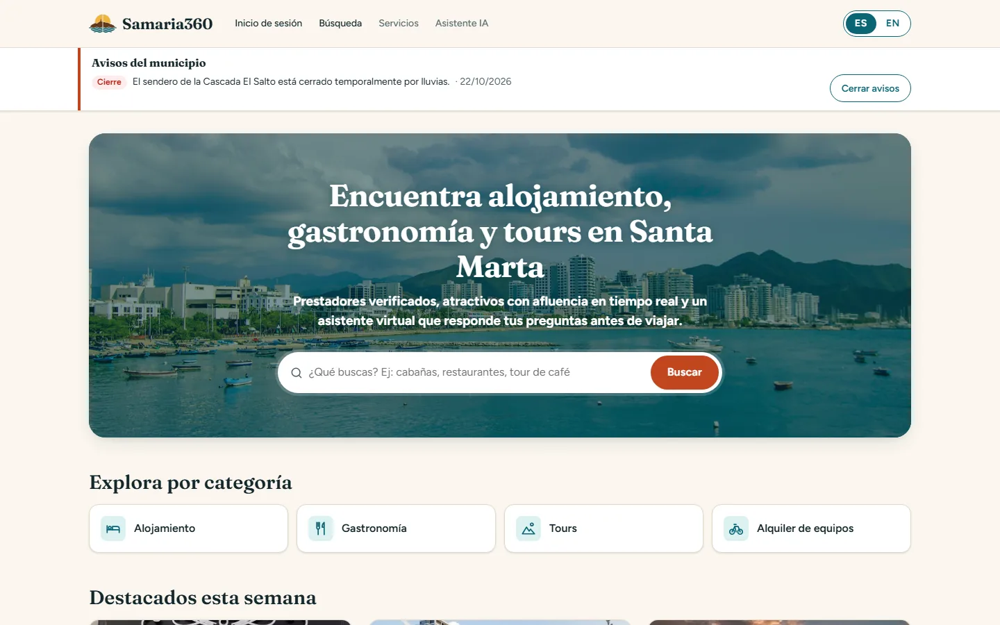
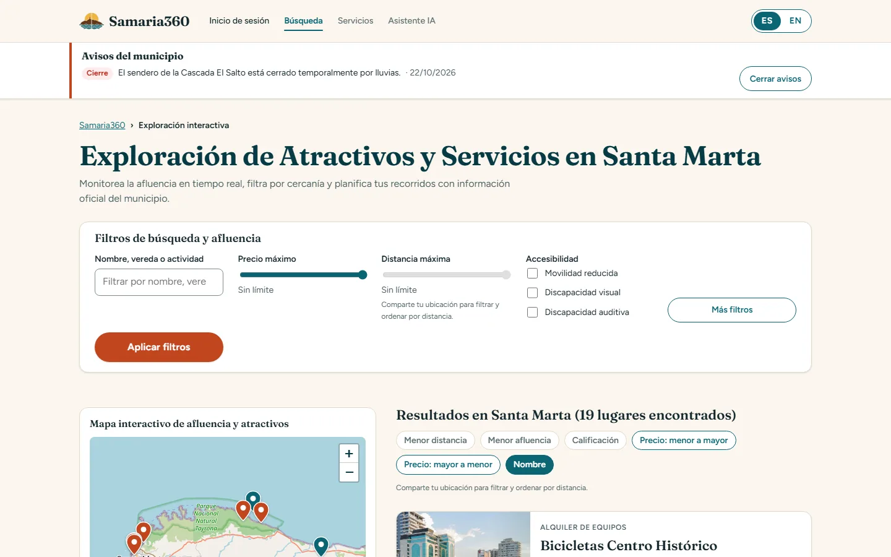
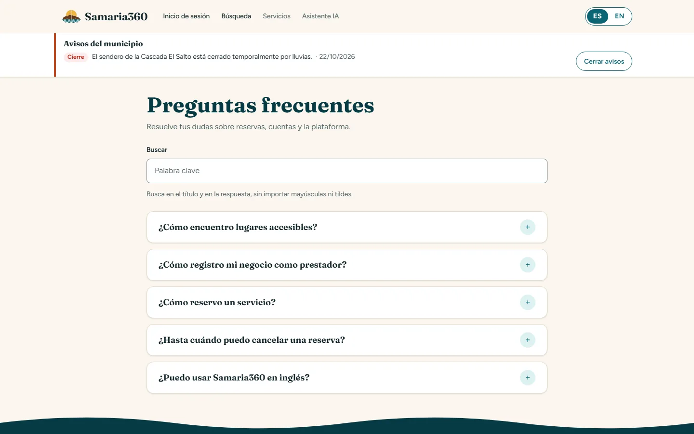

# Samaria360

[](https://github.com/Al3jooo/SM_Tours_Aplication/actions/workflows/ms-auth.yml)
[](https://github.com/Al3jooo/SM_Tours_Aplication/actions/workflows/ms-catalog.yml)
[](https://github.com/Al3jooo/SM_Tours_Aplication/actions/workflows/ms-booking.yml)
[](https://github.com/Al3jooo/SM_Tours_Aplication/actions/workflows/api-gateway.yml)
[](https://github.com/Al3jooo/SM_Tours_Aplication/actions/workflows/frontend.yml)

Plataforma de turismo de Santa Marta. Proyecto Capstone Design — Arquitectura de Software, Universidad del Magdalena.

- **Metodología:** RUP. Fase actual: Construcción (prototipo arquitectónico ejecutable que valida la línea base de la
  arquitectura; no es un producto completo).
- **Arquitectura:** microservicios con diseño hexagonal interno, detrás de un API Gateway.
- **Persistencia:** PostgreSQL (`auth_db`, `reservas_db`) y MongoDB (`catalog_db`).

| Inicio (WF-04) | Exploración con mapa (WF-05) | Preguntas frecuentes (WF-13) |
|---|---|---|
|  |  |  |

<sub>Capturas del prototipo con los datos de la semilla. Mapa: © OpenStreetMap contributors.</sub>

## Tecnologías

| Componente | Tecnología | Base de datos |
|---|---|---|
| `frontend` | React 19, Vite, TypeScript, i18next, Leaflet; servido por nginx | — |
| `api-gateway` | Spring Cloud Gateway 4.3 (WebFlux), Resilience4j | — |
| `ms-auth` | Java 17, Spring Boot 3.5, Spring Security (JWT RS256, BCrypt), Flyway | PostgreSQL 16 (`auth_db`) |
| `ms-catalog` | Java 17, Spring Boot 3.5, Spring Data MongoDB, GridFS | MongoDB 7 (`catalog_db`) |
| `ms-booking` | Java 17, Spring Boot 3.5, Spring Data JPA, Flyway, Resilience4j | PostgreSQL 16 (`reservas_db`) |

Pruebas: JUnit 5, Testcontainers y ArchUnit en los servicios Java; Vitest y Testing Library en el frontend. La línea
Spring Boot 3.5 se mantiene durante la Construcción ([ADR-010](docs/sad/adr/ADR-010-linea-spring-boot-3-5.md)).

## Documentación

| Documento | Contenido |
|---|---|
| [`docs/srs/`](docs/srs/) | Especificación de requisitos (fuente única de los RF y RNF) |
| [`docs/sad/adr/`](docs/sad/adr/) | Decisiones de arquitectura (ADR-004 a ADR-010) |
| [`docs/sad/api/`](docs/sad/api/) | Contratos de la API de ms-auth, ms-catalog y ms-booking |
| [`docs/sad/diagramas/`](docs/sad/diagramas/) y [`docs/sad/modelo-nosql/`](docs/sad/modelo-nosql/) | Modelo lógico (DBML) y esquemas JSON de `catalog_db` |
| [`docs/casos-de-uso/`](docs/casos-de-uso/) | Especificaciones textuales de los casos de uso |
| [`docs/wireframes/`](docs/wireframes/README.md) | Wireframes de las pantallas |
| [`docs/trazabilidad.md`](docs/trazabilidad.md) | Matriz wireframe ↔ caso de uso ↔ requisito ↔ endpoint ↔ componente, y decisiones (DEC) |
| [`docs/demo/reservas/`](docs/demo/reservas/README.md) | Demostración del CU «Reservar servicio» con la prueba de concurrencia |
| [`frontend/README.md`](frontend/README.md) | Frontend por pantalla y guía visual |
| [`CONTRIBUTING.md`](CONTRIBUTING.md) y [`SECURITY.md`](SECURITY.md) | Flujo de trabajo (ramas, commits, pruebas) y reporte de vulnerabilidades |

## Estructura del monorepo

Cada carpeta raíz corresponde a un contenedor del diagrama de despliegue del SAD.

```
samaria360/
├── .github/workflows/            # CI: un workflow por servicio, filtrado por paths (_java.yml es el común)
├── docs/                         # artefactos RUP versionados con el código (ver «Documentación»)
├── infra/
│   ├── postgres/init/            # 01-crear-bases.sql (auth_db, reservas_db), solo con el volumen vacío
│   ├── postgres/asegurar-bases.sql   # lo ejecuta postgres-bases en cada arranque (bases que falten)
│   ├── mongo/init/               # línea base congelada (v1): validadores, índices y semilla
│   ├── mongo/migraciones/        # aplicar.js + esquema/ y semilla/ (M001, M002…), las aplica mongo-migraciones
│   └── keys/                     # llaves RSA del JWT (no se versionan)
├── frontend/                     # React + Vite + TypeScript
│   ├── nginx/                    # default.conf (SPA y proxy /api/) y seguridad.conf (CSP y encabezados)
│   └── src/
│       ├── app/                  # router, diseños, rutas protegidas por rol y tokens visuales (estilos.css)
│       ├── features/             # una carpeta por área: auth, catalogo, reservas, perfil, favoritos,
│       │                         #   contenido, agenda, servicios, prestador, gestor, admin
│       ├── shared/api/           # httpClient.ts (fetch + token de sesión + ProblemDetail)
│       ├── shared/components/
│       └── i18n/                 # es.json, en.json
├── api-gateway/                  # Spring Cloud Gateway (sin dominio: no aplica la estructura hexagonal)
├── ms-auth/                      # Spring Boot 3 + PostgreSQL (auth_db)
│   └── src/
│       ├── main/java/co/edu/unimagdalena/samaria360/auth/
│       │   ├── domain/           # model/, service/ (p. ej. PoliticaBloqueo), exception/
│       │   ├── application/      # port/in, port/out y service/ (casos de uso)
│       │   └── infrastructure/
│       │       ├── adapter/in/   # web/ (controladores y DTO), programador/ (relevo del outbox)
│       │       ├── adapter/out/  # persistence/, security/ (BCrypt, JWT, JWKS), relevo/, reloj/, notificacion/
│       │       └── config/       # SecurityConfig, BeanConfig
│       ├── main/resources/db/migration/   # esquema y datos de referencia (Flyway)
│       ├── main/resources/db/semilla/     # usuarios de prueba, solo perfiles dev y test
│       └── test/java/.../auth/            # domain/, application/, infrastructure/, architecture/
├── ms-catalog/                   # Spring Boot 3 + MongoDB (catalog_db), misma estructura hexagonal
├── ms-booking/                   # Spring Boot 3 + PostgreSQL (reservas_db), misma estructura hexagonal
├── docker-compose.yml
├── .env.example
└── .editorconfig
```

El asistente con IA (WF-07) está fuera del alcance del prototipo: no hay un microservicio para él.

## Reglas de dependencia (verificadas con ArchUnit)

- `domain` no depende de nada externo: ni Spring, ni JPA, ni Mongo.
- `application` depende solo de `domain`.
- `infrastructure` implementa los puertos de `application`.
- No hay `pom.xml` raíz ni librería compartida: cada servicio se compila y despliega de forma independiente.

## Arranque en un comando

Levanta todo el sistema (PostgreSQL, MongoDB, ms-auth, ms-catalog, ms-booking, api-gateway y el frontend) desde cero.

**Requisitos**
- Docker Desktop (Windows/macOS) o Docker Engine (Linux), con Compose v2 (`docker compose`).
- OpenSSL, para generar las llaves del JWT. En Windows viene con Git Bash.
- Unos **4 GB de memoria** en la máquina virtual de Docker (ver «Memoria», abajo). En Docker Desktop se revisa en
  *Settings → Resources*, o en `.wslconfig` con WSL 2.
- Puertos libres en el host: **8000** (frontend) y, solo en 127.0.0.1, **8080** (API Gateway), 5432 y 27017 (bases
  de datos). Todos se pueden cambiar en `.env`, salvo el 8080.

**Pasos** (desde la raíz del repositorio, en Git Bash o en una terminal de Linux/macOS)

```bash
cp .env.example .env                       # y cambiar las contraseñas
cd infra/keys                              # llaves RS256 del JWT (no se versionan)
openssl genpkey -algorithm RSA -pkeyopt rsa_keygen_bits:2048 -out jwt-privada.pem
openssl rsa -in jwt-privada.pem -pubout -out jwt-publica.pem
cd ../..
docker compose up -d --build               # la primera vez tarda varios minutos (descarga dependencias)
docker compose ps                          # esperar a que todos digan (healthy)
```

Abrir **http://localhost:8000**. Usuarios de prueba (perfil `dev`, solo para demostración):
`turista@samaria360.test`, `prestador@samaria360.test`, `gestor@samaria360.test` y `admin@samaria360.test`, todos
con la contraseña `Samaria360*`. El prestador de prueba está validado (migración de semilla V6); un prestador recién
registrado queda Pendiente de Validación y no puede iniciar sesión hasta que el Administrador lo valide (RF28).
`prestador2@samaria360.test` tiene la cuenta Inactiva (403 `CUENTA_INACTIVA` con la contraseña correcta).

Para crear cuentas nuevas: **«Registrarse»** en la pantalla de inicio de sesión (`/registro`, RF01 y RF02).

**Cómo queda desplegado**
- El navegador habla solo con el **frontend** (nginx). nginx sirve la SPA y pasa `/api/` al **api-gateway**, que es
  el único punto de entrada a los servicios ([ADR-005](docs/sad/adr/ADR-005-api-gateway.md)).
- En el host se publican el 8000 (frontend) y el 8080 (gateway, solo en `127.0.0.1`). ms-auth (8081), ms-catalog
  (8082) y ms-booking (8083) solo se alcanzan dentro de la red de Docker. PostgreSQL y MongoDB se publican solo en
  `127.0.0.1`, para DBeaver o Compass.
- Las llaves del JWT se montan como *secrets* de solo lectura en `/run/secrets/` de ms-auth; nunca se copian a una
  imagen.
- **Servicios de un solo uso**, que se ejecutan en cada `docker compose up`, terminan y no dejan nada corriendo:
  `postgres-bases` crea las bases que falten (`infra/postgres/asegurar-bases.sql`) y `mongo-migraciones` aplica las
  migraciones de catalog_db que falten (`infra/mongo/migraciones`, registradas en la colección `migraciones`). Así un
  volumen creado con una versión anterior se pone al día **sin borrar datos**. ms-auth, ms-booking y ms-catalog
  esperan a que terminen bien (`service_completed_successfully`); en `docker compose ps -a` aparecen como `Exited (0)`.
- **Reservas:** ms-booking materializa los cupos de los próximos 60 días bajo demanda, a partir de la oferta que cada
  servicio define en ms-catalog (días de operación y salidas; DEC-135): la primera consulta de disponibilidad, de las
  tarjetas o de una reserva los crea. La demostración del CU, con la prueba de concurrencia, está en
  [`docs/demo/reservas/`](docs/demo/reservas/README.md).

**Memoria.** Docker Desktop con WSL 2 le da por defecto a su máquina virtual el 50 % de la RAM: unos 4 GB en un
portátil de 8 GB. Por eso cada contenedor tiene un límite (`mem_limit` en `docker-compose.yml`):

| Contenedor | Límite | Nota |
|---|---|---|
| ms-auth, ms-catalog, api-gateway | 768 MB cada uno | La JVM arranca con `-XX:MaxRAMPercentage=75`: heap de unos 576 MB (ancla `x-memoria-java`) |
| ms-booking | 512 MB | Servicio pequeño: heap de unos 384 MB |
| mongo | 512 MB | `--wiredTigerCacheSizeGB 0.25`; sin eso, su caché tomaría la mitad de la máquina virtual |
| postgres | 256 MB | En reposo usa ~60-150 MB |
| frontend (nginx), servicios de un solo uso | — | ~10 MB; los de un solo uso terminan y liberan la memoria |

La suma de los límites es de unos 3,6 GB, así que todo cabe, aunque justo. Sin estos límites, cada JVM calcularía su
memoria sobre **toda** la máquina virtual y MongoDB tomaría su caché de ella, y juntos podrían agotarla. Si Docker
se queda sin memoria (contenedores reiniciados con código 137), se puede subir la de la máquina virtual con
`memory=5GB` en `.wslconfig`.
- En Docker Compose los servicios Java corren con el perfil `dev` (`SPRING_PROFILES_ACTIVE` en
  `docker-compose.yml`): carga los usuarios de prueba y Swagger. Es una configuración de demostración; un despliegue
  real debe quitarlo. Fuera de Compose ningún servicio activa `dev` si no se le pide.
- Las pruebas no corren dentro de las imágenes (usan Testcontainers). Se ejecutan fuera, con `./mvnw test` en cada
  servicio y `npm test` en `frontend/`. **Antes de correr las pruebas, detener el sistema** (`docker compose stop`):
  los contenedores de Testcontainers y el sistema completo juntos no caben en 4 GB.

**Comandos útiles**

```bash
docker compose logs -f ms-auth             # logs de un servicio
docker compose up -d --build --no-deps frontend   # reconstruir solo un servicio (sin --no-deps recrea también sus dependencias)
docker compose stop ms-catalog             # simular la caída de un servicio (la búsqueda da 503; el login sigue)
docker compose start ms-catalog
docker compose down                        # detener todo (conserva los datos)
docker compose down -v                     # detener todo y BORRAR los volúmenes de las bases
```

**Solución de problemas**

| Síntoma | Causa | Solución |
|---|---|---|
| `Bind for 0.0.0.0:8000 failed: port is already allocated` (o `Bind for 127.0.0.1:8080`, `:5432` o `:27017`) | Otro programa usa el puerto | Cambiar `FRONTEND_PORT`, `POSTGRES_PORT` o `MONGO_PORT` en `.env`, o cerrar el programa. Para encontrarlo: `netstat -ano \| findstr :8000` en Windows o `lsof -i :8000` en Linux/macOS. El 8080 es fijo: hay que liberarlo. |
| PostgreSQL no arranca en 5432, o ms-auth se conecta a otra base | En Windows, el servicio de PostgreSQL instalado localmente (`postgresql-x64-*`) ya ocupa el 5432 | Poner `POSTGRES_PORT=5433` en `.env`, o detener ese servicio en `services.msc`. Dentro de Docker no cambia nada: ms-auth usa `postgres:5432` por la red interna. |
| `docker compose up` falla con un error que menciona `infra/keys/jwt-privada.pem` (o la pública) | Faltan las llaves del JWT | Generarlas en `infra/keys/` (paso 2) y volver a ejecutar `docker compose up -d`. |
| `required variable POSTGRES_PASSWORD is missing a value: Falta POSTGRES_PASSWORD en .env` | Falta el `.env` o una variable | `cp .env.example .env` y completar los valores. |
| En Linux, ms-auth no puede leer la llave privada | Los *secrets* de Compose son archivos montados con los permisos del host | Dar permiso de lectura al usuario del contenedor: `chmod 644 infra/keys/jwt-*.pem`. |
| Faltan datos de prueba, o no aparecen cambios de los scripts de `infra/*/init/` | Los scripts de inicialización solo corren con el volumen vacío, y son la línea base: no cambian | Los cambios de esquema y de datos llegan como migraciones (Flyway en ms-auth; `infra/mongo/migraciones` en catalog_db), que se aplican solas con `docker compose up -d` sin borrar nada. Solo como último recurso, y sabiendo que **borra** los datos: `docker compose down -v`. |
| ms-catalog no arranca y `mongo-migraciones` aparece como `Exited (1)` (o ms-auth y ms-booking, y `postgres-bases`) | Una migración falló; por ejemplo, M001 se detiene si un alojamiento no tiene `precioBase` | `docker compose logs mongo-migraciones` (o `postgres-bases`) muestra el motivo. Corregir el dato y volver a ejecutar `docker compose up -d`: las migraciones ya aplicadas no se repiten. |
| Un servicio Java se reinicia solo, con código de salida 137 | Superó su límite de memoria (`OOMKilled`) | Confirmarlo con `docker inspect -f '{{.State.OOMKilled}}' samaria360-ms-auth` y subir `mem_limit` en `docker-compose.yml`. |
| Justo después de `up -d`, el sitio muestra «servicio no disponible» durante unos 40 s | El gateway todavía está arrancando. El frontend ya lo espera (`service_healthy`), pero ms-auth y ms-catalog pueden seguir arrancando, y tras reiniciar Docker los contenedores vuelven sin respetar ese orden | Esperen a que `docker compose ps` marque todos los servicios como `healthy` y pulsen «Reintentar». |
| Con `./mvnw spring-boot:run`, ms-auth no arranca: `Validate failed` y `Detected applied migration not resolved locally: 2.` (y 3, 6, 7, 14) | Se arrancó sin el perfil `dev` contra una base que ya tiene la semilla aplicada: sin ese perfil, Flyway no ve `db/semilla` | Arrancar con `./mvnw spring-boot:run -Dspring-boot.run.profiles=dev` (sección «Arranque local»). |
| Un servicio queda en `unhealthy` o se reinicia | Error al arrancar (credenciales, llaves, base no disponible) | `docker compose logs <servicio>`. |

## Arranque local (desarrollo)

Para desarrollar con recarga en caliente: solo las bases en Docker y los servicios con `./mvnw` y Vite. Si el sistema
completo está levantado, primero `docker compose stop ms-auth ms-catalog ms-booking api-gateway frontend`: el
gateway del contenedor ocupa el 8080, y así no quedan dos instancias de cada servicio.

```bash
cp .env.example .env          # y cambiar las contraseñas
docker compose up -d postgres-bases mongo-migraciones   # las bases, con sus bases y migraciones al día
cd ms-auth && ./mvnw spring-boot:run -Dspring-boot.run.profiles=dev   # :8081 (igual en ms-catalog :8082 y ms-booking :8083)
cd api-gateway && ./mvnw spring-boot:run                              # :8080
cd frontend && npm install && npm run dev     # http://localhost:5173 (proxy /api → 8080)
```

El perfil `dev` no se activa solo: sin `-Dspring-boot.run.profiles=dev`, ms-auth arranca sin los usuarios de prueba y
ningún servicio publica Swagger. Docker Compose lo activa con `SPRING_PROFILES_ACTIVE=dev`.

## Pruebas

Cada servicio Java se prueba con su propio wrapper (no hay `pom.xml` raíz), y el frontend con npm. Las pruebas de
infraestructura usan Testcontainers: necesitan Docker en marcha y, en una máquina de 4 GB, el sistema detenido
(`docker compose stop`).

```bash
cd ms-auth && ./mvnw test      # igual en ms-catalog, ms-booking y api-gateway
cd ms-auth && ./mvnw verify    # pruebas + informe de cobertura en target/site/jacoco/index.html (JaCoCo)
cd frontend && npm test        # y npm run build (tipos) y npm run lint (ESLint)
```

En GitHub Actions (`.github/workflows/`) corren las mismas pruebas en cada *push* a `main` y en cada PR, solo para los
servicios cuyas carpetas cambiaron. El informe de cobertura de cada servicio Java queda como artefacto del workflow.

## Equipo

Proyecto Capstone Design de Arquitectura de Software, Universidad del Magdalena:

- Alejandro Luis Hincapie Pulido
- Bryan Andre Robles Mojica
- Juan David Rivera Santana
- Karyme Judith Sanchez Fernandez
- Mateo Damian López Ospino

## Licencia

Por ahora el repositorio **no tiene licencia** (DEC-254): todos los derechos quedan reservados a sus autores hasta que
el docente apruebe una, por la propiedad intelectual del capstone y su relación con la Alcaldía. Las fotografías de
`frontend/public/imagenes/` y las capturas de `docs/recursos-graficos/capturas/` no tienen autor, fuente ni licencia
verificados y se usan solo para la demostración académica; las teselas del mapa son © OpenStreetMap contributors.
