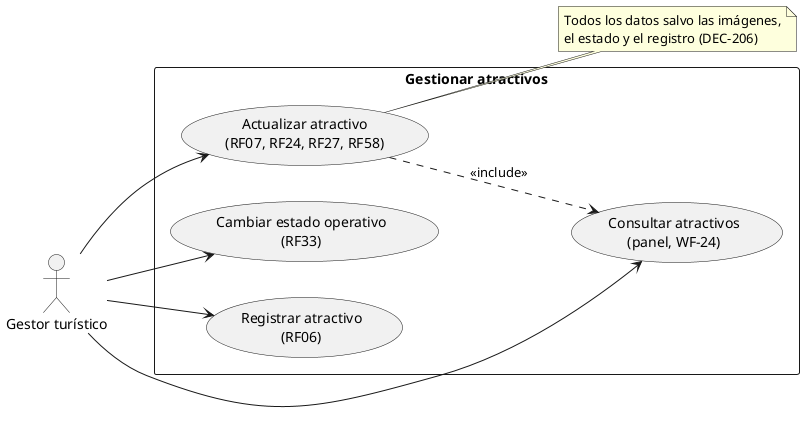
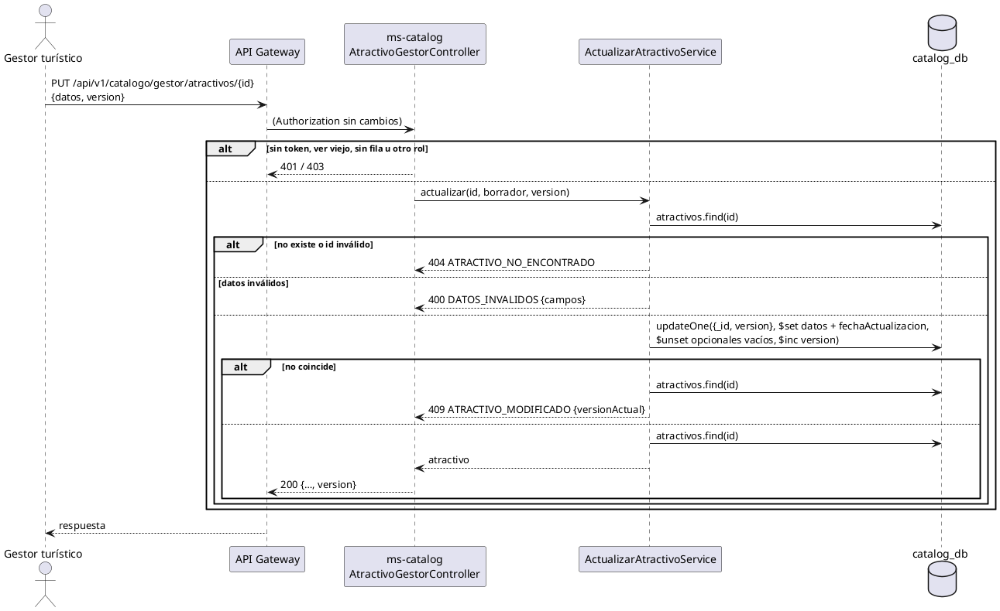

# Subsistema «Gestionar atractivos»: «Actualizar atractivo»

Fase de Construcción (RUP). Caso de uso de la iteración E «Atractivos y agenda», sesión A1 (DEC-54, DEC-213): RF07, RF24, RF27 y RF58 (parte del Gestor), con el flujo «Consultar atractivos» (el panel del Gestor). Cierra HC-E1 para la edición y N4 para el Gestor en el backend.
- **Pantallas:** WF-24 «Atractivos» (Panel del gestor; propuesto por arquitectura, pendiente de validación) y el formulario de WF-09 en modo edición. Las pantallas son de la sesión B1.
- **Requisitos:** citados de `docs/srs/especificacion de requisitos.pdf`.
- **Decisiones:** en `docs/trazabilidad.md` («Atractivos y agenda — decisiones», DEC-206 a DEC-221).
- **Contrato HTTP:** en [`sad/api/ms-catalog.md`](../sad/api/ms-catalog.md), sección «Atractivos (Gestor)».

| Campo | Valor |
|---|---|
| **Caso de uso** | «Actualizar atractivo», con el flujo «Consultar atractivos» |
| **Actores** | Gestor turístico |
| **Requisitos que traza** | RF07, RF24, RF27, RF58; RF06 (los mismos datos del registro); RNF06 |
| **Nivel** | Objetivo de usuario |
| **Alcance** | `ms-catalog` (`catalog_db.atractivos`) |

## Reglas de negocio (citadas del SRS)

- **RF07:** «El sistema debe permitir al gestor turístico **configurar** un límite numérico de capacidad de carga máxima para cada atractivo natural o público.»
- **RF24:** las «Normas Ambientales» se muestran «de forma estática y visible en la página de detalles del atractivo».
- **RF27:** el Gestor declara las condiciones de accesibilidad (movilidad reducida, visual, auditiva) de sus atractivos.
- **RF58:** el Gestor registra los días y horarios de atención como un campo de texto visible en la ficha.
- **Actor (SRS, perfiles):** «Gestor Turístico: Administra el estado operativo de atractivos públicos, aforos máximos y normativas ecológicas.»

Reglas que el SRS no fija y que decidió el equipo (`docs/trazabilidad.md`):
- **DEC-206:** cualquier Gestor edita **cualquier** atractivo: es del municipio. Por eso el panel se llama «Atractivos» y no «Mis atractivos», y lista todos. El Administrador no gestiona atractivos. Sin borrado ni desactivación.
- **DEC-207:** control de concurrencia con `version` (como DEC-186 en servicios): el Gestor envía la que leyó; la escritura la compara y la sube.
- **DEC-209:** las imágenes no se editan en esta iteración.
- **DEC-210:** el estado operativo no se edita aquí: tiene su propio CU, [Cambiar estado operativo](CU-cambiar-estado-atractivo.md).

## Diagrama de casos de uso

## Flujo «Consultar atractivos» (panel del Gestor, WF-24)

1. El Gestor abre «Atractivos» desde su menú.
2. El sistema envía `GET /api/v1/catalogo/gestor/atractivos?pagina=0`.
3. ms-catalog responde la página de 10, de **todos** los atractivos, del más reciente al más antiguo (`fechaRegistro`, desempate por id): nombre, categoría, estado, capacidad, portada, fecha y `version`.
4. El Gestor elige un atractivo; el sistema envía `GET /api/v1/catalogo/gestor/atractivos/{id}` y muestra todos sus datos, quién lo registró y la `version`.

## CU «Actualizar atractivo»

**Actor:** Gestor turístico.

**Precondiciones:**
1. El Gestor tiene sesión iniciada con el rol Gestor y su cuenta tiene fila en `cuentas` (DEC-110).
2. El atractivo existe.

**Flujo básico:**
1. El Gestor abre un atractivo desde el panel (incluye «Consultar atractivos»). El sistema muestra sus datos y su `version`.
2. El Gestor cambia la capacidad de carga, las normas ambientales, el horario, la accesibilidad u otro dato del registro, y elige **Guardar**.
3. El sistema envía `PUT /api/v1/catalogo/gestor/atractivos/{id}` con todos los datos editables y la `version` leída.
4. ms-catalog busca el atractivo y valida los datos con las reglas del registro.
5. ms-catalog escribe los datos y `fechaActualizacion` con una actualización condicional sobre el id y la `version` leída, y sube la `version`. Los opcionales vacíos se quitan.
6. El sistema responde 200 con el atractivo y su `version` nueva. La ficha pública muestra los datos nuevos.

**Flujos alternos:**
- **FA1. Datos inválidos.** Las mismas reglas que el registro, más `version` obligatoria (entero ≥ 0) → 400 `DATOS_INVALIDOS` con `campos`. No se guarda nada.
- **FA2. Atractivo inexistente o id inválido.** 404 `ATRACTIVO_NO_ENCONTRADO`. Se evalúa antes que los datos.
- **FA3. El atractivo cambió desde que se leyó.** Otro Gestor lo editó o le cambió el estado → 409 `ATRACTIVO_MODIFICADO` con `versionActual`. El Gestor vuelve a leer y decide.
- **FA4. Campos que no se editan aquí.** `estadoOperativo`, `imagenes`, `gestorId` y las fechas en el cuerpo se ignoran.
- **FA5. Otro rol o sin sesión.** 403 `ACCESO_DENEGADO`; 401 `NO_AUTENTICADO` o `SESION_INVALIDADA`.

**Postcondiciones:**
- **Éxito:** el atractivo tiene los datos nuevos, `fechaActualizacion` y su `version` subió en 1. Su estado, sus imágenes, su Gestor y su `fechaRegistro` no cambian.
- **Fallo:** no se guarda nada.

## Criterios de aceptación derivados

| # | Criterio | Prueba |
|---|---|---|
| C1 | El panel lista todos los atractivos (de cualquier Gestor) del más reciente al más antiguo, de 10 en 10 | `GestionAtractivoApiIntegracionTest`, `ConsultarAtractivosGestorServiceTest` |
| C2 | Un Gestor edita un atractivo registrado por otro; la versión sube y los opcionales vacíos se quitan | `GestionAtractivoApiIntegracionTest`, `ActualizarAtractivoServiceTest` |
| C3 | La edición no cambia el estado, las imágenes ni el registro | `ActualizacionAtractivoTest`, `GestionAtractivoApiIntegracionTest` |
| C4 | Versión vieja o escritura de otro Gestor entre la lectura y la escritura → 409 `ATRACTIVO_MODIFICADO` | `ActualizarAtractivoServiceTest`, `GestionAtractivoApiIntegracionTest` |
| C5 | Id inválido o inexistente → 404; otro rol → 403 | `GestionAtractivoApiIntegracionTest`, `AccesoGestorApiIntegracionTest` |

## Secuencia

## Fuera de alcance

- Editar la galería (DEC-209), borrar o desactivar un atractivo (DEC-206).
- Filtros y búsqueda en el panel (el volumen del prototipo no los necesita).
- Historial de cambios.
