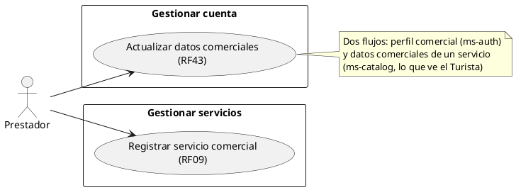
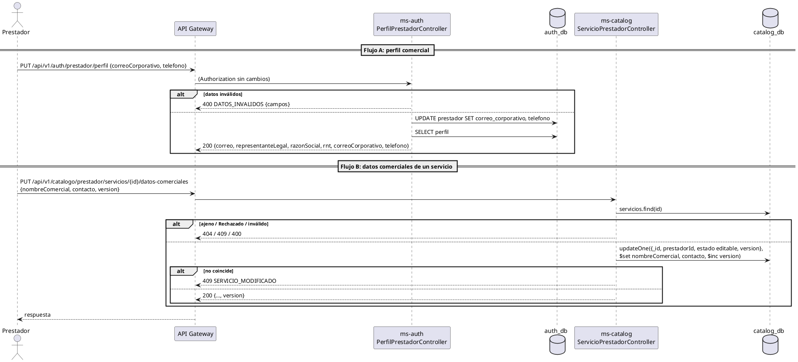

# Subsistema «Gestionar cuenta»: «Actualizar datos comerciales»

Fase de Construcción (RUP). Caso de uso de la iteración D «Oferta del prestador» (DEC-54): RF43. Cierra HC1 para RF43 y O16.
- **Pantallas:** sin wireframe todavía. Las pantallas son de la sesión B (frontend): el perfil comercial del Prestador y el detalle propio de WF-18.
- **Requisitos:** citados de `docs/srs/especificacion de requisitos.pdf`.
- **Decisiones:** en `docs/trazabilidad.md` («Oferta del prestador — decisiones», DEC-183 a DEC-195).
- **Contrato HTTP:** [`sad/api/ms-auth.md`](../sad/api/ms-auth.md) («Perfil comercial del Prestador») y [`sad/api/ms-catalog.md`](../sad/api/ms-catalog.md) («Editar un servicio (RF32, RF43)»).
- **Nombre:** se conserva el nombre original del CU, «Actualizar datos comerciales» (Entregable 1, p. 9-10, «Gestionar cuenta»; DEC-59).

| Campo | Valor |
|---|---|
| **Caso de uso** | «Actualizar datos comerciales», con dos flujos: perfil comercial (cuenta) y datos comerciales de un servicio |
| **Actores** | Prestador |
| **Requisitos que traza** | RF43; RF09 (el contacto del servicio); RNF06 |
| **Nivel** | Objetivo de usuario |
| **Alcance** | `ms-auth` (`auth_db.prestador`) y `ms-catalog` (`catalog_db.servicios`). Sin réplica entre los dos: el evento `CuentaActualizada` no cambia (DEC-188) |

## Reglas de negocio (citadas del SRS)

- **RF43:** «El sistema debe permitir al Prestador de Servicios actualizar en cualquier momento los datos básicos de su perfil comercial (nombre del establecimiento, correo corporativo y datos de contacto de atención al público), asegurando que la información que visualizan los turistas en la plataforma se mantenga vigente.»
- **RF09:** los datos de contacto (teléfono y correo) son datos del servicio registrado.
- **RNF06:** control de acceso basado en roles.

Reglas que el SRS no fija y que decidió el equipo (`docs/trazabilidad.md`):
- **DEC-188:** opción (c), sin réplica.
  - En ms-auth, el Prestador edita su **correo corporativo** de contacto y su **teléfono**. Ve en solo lectura su correo de acceso, el representante legal, la razón social y el **RNT** (cierra O16).
  - En ms-catalog, edita el **nombre comercial** y el **contacto** de cada servicio: es lo que ve el Turista (WF-06).
  - El correo de acceso (`usuario.correo`, la credencial) no se edita (decisión D2, DEC-79, ADR-006).
- **DEC-189:** el «nombre del establecimiento» es el `nombreComercial` de cada servicio (D2: el nombre comercial es del servicio, RF09). Se edita en `Pendiente` o `Publicado` sin nueva aprobación.
  - **Riesgo aceptado:** el Prestador puede cambiar contenido que el Administrador ya revisó (RF21) sin otra revisión. Se acepta porque RF43 dice «en cualquier momento» y «se mantenga vigente».
- **DEC-186:** la edición del servicio usa el mismo control de `version` que «Actualizar tarifas».

## Diagrama de casos de uso

ms-auth y ms-catalog no son actores: son componentes internos.

## CU «Actualizar datos comerciales» (RF43)

**Actor:** Prestador.

**Precondiciones:**
1. El Prestador tiene sesión iniciada con el rol Prestador (RF15). El token está vigente (firma, `iss`, `exp` y `ver`).

**Flujo básico A: perfil comercial (cuenta):**
1. El Prestador abre su perfil comercial.
2. El sistema lo consulta con `GET /api/v1/auth/prestador/perfil`. Muestra en solo lectura el correo de acceso, el representante legal, la razón social y el RNT, y en edición el correo corporativo y el teléfono.
3. El Prestador cambia el correo corporativo o el teléfono y elige **Guardar**.
4. El sistema envía `PUT /api/v1/auth/prestador/perfil`.
5. ms-auth valida los datos con las reglas del registro (RF02) y actualiza `prestador.correo_corporativo` y `prestador.telefono`.
6. El sistema responde 200 con el perfil.

**Flujo básico B: datos comerciales de un servicio:**
1. El Prestador abre el detalle de su servicio en «Mis servicios» (WF-18), con su `version`.
2. Cambia el nombre comercial o el contacto de atención al público y elige **Guardar**.
3. El sistema envía `PUT /api/v1/catalogo/prestador/servicios/{id}/datos-comerciales` con la `version` leída.
4. ms-catalog comprueba que el servicio sea del Prestador y no esté `Rechazado`, valida los datos (RF09, DEC-138) y escribe con una actualización condicional sobre la `version`, que sube.
5. El sistema responde 200. El detalle público (WF-06) muestra el nombre y el contacto nuevos.

**Flujos alternos:**
- **FA1. Datos inválidos.** 400 `DATOS_INVALIDOS` con `campos`: en el perfil, `correoCorporativo` (`REQUERIDO`, `FORMATO`, `LONGITUD_MAXIMA`) y `telefono`; en el servicio, `nombreComercial`, `contacto`, `contacto.telefono`, `contacto.correo` y `version`. No se guarda nada.
- **FA2. Campos de solo lectura en el cuerpo.** `correo`, `rnt`, `razonSocial` o `representanteLegal` se ignoran en el perfil; en el servicio, todo lo que no es el nombre, el contacto o la versión (DEC-141).
- **FA3. Servicio ajeno o inexistente.** 404 `SERVICIO_NO_ENCONTRADO`.
- **FA4. Servicio Rechazado.** 409 `ESTADO_CAMBIADO`.
- **FA5. El servicio cambió desde que se leyó.** 409 `SERVICIO_MODIFICADO` con `versionActual`.
- **FA6. Otro rol o sin sesión.** 403 `ACCESO_DENEGADO`; 401 `NO_AUTENTICADO` o `SESION_INVALIDADA`.

**Postcondiciones:**
- **Éxito (A):** `prestador.correo_corporativo` y `prestador.telefono` cambian. `usuario.correo` (la credencial), `version_cuenta` y el outbox no cambian: el inicio de sesión sigue con el correo de acceso y la sesión no se invalida.
- **Éxito (B):** el servicio tiene el nombre y el contacto nuevos y su `version` subió en 1. Su estado, su revisión y su precio no cambian. **Las reservas existentes conservan su copia de `nombre_servicio`** (ms-booking).
- **Fallo:** no se guarda nada.

## Criterios de aceptación derivados

| # | Criterio | Prueba |
|---|---|---|
| C1 | El perfil comercial trae el RNT de solo lectura (O16) | `PerfilPrestadorApiIntegracionTest`, `GestionarPerfilPrestadorServiceTest` |
| C2 | El PUT cambia el correo corporativo y el teléfono, pero no la credencial, la versión ni el outbox | `PerfilPrestadorApiIntegracionTest` |
| C3 | El inicio de sesión sigue con el correo de acceso | `PerfilPrestadorApiIntegracionTest` |
| C4 | Validaciones con 400 y `campos` | `DatosComercialesPrestadorTest`, `ActualizacionServicioTest`, `PerfilPrestadorApiIntegracionTest`, `EdicionServicioApiIntegracionTest` |
| C5 | El Turista ve el nombre y el contacto nuevos del servicio | `EdicionServicioApiIntegracionTest` |
| C6 | Otro rol → 403; Rechazado → 409; versión vieja → 409 | `PerfilPrestadorApiIntegracionTest`, `EdicionServicioApiIntegracionTest`, `ActualizarServicioServiceTest` |
| C7 | La reserva conserva su copia del nombre aunque cambie el catálogo | `ReservaApiIntegracionTest.rf32_laReservaConservaElPrecioYLosNombres…` |

## Secuencia

## Fuera de alcance

- Cambiar el correo de acceso (credencial) o la contraseña (DEC-79, ADR-006).
- Cambiar el RNT, la razón social o el representante legal (los valida el Administrador al aprobar la cuenta, RF28).
- Mostrar al Turista datos de `auth_db` (DEC-144; Ley 1581).
- Nueva aprobación de un servicio editado (DEC-189).
- Las pantallas (sesión B).
