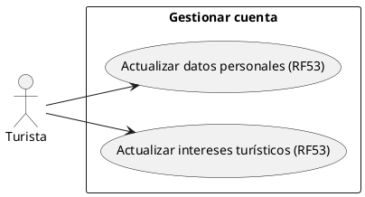
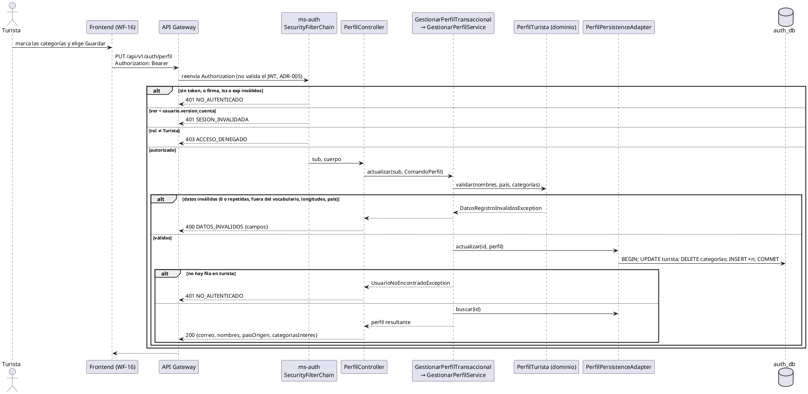

# Subsistema «Gestionar cuenta»: «Actualizar datos personales» y «Actualizar intereses turísticos»

Fase de Construcción (RUP). Casos de uso de la iteración B1 «Turista» (DEC-83): RF53.
- **Pantalla:** WF-16 ([wireframe](../wireframes/WF-16-perfil-turista.puml), propuesto por arquitectura y pendiente de validación del equipo).
- **Requisitos:** citados de `docs/srs/especificacion de requisitos.pdf`.
- **Decisiones:** en `docs/trazabilidad.md` («Turista (B1) — decisiones»).
- **Contrato HTTP:** en [`sad/api/ms-auth.md`](../sad/api/ms-auth.md), sección «Perfil del turista».
- **Nombres:** se conservan los originales del modelo de casos de uso (DEC-59).

| Campo | Valor |
|---|---|
| **Casos de uso** | «Actualizar datos personales» y «Actualizar intereses turísticos» |
| **Actores** | Turista |
| **Requisitos que traza** | RF53. Además RF01 (las mismas reglas del registro), RNF06 (solo el rol Turista) y RNF05 (la contraseña no se toca) |
| **Nivel** | Objetivo de usuario |
| **Alcance** | `ms-auth` (`auth_db`, tablas `turista` y `turista_categoria_interes`). La pantalla WF-16 la implementa la sesión B |

## Reglas de negocio (citadas del SRS)

- **RF53:** «El sistema debe permitir al Turista editar sus datos personales y actualizar sus tres categorías de interés turístico desde la sección de configuración de su perfil.»
- **RF01:** «El sistema debe permitir el registro de turistas, capturando obligatoriamente primer nombre, primer apellido, correo electrónico, contraseña, país de origen, tres categorías de interés turístico (ej. naturaleza, cultura, aventura), requiriendo la aceptación de políticas de privacidad y opcionalmente segundo nombre y apellido.»
- **RNF06:** control de acceso basado en roles.

Reglas que el SRS no fija y que se decidieron (`docs/trazabilidad.md`):
- **DEC-79:** el perfil vive en ms-auth. Se editan los nombres, los apellidos, el país y las categorías. **El correo y la contraseña no se editan:** el correo es la identidad del login, y un 409 por correo duplicado permitiría enumerar cuentas (ADR-006). No hay un RF de cambio de contraseña. El cambio no genera un evento de outbox.
- **DEC-84:** `GET` devuelve el correo en solo lectura. `PUT` reemplaza el perfil completo y responde 200 con el perfil resultante. Un `correo` en el cuerpo se ignora.
- **DEC-85:** las reglas son las del registro (RF01; decisión D1 del registro):
  - nombres y apellidos de hasta 50 caracteres, recortados; los segundos son opcionales;
  - país ISO 3166-1 alfa-2 de la lista de `GET /api/v1/auth/paises`;
  - **de 1 a 3 categorías**, distintas y del vocabulario Naturaleza, Cultura y Aventura. Las «tres» del SRS son el vocabulario cerrado;
  - las categorías se reemplazan como conjunto, en la misma transacción que los datos.

## Diagrama de casos de uso

Las dos pantallas comparten el endpoint: `PUT /api/v1/auth/perfil` siempre lleva el perfil completo.

## CU «Actualizar datos personales» (RF53)

**Actor:** Turista.

**Precondiciones:**
1. El turista inició sesión (RF15).
2. Su token está vigente: firma, `iss`, `exp` y `ver` no menor que `usuario.version_cuenta`.

**Flujo básico:**
1. El turista abre «Mi perfil» desde el menú del avatar (WF-16).
2. El sistema pide `GET /api/v1/auth/perfil` y muestra los datos. El correo se muestra en solo lectura.
3. El turista cambia sus nombres, apellidos o país y elige «Guardar».
4. El sistema valida el perfil completo con las reglas de RF01 y guarda los datos recortados. Un segundo nombre o apellido vacío queda sin valor.
5. El sistema responde 200 con el perfil resultante y la pantalla confirma el cambio.

**Flujos alternos:**
- **FA1. Datos inválidos.** Un campo obligatorio vacío, más de 50 caracteres o un país que no existe → 400 `DATOS_INVALIDOS` con un código por campo (`REQUERIDO`, `LONGITUD_MAXIMA`, `FORMATO`, `NO_PERMITIDO`). No cambia nada.
- **FA2. Llega un correo en el cuerpo.** Se ignora; el correo no cambia (DEC-84).
- **FA3. Quien actúa no es Turista.** Prestador, Gestor o Administrador → 403 `ACCESO_DENEGADO`. Sin token o con un token vencido → 401 `NO_AUTENTICADO`. Con `ver` viejo → 401 `SESION_INVALIDADA`.
- **FA4. El turista ya no existe.** El token es válido, pero no hay fila en `turista` → 401 `NO_AUTENTICADO`, como en `/me`.

**Postcondiciones:**
- **Éxito:** `turista` tiene los datos nuevos. `version_cuenta` no cambia y no se escribe en el outbox (DEC-79).
- **Fallo:** no cambia nada.

## CU «Actualizar intereses turísticos» (RF53)

**Actor y precondiciones:** las mismas de «Actualizar datos personales».

**Flujo básico:**
1. El turista abre la sección «Intereses turísticos» de su perfil (WF-16).
2. Marca o desmarca Naturaleza, Cultura o Aventura y elige «Guardar».
3. El sistema valida la lista: de 1 a 3, distintas y del vocabulario (DEC-85).
4. En una transacción, el sistema actualiza `turista` y reemplaza el conjunto en `turista_categoria_interes` (borra y vuelve a insertar).
5. El sistema responde 200 con el perfil resultante y las categorías en el orden del vocabulario.

**Flujos alternos:**
- **FA1. Ninguna categoría.** 400 `DATOS_INVALIDOS` con `campos.categoriasInteres = REQUERIDO`.
- **FA2. Una categoría repetida.** 400 con `DUPLICADO`; no se unifican.
- **FA3. Una categoría fuera del vocabulario.** 400 con `NO_PERMITIDO`.
- **FA4. Falla la escritura.** La transacción se revierte entera: quedan las categorías anteriores.
- **FA5.** Los mismos FA3 y FA4 de «Actualizar datos personales».

**Postcondiciones:**
- **Éxito:** el turista tiene exactamente las categorías enviadas.
- **Fallo:** las categorías anteriores siguen intactas.

## Criterios de aceptación derivados (RF53)

El SRS no define criterios de verificación por RF (HC1). Estos se derivan del enunciado:

| # | Criterio | Cómo se verifica |
|---|---|---|
| C1 | El GET devuelve los datos del turista del token, con el correo | `PerfilApiIntegracionTest` |
| C2 | El PUT persiste y devuelve el perfil resultante | `PerfilApiIntegracionTest`, `GestionarPerfilServiceTest` |
| C3 | Las reglas son las de RF01: longitudes, país y de 1 a 3 categorías | `PerfilTuristaTest`, `PerfilApiIntegracionTest` |
| C4 | El correo no cambia aunque llegue en el cuerpo | `PerfilApiIntegracionTest` |
| C5 | El reemplazo de las categorías es atómico | `PerfilPersistenceAdapterTest` |
| C6 | Solo el Turista; otro rol → 403; `ver` viejo → 401 | `PerfilApiIntegracionTest` |

## Secuencia: Actualizar intereses turísticos

## Fuera de alcance de este CU

- **Cambiar el correo o la contraseña** (DEC-79): no hay RF que lo pida, y cambiar el correo abriría la enumeración de cuentas.
- **Notificar el cambio** al turista (RF34, ms-notificaciones).
- **La pantalla WF-16:** la implementa la sesión B de la iteración.
