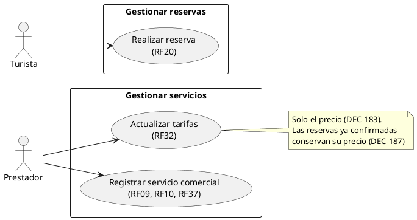
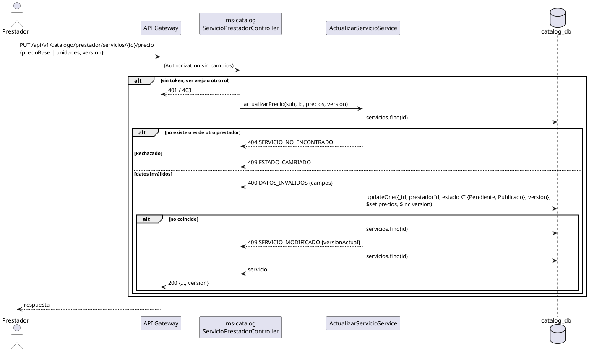
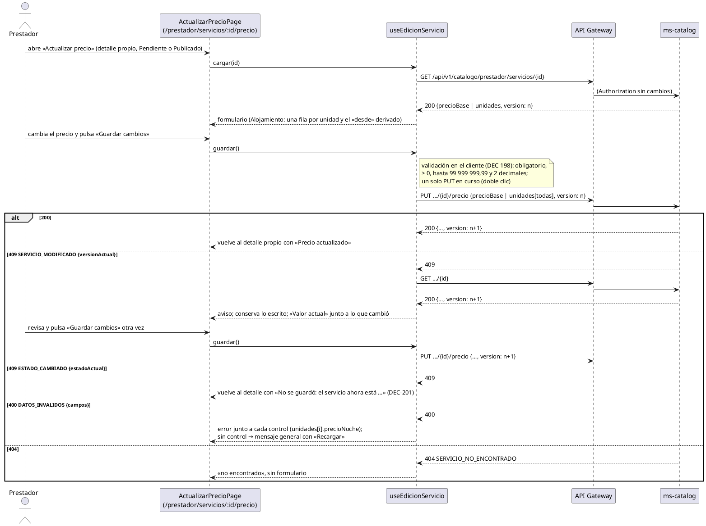

# Subsistema «Gestionar servicios»: «Actualizar tarifas»

Fase de Construcción (RUP). Caso de uso de la iteración D «Oferta del prestador» (DEC-54): RF32. Cierra HC1 para RF32.
- **Pantallas:** WF-20 «Actualizar precio» (`/prestador/servicios/:id/precio`; propuesto por arquitectura, pendiente de validación), a la que se llega con «Actualizar precio» desde el detalle propio de WF-18 en `Pendiente` o `Publicado`. Implementada en la iteración D, sesión B (DEC-196, DEC-198, DEC-200, DEC-201).
- **Requisitos:** citados de `docs/srs/especificacion de requisitos.pdf`.
- **Decisiones:** en `docs/trazabilidad.md` («Oferta del prestador — decisiones», DEC-183 a DEC-195).
- **Contrato HTTP:** en [`sad/api/ms-catalog.md`](../sad/api/ms-catalog.md), sección «Editar un servicio (RF32, RF43)».
- **Nombre:** se conserva el nombre original del CU, «Actualizar tarifas» (Entregable 2, figura 4, «Gestionar servicios»; DEC-59).

| Campo | Valor |
|---|---|
| **Caso de uso** | «Actualizar tarifas» |
| **Actores** | Prestador |
| **Requisitos que traza** | RF32; RF37 (el precio que ve el Turista); RNF06 |
| **Nivel** | Objetivo de usuario |
| **Alcance** | `ms-catalog` (`catalog_db.servicios`). `ms-booking` conserva el precio copiado en cada reserva (`reservas_db.reserva`, sin cambios) |

## Reglas de negocio (citadas del SRS)

- **RF32:** «El sistema debe permitir al Prestador actualizar el precio o tarifa de sus servicios registrados, aplicando el nuevo valor únicamente a reservas futuras y conservando el precio original en las reservas ya confirmadas.»
- **RF37:** el precio de cada servicio es visible para el Turista antes de confirmar una reserva.
- **RNF06:** control de acceso basado en roles.

Reglas que el SRS no fija y que decidió el equipo (`docs/trazabilidad.md`):
- **DEC-183:** la oferta (días de operación y salidas) es **inmutable después de la aprobación**. Este CU cambia solo el precio. Modificar fechas, horarios y cupos es RF19, fuera de alcance (DEC-34). Las filas ya materializadas en ms-booking no cambian si cambia la oferta: invalidarlas exigiría tocar el inventario y enmendar otra vez ADR-007.
- **DEC-184:** contrato. Tour, Gastronomía y Alquiler cambian `precioBase`; Alojamiento cambia el `precioNoche` de **todas** sus unidades y el «desde» se deriva (DEC-127). Mismas reglas que el registro (DEC-138).
- **DEC-185:** un servicio `Pendiente` o `Publicado` cambia de precio **sin nueva aprobación**. `Rechazado` es final (DEC-177).
- **DEC-186:** control de concurrencia con `version`: el Prestador envía la que leyó; la escritura la compara y la sube. La decisión del Administrador (RF21) también la sube.
- **DEC-187:** «conservar el precio original» ya se cumple: ms-booking copia `precio_unitario` y `monto_total` al confirmar (V1). Sin historial de precios (RF41 está descartado).

## Diagrama de casos de uso

ms-catalog y ms-booking no son actores: son componentes internos.

## CU «Actualizar tarifas» (RF32)

**Actor:** Prestador.

**Precondiciones:**
1. El Prestador tiene sesión iniciada con el rol Prestador (RF15). El token está vigente (firma, `iss`, `exp` y `ver`).
2. El servicio es suyo y está `Pendiente` o `Publicado`.

**Flujo básico:**
1. El Prestador abre el detalle de su servicio en «Mis servicios» (WF-18). El sistema muestra el precio vigente (en Alojamiento, el de cada unidad) y la `version` del servicio.
2. El Prestador escribe el precio nuevo y elige **Guardar**.
3. El sistema envía `PUT /api/v1/catalogo/prestador/servicios/{id}/precio` con el precio y la `version` leída.
4. ms-catalog busca el servicio y comprueba que sea del Prestador y que no esté `Rechazado`.
5. ms-catalog valida el precio (en Alojamiento, el de todas las unidades, una vez cada una) y deriva el «desde».
6. ms-catalog escribe el precio con una actualización condicional sobre el id, el prestador, el estado editable y la `version` leída, y sube la `version`.
7. El sistema responde 200 con el servicio y su `version` nueva. El detalle público muestra el precio nuevo.
8. Desde ese momento, una reserva nueva usa el precio nuevo (ms-booking lo lee del detalle público, ADR-007). Las reservas ya confirmadas conservan su precio.

**Flujos alternos:**
- **FA1. Datos inválidos.** Falta el precio o la `version`, el precio no es mayor que 0, excede `99999999.99` o tiene más de 2 decimales; en Alojamiento falta una unidad (`unidades`: `CANTIDAD_MINIMA`), se repite (`DUPLICADO`) o no es del servicio (`NO_PERMITIDO`) → 400 `DATOS_INVALIDOS` con `campos`. No se guarda nada.
- **FA2. Servicio ajeno o inexistente.** 404 `SERVICIO_NO_ENCONTRADO` (no se revela cuál, DEC-143).
- **FA3. Servicio Rechazado.** 409 `ESTADO_CAMBIADO` con `estadoActual: Rechazado`. Se evalúa antes que los datos.
- **FA4. El servicio cambió desde que se leyó.** Otra edición del Prestador o la decisión del Administrador subieron la `version` → 409 `SERVICIO_MODIFICADO` con `versionActual`. El Prestador vuelve a leer y decide.
- **FA5. Oferta en el cuerpo.** `oferta` y los demás campos se ignoran (DEC-141): la oferta no cambia (DEC-183).
- **FA6. Otro rol o sin sesión.** 403 `ACCESO_DENEGADO`; 401 `NO_AUTENTICADO` o `SESION_INVALIDADA`.
- **FA7. El Turista confirma con el precio anterior.** Si el Turista leyó el precio antes del cambio, ms-booking responde 409 `PRECIO_CAMBIADO` con el precio vigente (RF37) y no reserva.

**Postcondiciones:**
- **Éxito:** el servicio tiene el precio nuevo y su `version` subió en 1. Su estado, su revisión y su oferta no cambian. Las reservas ya confirmadas conservan `precio_unitario` y `monto_total`.
- **Fallo:** no se guarda nada.

## Criterios de aceptación derivados

| # | Criterio | Prueba |
|---|---|---|
| C1 | El Prestador cambia el precio de su servicio Publicado; el detalle público muestra el nuevo; la versión sube | `EdicionServicioApiIntegracionTest`, `ActualizarServicioServiceTest` |
| C2 | Alojamiento: cambian los precios por noche y el «desde» se recalcula en la misma escritura | `ActualizacionServicioTest`, `EdicionServicioApiIntegracionTest` |
| C3 | La reserva nueva usa el precio nuevo; la Confirmada anterior conserva el original | `ReservaApiIntegracionTest.rf32_trasCambiarElPrecio…` |
| C4 | Validaciones con 400 y `campos` | `ActualizacionServicioTest`, `EdicionServicioApiIntegracionTest` |
| C5 | Servicio ajeno → 404; otro rol → 403; Rechazado → 409 | `EdicionServicioApiIntegracionTest`, `ActualizarServicioServiceTest` |
| C6 | Versión vieja o aprobación entre la lectura y la escritura → 409 `SERVICIO_MODIFICADO` | `EdicionServicioApiIntegracionTest`, `ActualizarServicioServiceTest` |
| C7 | La oferta no cambia por esta vía (DEC-183) | `EdicionServicioApiIntegracionTest`, `ActualizacionServicioTest` |
| C8 | M011 rellena `version` y RF21 y RF22 siguen escribiendo sobre documentos migrados | `MigracionesMongoTest` |

## Secuencia

## Secuencia desde la pantalla (WF-20)

El flujo básico con el 409 `SERVICIO_MODIFICADO` (FA4) tal como lo atiende la pantalla: conserva lo escrito, relee el servicio y el reenvío es otro clic del Prestador con la versión nueva (DEC-200). Componentes del frontend: [`componentes-frontend-prestador.puml`](../sad/diagramas/componentes-frontend-prestador.puml).

## Fuera de alcance

- Modificar la oferta (días, salidas) o los cupos (RF19, DEC-34, DEC-183).
- Historial de precios (RF41, descartado).
- Precios por temporada o por fecha.
