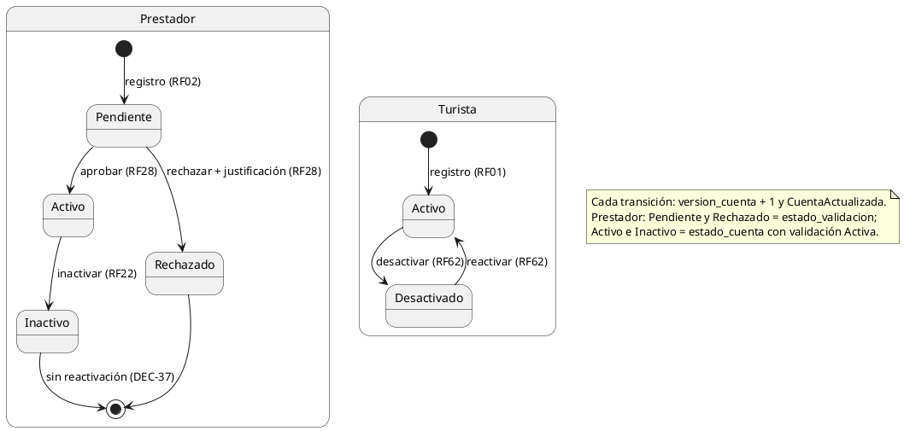
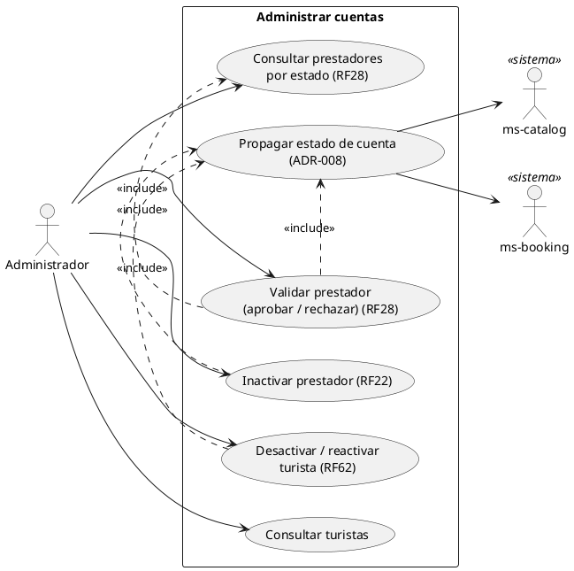
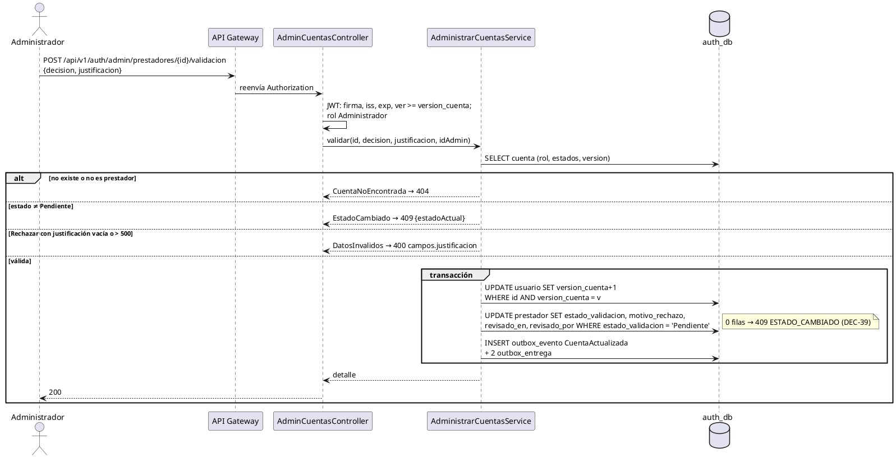
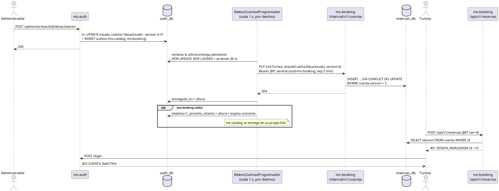
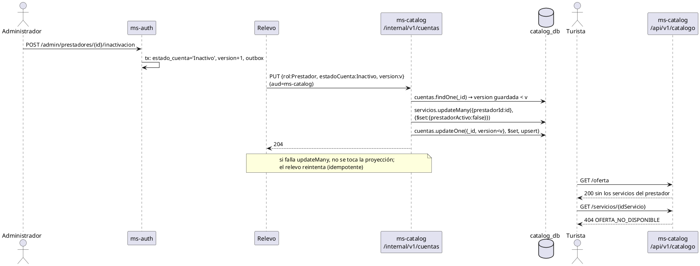

# CU «Administrar cuentas»

Fase de Construcción (RUP). Caso de uso de la iteración «Administrar cuentas»: RF28, RF62 y RF22, con la pantalla WF-12 ([wireframe](../wireframes/WF-12-administrar-cuentas.puml), propuesto por arquitectura y pendiente de validación del equipo). Requisitos citados de `docs/srs/especificacion de requisitos.pdf`. Decisiones en `docs/trazabilidad.md` («Administrar cuentas — decisiones») y [ADR-008](../sad/adr/ADR-008-sincronizacion-estado-cuentas.md). Contrato HTTP en [`sad/api/ms-auth.md`](../sad/api/ms-auth.md).

| Campo | Valor |
|---|---|
| **Nombre** | Administrar cuentas |
| **Actor principal** | Administrador |
| **Actores secundarios** | ms-catalog y ms-booking (sistemas; reciben el estado de la cuenta, ver «Propagar estado de cuenta») |
| **Requisitos que traza** | RF28, RF22, RF62. RF45 (roles) tiene su propio CU desde la iteración B2: [«Cambiar rol de cuenta»](CU-cambiar-rol-cuenta.md), con el mismo mecanismo (el evento lleva el rol y la versión, y el relevo cubre todos los roles) |
| **Nivel** | Objetivo de usuario |
| **Alcance** | `ms-auth` (`auth_db`), `ms-catalog` (`catalog_db`) y `ms-booking` (`reservas_db`) |

**Nota (DEC-59):**
- Se conservan los nombres originales de los CU de los entregables, y no se corrigen sus observaciones UML (N14).
- La reactivación aplica solo al turista: reafirma DEC-37.
- RF45 entra en la iteración B2 con el CU [«Cambiar rol de cuenta»](CU-cambiar-rol-cuenta.md) (DEC-82). Desde V15 de ms-auth, el Administrador tiene fila en la proyección `cuentas` y su `ver` se invalida (L3 cerrado, DEC-110).

## Reglas de negocio (citadas del SRS)

- **RF02:** «La cuenta quedará en estado "Pendiente de Validación" hasta que el Administrador verifique sus credenciales.»
- **RF28:** «El sistema debe permitir al Administrador revisar las cuentas de Prestadores en estado "Pendiente de Validación" (RF02), visualizando sus datos organizacionales y número de RNT, y cambiar el estado de la cuenta a "Activo" o "Rechazado", este último requiriendo un campo de texto obligatorio con la justificación.»
- **RF22:** «El sistema debe permitir al Administrador cambiar el estado de la cuenta de cualquier Prestador de Servicios a "Inactivo", lo cual ocultará automáticamente todos los servicios asociados a ese prestador de las búsquedas públicas.»
- **RF62:** «El sistema debe permitir al Administrador desactivar temporalmente la cuenta de un Turista que incumpla las políticas de uso, impidiendo el acceso hasta que el Administrador reactive la cuenta.»
- **RNF06:** control de acceso basado en roles. **RNF02:** respuesta de menos de 2 s. **RNF01:** disponibilidad del 99 %: ms-booking no depende de ms-auth en cada petición (ADR-008).

Reglas que el SRS no fija y que decidió el equipo (`docs/trazabilidad.md`):
- **DEC-37:** un prestador inactivo no se reactiva (RF22 no lo define).
- **DEC-38:** inactivar y desactivar no llevan motivo; solo el rechazo (RF28) exige justificación.
- **DEC-39:** concurrencia entre administradores con UPDATE condicional; si el estado ya cambió, 409 `ESTADO_CAMBIADO`.
- **DEC-41:** listados de 10 elementos. **DEC-42:** justificación de 1 a 500 caracteres sin contar los espacios de los extremos.
- **DEC-43:** transiciones válidas (ver «Estados») y estado **derivado** del prestador.

## Precondiciones

1. El Administrador inició sesión (RF15). La cuenta del Administrador se crea desde la base de datos (DEC-25).
2. Su token está vigente: firma, `iss`, `exp` y `ver` no menor que `usuario.version_cuenta` (ms-auth compara contra su propia tabla).
3. Para validar, existe un prestador en «Pendiente de Validación» (RF02).

## Estados

El prestador tiene dos estados en `auth_db` (`estado_validacion` y `estado_cuenta`); el CU y el evento usan un estado **derivado** (DEC-43), con esta precedencia: validación Pendiente → **Pendiente**; validación Rechazado → **Rechazado**; validación Activo y cuenta Activa → **Activo**; validación Activo y cuenta que no es Activa → **Inactivo**. El turista es **Activo** o **Desactivado** (RF62).



Cualquier otra transición (por ejemplo, aprobar a un prestador que ya está Activo) es un 409 `ESTADO_CAMBIADO`.

## Diagrama de casos de uso



## Flujo básico: validar a un prestador (RF28)

1. El Administrador abre «Administrar cuentas» (WF-12), pestaña «Prestadores por validar».
2. El sistema lista los prestadores Pendientes, de 10 en 10, por fecha de registro: representante legal, RNT, correo corporativo y fecha de registro. El Administrador puede buscar por nombre, correo o RNT.
3. El Administrador elige **Revisar** en uno. El sistema muestra sus datos organizacionales: representante legal, razón social (si la dio), RNT, correo corporativo, teléfono, políticas aceptadas (con la fecha de registro) y estado.
4. El Administrador elige **Aprobar**.
5. El sistema cambia la validación del prestador a Activo, guarda quién revisó y cuándo, sube `version_cuenta` y registra el evento `CuentaActualizada`, todo en una transacción, y responde con el detalle actualizado.
6. El sistema propaga el estado a ms-catalog y ms-booking (caso de uso incluido «Propagar estado de cuenta»).
7. El prestador puede iniciar sesión (RF15).

## Flujos alternos

**FA1. Rechazar con justificación (RF28).** En el paso 4 el Administrador elige **Rechazar**. El sistema pide la justificación (obligatoria, de 1 a 500 caracteres). El Administrador la escribe y confirma. El sistema cambia la validación a Rechazado y guarda la justificación y la revisión. El prestador, al iniciar sesión con la contraseña correcta, recibe 403 `CUENTA_RECHAZADA`. Continúa en el paso 6.

**FA1a. Justificación vacía o demasiado larga.** El sistema responde 400 `DATOS_INVALIDOS` con `campos.justificacion` = `REQUERIDO` (vacía o en blanco) o `LONGITUD_MAXIMA` (más de 500 caracteres) y no cambia nada. La pantalla deshabilita «Confirmar rechazo» mientras esté vacía y marca el campo.

**FA2. Inactivar un prestador (RF22).** El Administrador, en la pestaña «Prestadores», elige **Inactivar** en un prestador Activo y confirma (sin motivo, DEC-38). El sistema cambia `estado_cuenta` a Inactivo, sube la versión y registra el evento. Al llegar el evento a ms-catalog, los servicios del prestador salen de la búsqueda pública y su detalle responde 404 (RF22). El prestador inactivo no se reactiva (DEC-37): la acción aparece deshabilitada.

**FA3. Desactivar o reactivar a un turista (RF62).** En la pestaña «Turistas», el Administrador elige **Desactivar** (o **Reactivar**) y confirma (sin motivo). El sistema cambia `estado_cuenta` a Desactivado (o Activo), sube la versión y registra el evento. El turista desactivado no puede iniciar sesión (403 `CUENTA_INACTIVA`) y sus sesiones abiertas dejan de valer (401 `SESION_INVALIDADA`) hasta que se reactive la cuenta.

**FA4. Concurrencia entre administradores (DEC-39).** Dos administradores actúan sobre la misma cuenta a la vez, o uno actúa sobre una lista desactualizada. El UPDATE condicional solo aplica el primero; el segundo recibe 409 `ESTADO_CAMBIADO` con el estado actual. La pantalla muestra «La cuenta cambió de estado; se recargó la lista» y recarga.

**FA5. Cuenta inexistente.** El id no existe, o es de un usuario que no es turista ni prestador (según la acción): 404 `CUENTA_NO_ENCONTRADA`.

**FA6. Lista vacía.** Ningún prestador o turista cumple el filtro: el sistema responde una página sin elementos y la pantalla lo anuncia en la región de estado.

**FA7. Quien actúa no es Administrador.** 403 `ACCESO_DENEGADO` (RNF06). Sin token o con un token vencido: 401 `NO_AUTENTICADO`. Con un token de antes de un cambio de estado o de rol de la propia cuenta: 401 `SESION_INVALIDADA`.

**FA8. Un servicio destino no responde.** El cambio ya está guardado y el evento queda pendiente en el outbox; el relevo reintenta con espera creciente y el otro destino no se ve afectado. Mientras el destino no lo reciba, ms-catalog sigue mostrando los servicios del prestador inactivado y ms-booking sigue aceptando el token; el techo es el TTL del token (15 minutos).

## Caso de uso incluido: Propagar estado de cuenta (ADR-008)

Lo ejecuta el sistema, sin actor humano, tras cada cambio.

1. El relevo de ms-auth toma las entregas pendientes de un destino (la última versión de cada usuario).
2. Firma un JWT de servicio (`sub = ms-auth`, `rol = SERVICIO`, `aud` = el destino, vigencia de 5 minutos) y envía `PUT /internal/v1/cuentas/{id}` con `{rol, estadoCuenta, version}`.
3. El destino guarda la proyección `cuentas` con un *upsert* que solo avanza si la versión es mayor (tolera duplicados y desorden) y responde 204.
4. ms-catalog, si la cuenta es de un Prestador, actualiza antes `servicios.prestadorActivo` (RF22).
5. El relevo marca la entrega y, si falla, reintenta.

## Postcondiciones

**Éxito:**
- La cuenta quedó en el estado nuevo y `version_cuenta` subió en 1; el evento `CuentaActualizada` quedó registrado para los dos destinos en la misma transacción.
- Si fue una validación, el prestador queda con la revisión (quién y cuándo) y, si se rechazó, con su justificación.
- Cuando el evento llega, ms-catalog y ms-booking tienen la versión nueva: un token con `ver` menor recibe 401 `SESION_INVALIDADA`, y `servicios.prestadorActivo` refleja el estado del prestador.

**Fallo:** si falla cualquier paso de la transacción (el cambio o el evento), no queda ninguno de los dos.

## Criterios de aceptación derivados (RF22 y RF62)

El SRS no define criterios de verificación por RF (hallazgo HC1); estos se derivan de los enunciados:

| # | Criterio | Cómo se verifica |
|---|---|---|
| C1 | Con el relevo y los consumidores en marcha, el efecto de un cambio llega a ms-catalog y ms-booking en **5 s o menos** (el relevo corre cada 1 s) | `RelevoCuentasIntegracionTest`; el valor de `samaria360.outbox.cada` |
| C2 | Con un consumidor caído, el efecto llega a más tardar al vencer el token: **15 minutos** (TTL) | `AdminCuentasApiIntegracionTest` (el token trae `ver` y vence a los 15 min); `SesionVersionIntegracionTest` |
| C3 | Un turista desactivado no inicia sesión hasta que se reactive (RF62) | `AdminCuentasApiIntegracionTest` |
| C4 | Los servicios de un prestador inactivo no aparecen en las búsquedas públicas y su detalle es 404 (RF22) | `VisibilidadPrestadorApiIntegracionTest` |
| C5 | El rechazo exige justificación (RF28) | `AdminCuentasApiIntegracionTest`, `JustificacionRechazoTest` |
| C6 | Dos administradores sobre la misma cuenta: uno 200 y otro 409 (DEC-39) | `AdminCuentasApiIntegracionTest` |
| C7 | El cambio y su evento se confirman juntos o ninguno (DEC-26) | `AdminCuentasApiIntegracionTest` |

## Secuencias

**Validar (aprobar y rechazar):**



**Desactivar turista, relevo y rechazo del token viejo en ms-booking:**



**Inactivar prestador hasta ocultar sus servicios:**



**Componentes:**

```plantuml
@startuml
node "api-gateway" { [Rutas /api/v1/**] }
note right of [Rutas /api/v1/**] : no enruta /internal/**
node "ms-auth" {
  [AdminCuentasController] --> [AdministrarCuentasService]
  [AdministrarCuentasService] --> [Outbox (JDBC)]
  [RelevoCuentasProgramador] --> [RelevarCuentasService]
  [RelevarCuentasService] --> [Outbox (JDBC)]
  [RelevarCuentasService] --> [CuentasHttpAdapter]
  [CuentasHttpAdapter] --> [JwtServicioAdapter]
  [JWKS]
}
database "auth_db\n(usuario.version_cuenta,\noutbox_evento, outbox_entrega)" as ADB
node "ms-catalog" {
  [CuentaInternaController] as CIC
  [ValidadorVersionSesion] as VC
}
database "catalog_db\n(cuentas, servicios.prestadorActivo)" as MDB
node "ms-booking" {
  [CuentaInternaController] as BIC
  [ValidadorVersionSesion] as VB
}
database "reservas_db\n(cuenta)" as BDB
[Rutas /api/v1/**] --> [AdminCuentasController]
[Outbox (JDBC)] --> ADB
[CuentasHttpAdapter] --> CIC : PUT /internal/v1/cuentas/{id}\nJWT SERVICIO aud=ms-catalog
[CuentasHttpAdapter] --> BIC : PUT /internal/v1/cuentas/{id}\nJWT SERVICIO aud=ms-booking
CIC --> MDB
VC --> MDB
BIC --> BDB
VB --> BDB
CIC ..> [JWKS] : valida firma
BIC ..> [JWKS] : valida firma
@enduml
```

## Fuera de alcance de este CU

- **RF45** (asignar, modificar o revocar el rol de Gestor o Administrador): es el CU [«Cambiar rol de cuenta»](CU-cambiar-rol-cuenta.md). Usa el mismo mecanismo: el evento lleva el rol y la versión sube con cada cambio de rol, así que un cambio de rol invalida los tokens viejos.
- **Reactivar a un prestador inactivo o rechazado** (DEC-37).
- **Notificar** al prestador o al turista del cambio (RF30, RF63, RF34): ms-notificaciones.
- **Registro de auditoría** (log de RF29): solo se guarda la última revisión del prestador (`revisado_en`, `revisado_por`).
- **Token de refresco:** el turista vuelve a iniciar sesión cada 15 minutos hasta que exista (ADR-008).
- **La pantalla WF-12:** la implementa la sesión B de la iteración.
