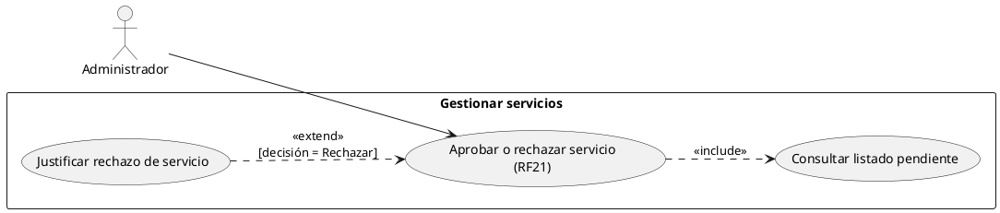
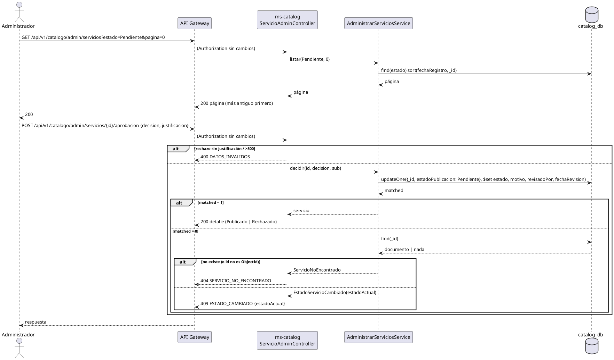

# Subsistema «Gestionar servicios»: «Aprobar o rechazar servicio»

Fase de Construcción (RUP). Caso de uso de la iteración C «Registrar y aprobar servicio» (DEC-54, DEC-134): RF21. Incluye «Consultar listado pendiente» y lo extiende «Justificar rechazo de servicio».
- **Pantalla:** WF-19 «Aprobar servicios» ([wireframe](../wireframes/WF-19-aprobar-servicios.puml), propuesto por arquitectura y pendiente de validación del equipo). La implementa la sesión B2.
- **Requisitos:** citados de `docs/srs/especificacion de requisitos.pdf`.
- **Decisiones:** en `docs/trazabilidad.md` («Registrar y aprobar servicio — decisiones», DEC-124 a DEC-151).
- **Contrato HTTP:** en [`sad/api/ms-catalog.md`](../sad/api/ms-catalog.md), sección «Aprobar o rechazar servicio».
- **Nombre:** se conservan los nombres originales de los CU (Entregable 2, figura 4; DEC-59).

| Campo | Valor |
|---|---|
| **Casos de uso** | «Aprobar o rechazar servicio», que incluye «Consultar listado pendiente» y al que extiende «Justificar rechazo de servicio» |
| **Actores** | Administrador |
| **Requisitos que traza** | RF21. Además RNF06, RF09 (el servicio registrado que se revisa) y RF22 (un servicio publicado de un prestador inactivo sigue oculto) |
| **Nivel** | Objetivo de usuario |
| **Alcance** | `ms-catalog` (`catalog_db`: `servicios` y la proyección `cuentas`) |

## Reglas de negocio (citadas del SRS)

- **RF21:** «El sistema debe mostrar al Administrador un listado de los servicios turísticos con estado "Pendiente de aprobación" (registrados según el RF08), permitiéndole cambiar su estado a "Publicado" para que sea visible, o a "Rechazado" incluyendo un campo de texto obligatorio con la justificación.» La referencia a RF08 es una errata: debe ser RF09 (`docs/trazabilidad.md`, «Erratas del SRS»; hallazgo N21).
- **RF09:** «Todo servicio registrado requerirá aprobación previa del Administrador antes de ser publicado en la plataforma.»
- **RF22:** el Inactivo de un prestador oculta todos sus servicios de las búsquedas públicas.
- **RNF06:** control de acceso basado en roles.

Reglas que el SRS no fija y que decidió el equipo (`docs/trazabilidad.md`):
- **DEC-124:** las únicas transiciones son Pendiente → Publicado y Pendiente → Rechazado.
- **DEC-128:** el patrón de RF28: `{decision, justificacion}`, UPDATE condicional por estado y 409 `ESTADO_CAMBIADO`. `Rechazado` es final en esta iteración (la edición es de la iteración D).
- **DEC-144:** listado con `estado` (por defecto `Pendiente`), del más antiguo al más reciente, en páginas de 10; detalle sin la regla de visibilidad pública.
- **DEC-145:** justificación de 1 a 500 caracteres sin los espacios de los extremos (como DEC-42), ignorada al aprobar; se guardan `revisadoPor` y `fechaRevision`. Aprobar a un prestador ya inactivo se permite: queda Publicado y oculto.

## Diagrama de casos de uso

- **Punto de extensión** de «Aprobar o rechazar servicio»: «decisión», en el paso 4 del flujo básico. «Justificar rechazo de servicio» lo extiende cuando el Administrador elige Rechazar.
- El modelo completo del subsistema (con «Registrar servicio») está en [`CU-registrar-servicio.md`](CU-registrar-servicio.md).

## CU «Aprobar o rechazar servicio» (RF21)

**Actor:** Administrador.

**Precondiciones:**
1. El Administrador inició sesión (RF15) y su token está vigente; ms-catalog tiene su fila en `cuentas` (DEC-110).
2. Hay al menos un servicio `Pendiente` registrado según RF09.

**Flujo básico:**
1. El Administrador abre WF-19.
2. **Include «Consultar listado pendiente»:** el sistema lista los servicios `Pendiente` con `GET /api/v1/catalogo/admin/servicios?estado=Pendiente&pagina=`, del más antiguo al más reciente, de 10 en 10: nombre, categoría, prestador (id y RNT), copia del estado del prestador y fecha de registro.
3. El Administrador elige un servicio. El sistema muestra su detalle con `GET /api/v1/catalogo/admin/servicios/{id}`: todos los datos del registro, la oferta, el RNT y el estado de la cuenta del prestador según la proyección.
4. **Punto de extensión «decisión».** El Administrador elige **Aprobar**.
5. El sistema envía `POST /api/v1/catalogo/admin/servicios/{id}/aprobacion` con `{decision: "Aprobar"}`.
6. ms-catalog hace el UPDATE condicional: pasa a `Publicado` solo si sigue `Pendiente`, y guarda `revisadoPor` (`sub`) y `fechaRevision`.
7. El sistema responde 200 con el detalle. Si el prestador está activo, el servicio aparece en la búsqueda y en el detalle públicos.

**Extend «Justificar rechazo de servicio» (en el paso 4):**
1. El Administrador elige **Rechazar** y escribe la justificación (obligatoria, de 1 a 500 caracteres).
2. El sistema envía `{decision: "Rechazar", justificacion}`.
3. ms-catalog hace el UPDATE condicional a `Rechazado` con `motivoRechazo` (sin los espacios de los extremos), `revisadoPor` y `fechaRevision`.
4. El sistema responde 200. El prestador ve el motivo en «Mis servicios» (CU «Registrar servicio»).

**Flujos alternos:**
- **FA1. Justificación inválida.** Rechazar sin justificación, en blanco o con más de 500 caracteres → 400 `DATOS_INVALIDOS` con `campos.justificacion` (`REQUERIDO` o `LONGITUD_MAXIMA`). No cambia nada.
- **FA2. Decisión inválida.** `decision` ausente → `campos.decision: REQUERIDO`; fuera de `Aprobar` y `Rechazar` → `NO_PERMITIDO`. Un cuerpo que no es JSON → 400 sin `campos`.
- **FA3. El servicio no existe.** Id inexistente o que no es un ObjectId → 404 `SERVICIO_NO_ENCONTRADO`.
- **FA4. Otro Administrador ya decidió.** El servicio ya no está `Pendiente` → 409 `ESTADO_CAMBIADO` con `estadoActual`. La pantalla avisa y recarga la lista (DEC-52).
- **FA5. Quien actúa no es Administrador.** 403 `ACCESO_DENEGADO`. Sin token → 401 `NO_AUTENTICADO`; con `ver` viejo → 401 `SESION_INVALIDADA`.
- **FA6. El prestador está inactivo.** Aprobar se permite: el servicio queda `Publicado` con `prestadorActivo = false` y no aparece en público (RF22).
- **FA7. Estado o página inválidos en el listado.** 400 `DATOS_INVALIDOS` con `campos.estado` o `campos.pagina`.

**Postcondiciones:**
- **Éxito (aprobar):** el servicio está `Publicado`, con quién y cuándo; es visible si su prestador está activo.
- **Éxito (rechazar):** el servicio está `Rechazado`, con el motivo, quién y cuándo; nunca es visible.
- **Fallo:** no cambia nada.

## Criterios de aceptación derivados

| # | Criterio | Prueba |
|---|---|---|
| C1 | El listado de Pendientes va del más antiguo al más reciente, de 10 en 10 | `AprobacionServicioApiIntegracionTest`, `AdministrarServiciosServiceTest` |
| C2 | Aprobar publica el servicio y lo vuelve visible en la búsqueda | `AprobacionServicioApiIntegracionTest` |
| C3 | Rechazar sin justificación es 400; con justificación guarda el motivo | `AprobacionServicioApiIntegracionTest`, `AdministrarServiciosServiceTest` |
| C4 | Una segunda decisión es 409 `ESTADO_CAMBIADO` con `estadoActual` | `AprobacionServicioApiIntegracionTest`, `AdministrarServiciosServiceTest` |
| C5 | Un id inexistente o inválido es 404 | `AprobacionServicioApiIntegracionTest` |
| C6 | Solo el Administrador revisa | `AprobacionServicioApiIntegracionTest` |
| C7 | Inactivar al prestador oculta también su servicio nuevo publicado (RF22) | `AprobacionServicioApiIntegracionTest` |

## Secuencia

## Fuera de alcance

- Reenviar o editar un servicio rechazado (iteración D).
- Notificar al prestador la decisión (ms-notificaciones; RF13 y RF30 siguen fuera de alcance) y el log de auditoría de la aprobación (RF13): `revisadoPor` y `fechaRevision` lo preparan.
- Despublicar un servicio ya publicado: el SRS no lo define.
