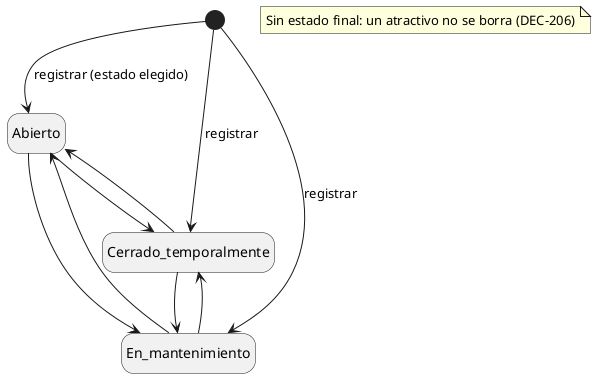
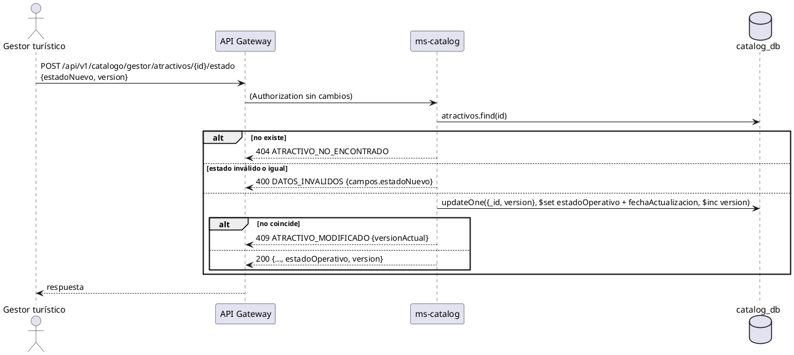

# Subsistema «Gestionar atractivos»: «Cambiar estado operativo»

Fase de Construcción (RUP). Caso de uso de la iteración E «Atractivos y agenda», sesión A1 (DEC-54, DEC-213): RF33. Cierra HC-E1 para RF33.
- **Pantallas:** diálogo «Cambiar estado» del panel «Atractivos» (WF-24) y del detalle de gestión. Sesión B1.
- **Requisitos:** citados de `docs/srs/especificacion de requisitos.pdf`.
- **Decisiones:** en `docs/trazabilidad.md` (DEC-206, DEC-207, DEC-210).
- **Contrato HTTP:** en [`sad/api/ms-catalog.md`](../sad/api/ms-catalog.md), sección «Atractivos (Gestor)».

| Campo | Valor |
|---|---|
| **Caso de uso** | «Cambiar estado operativo» |
| **Actores** | Gestor turístico |
| **Requisitos que traza** | RF33; RNF06 |
| **Nivel** | Objetivo de usuario |
| **Alcance** | `ms-catalog` (`catalog_db.atractivos`) |

## Reglas de negocio (citadas del SRS)

- **RF33:** «El sistema debe permitir al Gestor Turístico modificar el estado operativo de un atractivo público registrado (RF06) entre "Abierto", "Cerrado temporalmente" o "En mantenimiento", mostrando dicho estado de forma visible en la ficha del atractivo para los Turistas.»

Reglas que el SRS no fija y que decidió el equipo (`docs/trazabilidad.md`):
- **DEC-210:** los tres estados se guardan como `Abierto`, `Cerrado_temporalmente` y `En_mantenimiento`. RF33 no restringe transiciones: se pasa de cualquiera a cualquiera, pero no al mismo estado (`campos.estadoNuevo: NO_PERMITIDO`). Es un endpoint propio, separado de la edición, para el cambio rápido del mismo día que pide WF-09 («Actualiza el estado»).
- **DEC-207:** el cambio compara y sube la `version`, como la edición.
- **Decisión 5 de la búsqueda:** un atractivo cerrado o en mantenimiento sigue en la búsqueda, con su estado visible.

## Estados de `estadoOperativo`

## CU «Cambiar estado operativo» (RF33)

**Actor:** Gestor turístico.

**Precondiciones:**
1. El Gestor tiene sesión iniciada con el rol Gestor y su cuenta tiene fila en `cuentas` (DEC-110).
2. El atractivo existe.

**Flujo básico:**
1. El Gestor abre el atractivo desde el panel. El sistema muestra su estado y su `version`.
2. El Gestor elige el estado nuevo y confirma.
3. El sistema envía `POST /api/v1/catalogo/gestor/atractivos/{id}/estado` con `{estadoNuevo, version}`.
4. ms-catalog busca el atractivo y valida que el estado sea uno de los tres y distinto del actual.
5. ms-catalog escribe el estado y `fechaActualizacion` con una actualización condicional sobre el id y la `version`, y la sube.
6. El sistema responde 200 con el atractivo. La ficha pública, las tarjetas y el mapa muestran el estado nuevo.

**Flujos alternos:**
- **FA1. Estado inválido o igual al actual.** 400 `DATOS_INVALIDOS` con `campos.estadoNuevo` (`REQUERIDO` o `NO_PERMITIDO`); sin `version`, `campos.version`.
- **FA2. Atractivo inexistente o id inválido.** 404 `ATRACTIVO_NO_ENCONTRADO`.
- **FA3. El atractivo cambió desde que se leyó.** 409 `ATRACTIVO_MODIFICADO` con `versionActual`.
- **FA4. Otro rol o sin sesión.** 403 `ACCESO_DENEGADO`; 401 `NO_AUTENTICADO` o `SESION_INVALIDADA`.

**Postcondiciones:**
- **Éxito:** el atractivo tiene el estado nuevo, `fechaActualizacion` y su `version` subió en 1.
- **Fallo:** el estado no cambia.

## Criterios de aceptación derivados

| # | Criterio | Prueba |
|---|---|---|
| C1 | El Gestor cambia el estado; la ficha pública lo muestra | `GestionAtractivoApiIntegracionTest` |
| C2 | Versión vieja → 409 `ATRACTIVO_MODIFICADO` con `versionActual` | `GestionAtractivoApiIntegracionTest`, `ActualizarAtractivoServiceTest` |
| C3 | El mismo estado o uno desconocido → 400 sin escribir | `ActualizacionAtractivoTest`, `GestionAtractivoApiIntegracionTest` |
| C4 | Otro rol → 403 | `AccesoGestorApiIntegracionTest` |

## Secuencia

## Fuera de alcance

- Cambios de estado programados o automáticos (por clima, por aforo: RF08 y RF39 están descartados).
- Notificar a los turistas (RF13, RF30 y RF63, con ms-notificaciones).
