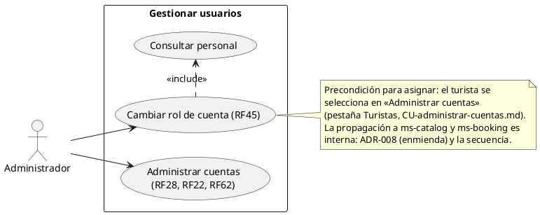
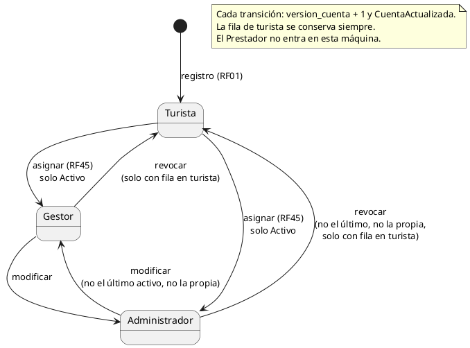
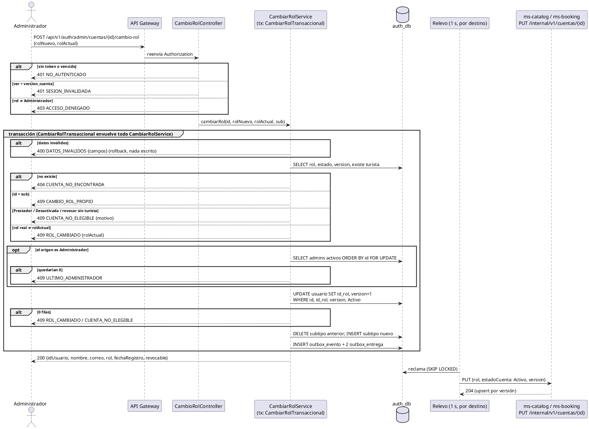
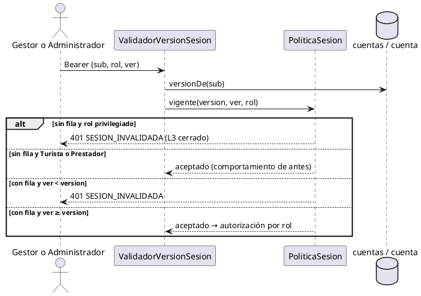

# Subsistema «Gestionar usuarios»: «Cambiar rol de cuenta»

Fase de Construcción (RUP). Caso de uso de la iteración B2 «Cambiar rol de cuenta» (DEC-82, DEC-83): RF45.
- **Pantalla:** WF-12 «Administrar cuentas», con la pestaña «Personal» y la acción «Asignar rol» en la pestaña «Turistas» ([wireframe](../wireframes/WF-12-administrar-cuentas.puml), propuesto por arquitectura y pendiente de validación del equipo). La implementa la sesión B.
- **Requisitos:** citados de `docs/srs/especificacion de requisitos.pdf`.
- **Decisiones:** en `docs/trazabilidad.md` («Cambiar rol de cuenta — decisiones», DEC-103 a DEC-114).
- **Mecanismo:** [ADR-008](../sad/adr/ADR-008-sincronizacion-estado-cuentas.md), sección «Enmienda RF45 (B2)».
- **Contrato HTTP:** en [`sad/api/ms-auth.md`](../sad/api/ms-auth.md), sección «Personal y cambio de rol (RF45)».
- **Nombre:** se conserva el nombre original del CU (Entregable 2 §1; DEC-59).

| Campo | Valor |
|---|---|
| **Casos de uso** | «Cambiar rol de cuenta», que incluye «Consultar personal» |
| **Actores** | Administrador |
| **Requisitos que traza** | RF45. Además RNF06 (control de acceso por roles) y RF15 (el rol nuevo llega con el siguiente inicio de sesión) |
| **Nivel** | Objetivo de usuario |
| **Alcance** | `ms-auth` (`auth_db`: `usuario`, `gestor`, `administrador`, `turista`, outbox). ms-catalog y ms-booking reciben el cambio por la proyección `cuentas` (ADR-008) |

## Reglas de negocio (citadas del SRS)

- **RF45:** «El sistema debe permitir al Administrador asignar, modificar o revocar el rol de "Gestor Turístico" o "Administrador" a cualquier cuenta de usuario registrada, habilitando o deshabilitando inmediatamente los menús y permisos correspondientes a dicho rol dentro de la plataforma.»
- **RNF06:** «El sistema debe implementar control de acceso basado en roles (Turista, Prestador, Gestor Turístico, Administrador), restringiendo el acceso a funcionalidades y datos según el rol asignado.»
- **RF15:** el inicio de sesión de todos los roles, con correo y contraseña.

Reglas que el SRS no fija y que decidió el equipo (`docs/trazabilidad.md`):
- **DEC-82:**
  - cambiar el rol actualiza `usuario.id_rol`, crea o borra la fila de `gestor` o `administrador`, sube `version_cuenta` y registra el evento `CuentaActualizada`, todo en una transacción;
  - solo son elegibles las cuentas cuyo rol base es Turista. **El Prestador queda fuera:** su validación, sus servicios y sus reservas dependen de ese rol. Es una diferencia con «a cualquier cuenta» de RF45 (DEC-113);
  - «Asignar» es pasar de Turista a Gestor o Administrador; «Modificar», pasar de Gestor a Administrador o al revés; «Revocar», volver a Turista;
  - un Administrador no cambia su propia cuenta, y siempre queda al menos un Administrador activo.
- **DEC-105:**
  - un turista Desactivado (RF62) no recibe un rol;
  - el estado de la cuenta no cambia al cambiar de rol, y la fila de `turista` se conserva siempre;
  - las cuentas sin fila en `turista` (las de la semilla) se modifican, pero no se revocan.
- **DEC-112:** mientras tiene el rol de Gestor o Administrador, la cuenta no usa sus reservas, favoritos ni historial (exigen el rol Turista). Los datos se conservan y vuelven al revocar.

## Diagrama de casos de uso

- ms-catalog y ms-booking no son actores de este modelo: son componentes internos del sistema. La propagación del cambio se describe en la enmienda de ADR-008 y en la secuencia.
- «Consultar personal» es una ampliación del modelo de casos de uso del Entregable 2 (subsistema «Gestionar usuarios»). Se registra en `docs/trazabilidad.md` (N15).

## Estados del rol de una cuenta

| Transición | `usuario` | Subtipos |
|---|---|---|
| Turista → Gestor | `id_rol` = Gestor, `version_cuenta + 1` | INSERT `gestor` |
| Turista → Administrador | `id_rol` = Administrador, `version_cuenta + 1` | INSERT `administrador` |
| Gestor → Administrador | `id_rol` = Administrador, `version_cuenta + 1` | DELETE `gestor`, INSERT `administrador` |
| Administrador → Gestor | `id_rol` = Gestor, `version_cuenta + 1` | DELETE `administrador`, INSERT `gestor` |
| Gestor o Administrador → Turista | `id_rol` = Turista, `version_cuenta + 1` | DELETE del subtipo; `turista` intacta |

## CU «Cambiar rol de cuenta» (RF45)

**Actor:** Administrador.

**Precondiciones:**
1. El Administrador inició sesión (RF15) y su token está vigente: firma, `iss`, `exp` y `ver` no menor que su `version_cuenta` (ms-auth compara con su propia tabla).
2. Para asignar, el Administrador eligió un turista Activo en la pestaña «Turistas» de «Administrar cuentas» (`GET /api/v1/auth/admin/turistas`).
3. Para modificar o revocar, el Administrador eligió una cuenta en la pestaña «Personal» (caso de uso incluido «Consultar personal»).

**Flujo básico (asignar un rol a un turista):**
1. En la pestaña «Turistas» de WF-12, el Administrador elige **Asignar rol** en un turista Activo y elige Gestor o Administrador.
2. El sistema muestra la confirmación con la advertencia de DEC-112: mientras tenga el rol, la cuenta pierde el acceso a sus reservas, favoritos e historial; los datos se conservan.
3. El Administrador confirma. El sistema envía `POST /api/v1/auth/admin/cuentas/{id}/cambio-rol` con `{rolNuevo, rolActual: "Turista"}`.
4. En una sola transacción, el sistema:
   1. valida los datos;
   2. lee la cuenta (rol, estado, versión y si tiene fila en `turista`) y aplica las reglas de DEC-82 y DEC-105;
   3. hace el UPDATE condicional de `id_rol` y `version_cuenta + 1`;
   4. crea la fila del subtipo nuevo;
   5. registra el evento `CuentaActualizada` (`rol` nuevo, `estadoCuenta: Activo`, `version` nueva) para ms-catalog y ms-booking.
5. El sistema responde 200 con la fila del personal: `{idUsuario, nombre, correo, rol, fechaRegistro, revocable}`.
6. El relevo de ms-auth entrega el evento a ms-catalog y ms-booking (ADR-008).
7. El token anterior de la cuenta recibe 401 `SESION_INVALIDADA` en los tres servicios. Al volver a iniciar sesión, el token trae el rol nuevo y la pantalla muestra los menús de ese rol: es la inmediatez de RF45.

**Caso de uso incluido «Consultar personal»:**
1. El Administrador abre la pestaña «Personal».
2. El sistema lista los Gestores y Administradores con `GET /api/v1/auth/admin/personal?rol=&q=&pagina=`, de 10 en 10 y por fecha de registro. Puede filtrar por rol y buscar por nombre o correo (hasta 100 caracteres).
3. Cada fila trae `revocable`: si la cuenta tiene fila en `turista`. Si no la tiene, la pantalla muestra «Revocar» deshabilitado.

**Flujos alternos:**
- **FA1. Modificar.** En «Personal», el Administrador elige **Cambiar rol** en un Gestor (o un Administrador) y elige Administrador (o Gestor). Sigue el flujo básico desde el paso 3, con `rolActual` = el rol de la fila. El sistema mueve la fila del subtipo.
- **FA2. Revocar.** En «Personal», el Administrador elige **Revocar**. Sigue el flujo básico desde el paso 3, con `rolNuevo: "Turista"`. El sistema borra la fila del subtipo, conserva la de `turista` y publica el evento con `rol: Turista`. La cuenta vuelve a la pestaña «Turistas» con sus reservas, favoritos e historial.
- **FA3. Datos inválidos.** `rolNuevo` o `rolActual` ausente, desconocido o `Prestador`, o `rolNuevo` igual a `rolActual` → 400 `DATOS_INVALIDOS`, con `campos.rolNuevo` o `campos.rolActual` = `REQUERIDO` o `NO_PERMITIDO`. Un cuerpo que no es JSON → 400 sin `campos`. No cambia nada.
- **FA4. La cuenta no existe.** 404 `CUENTA_NO_ENCONTRADA`.
- **FA5. La propia cuenta.** El id es el del Administrador que actúa (`sub`) → 409 `CAMBIO_ROL_PROPIO`. No cambia nada.
- **FA6. Un Prestador.** 409 `CUENTA_NO_ELEGIBLE` con `motivo: PRESTADOR` (DEC-82).
- **FA7. El rol ya cambió.** Otro Administrador cambió el rol antes, o la lista estaba desactualizada: el rol real no es `rolActual`, o la versión cambió mientras tanto → 409 `ROL_CAMBIADO` con `rolActual`. La pantalla avisa y recarga la lista (DEC-52).
- **FA8. Un turista Desactivado.** 409 `CUENTA_NO_ELEGIBLE` con `motivo: DESACTIVADA` (DEC-105). También si lo desactivaron mientras se pedía el cambio.
- **FA9. Revocar una cuenta sin fila en `turista`.** Las cuentas de la semilla → 409 `CUENTA_NO_ELEGIBLE` con `motivo: SIN_ROL_BASE`. Sí se pueden modificar (FA1).
- **FA10. El último Administrador activo.** Si el cambio quita a un Administrador y no queda otro Administrador activo → 409 `ULTIMO_ADMINISTRADOR`.
  - **Concurrencia (DEC-106):** si dos Administradores se degradan entre sí a la vez, el sistema bloquea las filas de los Administradores activos dentro de la transacción. El segundo cambio espera y, al continuar, ya no ve al primero como Administrador: recibe el 409. Si su petición llega después de que el primero confirmó, su token ya no vale y recibe 401 `SESION_INVALIDADA`. En los dos casos queda un Administrador activo.
- **FA11. Falla el registro del evento.** La transacción se revierte entera: no cambian ni el rol, ni los subtipos, ni la versión (500 `ERROR_INTERNO`).
- **FA12. Quien actúa no es Administrador.** Turista, Prestador o Gestor → 403 `ACCESO_DENEGADO` (RNF06). Sin token o con un token vencido → 401 `NO_AUTENTICADO`. Con `ver` viejo → 401 `SESION_INVALIDADA`.
- **FA13. Un servicio destino no responde.** El cambio ya está guardado y el evento queda pendiente en el outbox; el relevo reintenta (ADR-008). En ms-auth el token anterior ya no vale. Mientras el destino no recibe el evento:
  - el token anterior sigue valiendo en ese destino. El techo es el TTL del token: 15 minutos;
  - una cuenta que nunca tuvo fila en ese destino recibe 401 con su token nuevo de Gestor o Administrador (DEC-110, *fail-closed*).

**Postcondiciones:**
- **Éxito:**
  - la cuenta tiene el rol nuevo y la fila de su subtipo (ninguna, si volvió a Turista), y conserva la fila de `turista`;
  - `version_cuenta` subió en 1 y el evento `CuentaActualizada` quedó registrado para los dos destinos, en la misma transacción.
- **Cuando llega el evento:** ms-catalog y ms-booking tienen la fila de la cuenta con el rol y la versión nuevos, y un token con `ver` menor recibe 401.
- **Fallo:** no cambia nada.

## Criterios de aceptación derivados (RF45)

El SRS no define criterios de verificación por RF (hallazgo HC1); estos se derivan del enunciado:

| # | Criterio | Cómo se verifica |
|---|---|---|
| C1 | Asignar, modificar y revocar cambian el rol, mueven el subtipo, conservan `turista`, suben la versión y registran el evento, en una transacción | `CambioRolApiIntegracionTest`, `CambioRolJdbcAdapterTest`, `CambiarRolServiceTest` |
| C2 | «Inmediatamente»: el token anterior recibe 401 `SESION_INVALIDADA` y un inicio de sesión nuevo trae el rol nuevo | `CambioRolApiIntegracionTest` (ms-auth); `SesionVersionApiIntegracionTest`, `CuentaInternaApiIntegracionTest` (ms-catalog); `SesionVersionIntegracionTest`, `CuentaInternaApiIntegracionTest` (ms-booking) |
| C3 | El Prestador, el turista Desactivado y revocar sin fila en `turista` son 409 `CUENTA_NO_ELEGIBLE` | `CuentaConRolTest`, `CambioRolApiIntegracionTest` |
| C4 | El Administrador no cambia su propia cuenta | `CuentaConRolTest`, `CambioRolApiIntegracionTest` |
| C5 | Siempre queda al menos un Administrador activo, también con dos cambios simultáneos | `PoliticaAdministradoresTest`, `CambioRolApiIntegracionTest` |
| C6 | Un `rolActual` desactualizado es 409 `ROL_CAMBIADO` con el rol actual | `CuentaConRolTest`, `CambioRolApiIntegracionTest`, `CambioRolJdbcAdapterTest` |
| C7 | Si falla el evento, no queda el cambio | `CambioRolApiIntegracionTest` |
| C8 | Solo el Administrador (RNF06) | `CambioRolApiIntegracionTest` (401, 403) |
| C9 | Un Gestor o un Administrador sin fila en la proyección no tiene sesión en ms-catalog ni en ms-booking (L3 cerrado) | `PoliticaSesionTest`, `SesionVersionApiIntegracionTest`, `SesionVersionIntegracionTest` |

## Secuencia: Asignar rol

El orden de los errores es el de la implementación (DEC-104): datos (400), cuenta (404) y, sobre la cuenta leída, la propia cuenta, el Prestador, el rol esperado, el estado y el rol base (409). El último Administrador se comprueba al final, con las filas bloqueadas.

## Secuencia: Validar la sesión de un rol privilegiado (ms-catalog y ms-booking)

## Fuera de alcance de este CU

- **Cambiar el rol de un Prestador** (DEC-82; diferencia con el SRS, DEC-113).
- **Desactivar a un Gestor o a un Administrador:** RF62 solo aplica al turista, y la ruta de turistas responde 404 para el personal.
- **Notificar** a la cuenta del cambio de rol (RF13, RF30, RF63): ms-notificaciones.
- **Registro de auditoría** de los cambios de rol: el outbox guarda los eventos, pero no es un registro de auditoría (RF29 no aplica aquí).
- **Las pantallas** de WF-12 (pestaña «Personal», «Asignar rol», diálogos y mensajes): sesión B de la iteración.
