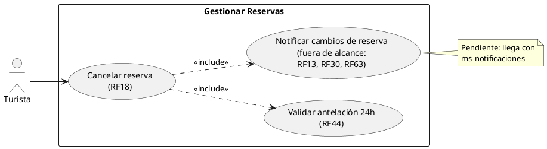
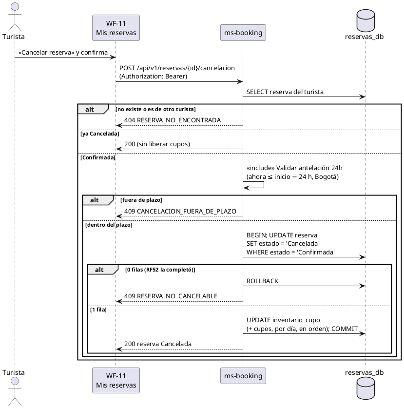

# Subsistema «Gestionar reservas»: «Cancelar reserva» e incluido «Validar antelación 24h»

Fase de Construcción (RUP). Especificación del CU que el prototipo implementa desde el PR #12 («Reservar servicio», D1 a D10) y que no tenía documento propio (HC1, **Hallazgo Crítico**). Se escribe en la iteración C, sesión B1 (DEC-172), a partir de lo implementado; **no cambia código**.
- **Pantallas:** WF-11 «Mis reservas» (`/mis-reservas`): «Cancelar reserva» en las reservas Confirmadas, con un diálogo de confirmación. WF-10 informa el plazo de cancelación antes de reservar y en la confirmación.
- **Requisitos:** citados de `docs/srs/especificacion de requisitos.pdf`.
- **Decisiones:** en `docs/trazabilidad.md` («Reservar servicio — decisiones», D1 a D10, en especial D3 y D9, y DEC-172).
- **Contrato HTTP:** en [`sad/api/ms-booking.md`](../sad/api/ms-booking.md) (`POST /api/v1/reservas/{idReserva}/cancelacion`); arquitectura en [ADR-007](../sad/adr/ADR-007-reservas-y-catalogo.md).
- **Nombre:** se conservan los nombres originales del modelo de casos de uso del Entregable 1, subsistema «Gestionar Reservas» (`DocumentoEntregable1.pdf`, página 9; DEC-59): «Cancelar reserva» «include» «Validar antelación 24h» y «Notificar cambios de reserva». El Entregable 2 (`DocumentoEntregable2.md`) no trae el diagrama de nivel 1 de este subsistema.

| Campo | Valor |
|---|---|
| **Casos de uso** | «Cancelar reserva»; incluido «Validar antelación 24h». El incluido «Notificar cambios de reserva» está fuera de alcance |
| **Actores** | Turista |
| **Requisitos que traza** | RF18 y RF44. Además RNF06 |
| **Relacionados** | RF52 (Confirmada → Completada, que hace la reserva no cancelable) y RF12 («Mis reservas», donde está la acción) |
| **Nivel** | Objetivo de usuario |
| **Alcance** | `ms-booking` (`reservas_db`: `reserva`, `reserva_cupo_dia`, `inventario_cupo`). No consulta `ms-catalog` (D4) |

## Reglas de negocio (citadas del SRS)

- **RF18:** «El sistema debe permitir al Turista cancelar una reserva que tenga el estado "Confirmada", cambiando automáticamente su estado a "Cancelada" y liberando de inmediato el cupo en la disponibilidad del servicio.»
- **RF44:** «Como condición adicional al proceso de cancelación descrito en el RF17, el sistema debe validar que la solicitud de cancelación de una reserva "Confirmada" se realice con una antelación mínima de 24 horas respecto a la fecha programada de la actividad. Si el Turista intenta cancelar dentro de ese plazo, el sistema debe bloquear la ejecución del cambio de estado a "Cancelada" descrito en el RF17 y mostrar un mensaje indicando que el tiempo límite para cancelar ha expirado.» La referencia a RF17 es una errata del SRS: el proceso de cancelación es RF18 (`docs/trazabilidad.md`, «Erratas del SRS»).
- **RF52:** «El sistema debe cambiar automáticamente el estado de una reserva de "Confirmada" a "Completada" una vez que la fecha y hora de la actividad hayan transcurrido.»
- **RNF06:** control de acceso basado en roles.

Reglas que el SRS no fija y que decidió el equipo (`docs/trazabilidad.md`):
- **D9:** la hora es la de Santa Marta (`America/Bogota`). La «fecha programada de la actividad» es el inicio: el check-in (15:00) en un alojamiento y la hora de la salida en un tour. El límite de 24 h **está incluido**: con exactamente 24 h se puede cancelar.
- **D9:** `cancelableHasta` (inicio − 24 h) lo calcula el servidor y viaja en todas las respuestas de una reserva; la pantalla no hace el cálculo.
- **D3:** los cupos vuelven a las mismas noches u horario con UPDATE condicionales, en una transacción.
- Cancelar una reserva ya Cancelada no es un error: responde la reserva y no devuelve cupos otra vez (idempotente).

## Diagrama de casos de uso

- ms-booking no es un actor: es el componente que implementa el CU.
- «Notificar cambios de reserva» se muestra porque está en el modelo del Entregable 1, pero no se implementa: las notificaciones están fuera del alcance de esta iteración.

## CU incluido «Validar antelación 24h» (RF44)

**Actor:** ninguno directo; lo incluye «Cancelar reserva».

**Precondiciones:** la reserva existe, es del Turista y está Confirmada.

**Flujo básico:**
1. El sistema toma la hora actual de Santa Marta (`RelojPort`).
2. El sistema calcula el inicio de la actividad: la fecha de entrada a las 15:00 (alojamiento) o la fecha y la hora de la salida (tour).
3. Si faltan 24 h o más (`ahora ≤ inicio − 24 h`), la validación se cumple y el CU base continúa.

**Flujo alterno:**
- **FA1. Fuera de plazo.** Faltan menos de 24 h: la validación falla, el CU base termina con 409 `CANCELACION_FUERA_DE_PLAZO` y el mensaje «el tiempo límite para cancelar ha expirado» (RF44). No cambia el estado ni se liberan cupos.

**Postcondiciones:** ninguna sobre los datos: solo decide si la cancelación sigue.

## CU «Cancelar reserva» (RF18)

**Actor:** Turista.

**Precondiciones:**
1. El Turista inició sesión con el rol Turista y el token está vigente (firma, `iss`, `exp` y `ver`).
2. La reserva es del Turista (`id_turista` = `sub` del token).

**Flujo básico:**
1. En WF-11 «Mis reservas», el Turista pulsa «Cancelar reserva» en una reserva Confirmada cuyo `cancelableHasta` no pasó.
2. El sistema muestra un diálogo de confirmación con la reserva y el plazo.
3. El Turista confirma. El sistema envía `POST /api/v1/reservas/{idReserva}/cancelacion`.
4. El sistema busca la reserva del Turista.
5. **«include» Validar antelación 24h** (RF44).
6. En una transacción, el sistema cambia el estado de `Confirmada` a `Cancelada` con un UPDATE condicional y devuelve los cupos a las mismas noches u horario (RF18, D3).
7. El sistema responde 200 con la reserva `Cancelada` y su `cancelableHasta`.
8. WF-11 actualiza la tarjeta y devuelve el foco a su título.

**Flujos alternos:**
- **FA1. Fuera de plazo (RF44).** Lo decide el CU incluido: 409 `CANCELACION_FUERA_DE_PLAZO`. En WF-11, pasado `cancelableHasta`, el botón ya aparece con `aria-disabled` y el motivo; si el plazo vence con el diálogo abierto, el 409 se muestra en el diálogo.
- **FA2. Ya cancelada.** La reserva ya estaba Cancelada: 200 con la reserva, sin devolver cupos otra vez (idempotente).
- **FA3. No es suya o no existe.** La reserva es de otro turista, no existe o el id no es un uuid: 404 `RESERVA_NO_ENCONTRADA`. No se revela si existe.
- **FA4. Ya completada (RF52).** La reserva está Completada, o RF52 la completa entre la lectura y el UPDATE: 409 `RESERVA_NO_CANCELABLE`. No se liberan cupos; WF-11 vuelve a consultar la lista.
- **FA5. Sin sesión u otro rol.** 401 `NO_AUTENTICADO` o `SESION_INVALIDADA` (la sesión se cierra y se va al login); 403 `ACCESO_DENEGADO` con otro rol.
- **FA6. Catálogo caído.** No afecta: cancelar no consulta ms-catalog (D4).

**Postcondiciones:**
- **Éxito:** la reserva está Cancelada y los cupos de cada día volvieron al inventario, una sola vez.
- **Fallo:** la reserva y el inventario no cambian.

## Criterios de aceptación derivados

| # | Criterio | Prueba |
|---|---|---|
| C1 | Cancelar devuelve los cupos; cancelar otra vez responde 200 y no los libera dos veces | `ReservaApiIntegracionTest.cancelarDevuelveLosCuposYCancelarOtraVezNoLiberaDosVeces`, `CancelarReservaServiceTest` |
| C2 | Con exactamente 24 h se cancela; un segundo después, 409 `CANCELACION_FUERA_DE_PLAZO` con el mensaje del tiempo límite | `ReservaApiIntegracionTest.rf44_conExactamente24HorasSeCancelaYUnSegundoDespuesNo`, `CancelarReservaServiceTest` |
| C3 | La reserva de otro turista (o un id que no es uuid) es 404 al consultar y al cancelar | `ReservaApiIntegracionTest.laReservaDeOtroTuristaNoExisteNiParaConsultarNiParaCancelar` |
| C4 | Una reserva Completada, también en carrera con RF52, es 409 `RESERVA_NO_CANCELABLE` y no libera cupos | `CancelarReservaServiceTest`, `ConcurrenciaIntegracionTest` |
| C5 | Con el catálogo caído, cancelar funciona | `ReservaApiIntegracionTest.conElCatalogoCaidoReservarResponde503PeroConsultarYCancelarFuncionan` |
| C6 | WF-11: el botón solo en las Confirmadas, `aria-disabled` pasado el plazo, el 409 en el diálogo y el foco al terminar | `misReservas.test.tsx` (frontend) |

## Secuencia

## Fuera de alcance

- «Notificar cambios de reserva» (RF13, RF30, RF63): llega con ms-notificaciones.
- RF12 del lado del prestador y RF19 (el prestador modifica fechas y cupos).
- Reembolsos y pagos: el prototipo no cobra.
