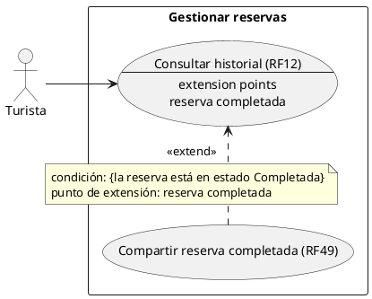

# Subsistema «Gestionar reservas»: «Compartir reserva completada»

Fase de Construcción (RUP). Caso de uso nuevo de la iteración B1 «Turista» (DEC-83): RF49. Cierra el Hallazgo Crítico **HC-B1** (RF49 no tenía un caso de uso).
- **Pantalla:** WF-11 «Mis reservas», con el botón «Compartir» en las reservas Completadas ([cambios](../wireframes/WF-05-06-11-cambios-turista.puml), propuestos por arquitectura y pendientes de validación del equipo).
- **Requisitos:** citados de `docs/srs/especificacion de requisitos.pdf`.
- **Decisiones:** en `docs/trazabilidad.md` («Turista (B1) — decisiones»).
- **Contrato HTTP:** ninguno nuevo. Usa `GET /api/v1/reservas/mias` ([`sad/api/ms-booking.md`](../sad/api/ms-booking.md)).
- **Nombres:** se conservan los originales del modelo de casos de uso (DEC-59).

| Campo | Valor |
|---|---|
| **Casos de uso** | «Compartir reserva completada», `«extend»` de «Consultar historial» |
| **Actores** | Turista |
| **Requisitos que traza** | RF49. El CU base, «Consultar historial», traza RF12 |
| **Nivel** | Objetivo de usuario |
| **Alcance** | **Solo el frontend** (DEC-81, sesión B). Sin endpoint nuevo y sin cambios en ms-booking |

## Reglas de negocio (citadas del SRS)

- **RF49:** «El sistema debe incluir un botón de "Compartir" en cada registro del historial de reservas "Completadas" del Turista, el cual generará un hipervínculo directo al detalle del servicio o atractivo para que el usuario pueda enviarlo a terceros mediante aplicaciones externas.»
- **RF12:** el turista consulta su historial de reservas (confirmada, cancelada o completada) filtrando por rango de fechas.

Reglas que el SRS no fija y que se decidieron (`docs/trazabilidad.md`):
- **DEC-81:**
  - el enlace es `/servicios/:idServicio` (la ficha pública WF-06), con el `idServicio` que trae cada reserva de `GET /api/v1/reservas/mias`;
  - se comparte con la Web Share API del navegador y, si no está disponible, se copia al portapapeles;
  - las reservas son solo de servicios (D1 de «Reservar servicio»), así que el «atractivo» del enunciado no aplica.
- **WF-06:** el ícono «Compartir» de la ficha **sigue deshabilitado**. RF49 solo traza el botón de las reservas Completadas de WF-11.
- **O1:** el CU base «Consultar historial» (RF12) no tiene un documento propio; en la matriz, WF-11 está trazado al CU «Reservar servicio». Aquí solo se describe su punto de extensión.

## Diagrama de casos de uso

## CU base «Consultar historial» (RF12): punto de extensión

**Punto de extensión «reserva completada»:** mientras WF-11 muestra la lista, en cada tarjeta cuyo `estado` es `Completada`. Una reserva pasa a Completada sola cuando termina su actividad (RF52).

## CU «Compartir reserva completada» (RF49), extiende «Consultar historial»

**Actor:** Turista. **Condición de extensión:** `{la reserva está en estado Completada}`.

**Precondiciones:**
1. El turista inició sesión y está en «Mis reservas» (WF-11).
2. La lista ya llegó de `GET /api/v1/reservas/mias`, con `idServicio`, `nombreServicio` y `estado` en cada reserva.

**Flujo:**
1. En una tarjeta Completada, el turista elige «Compartir».
2. El frontend arma el enlace absoluto a `/servicios/{idServicio}` con el origen de la aplicación. El título es `nombreServicio`.
3. Si el navegador tiene la Web Share API, el frontend abre la hoja de compartir del sistema; el turista elige la aplicación externa.
4. El caso de uso vuelve a la lista de «Mis reservas».

**Flujos alternos:**
- **FA1. Sin Web Share API.** El frontend copia el enlace al portapapeles y avisa «Enlace copiado» en una región `aria-live`.
- **FA2. No se puede copiar.** El frontend muestra el enlace seleccionable para copiarlo a mano.
- **FA3. El turista cancela la hoja de compartir.** No pasa nada; no es un error.
- **FA4. El servicio ya no está visible.** El enlace abre WF-06, que responde «no disponible» (404 `OFERTA_NO_DISPONIBLE`). El botón no consulta el catálogo antes, porque «Mis reservas» no llama a ms-catalog (D4 de «Reservar servicio»).
- **FA5. Reserva Confirmada o Cancelada.** No tiene el botón.

**Postcondición:** ninguna en el sistema; no se guarda nada.

## Criterios de aceptación derivados (RF49)

| # | Criterio | Cómo se verifica |
|---|---|---|
| C1 | Solo las reservas Completadas tienen «Compartir» | Sesión B (pruebas del frontend) |
| C2 | El enlace es `/servicios/:idServicio` de la reserva | Sesión B |
| C3 | Sin Web Share API, se copia al portapapeles y se avisa | Sesión B |
| C4 | `GET /mias` trae `idServicio` y el estado `Completada` | Ya cubierto en ms-booking (`RespuestaReserva`, `EstadoReserva`) |

## Fuera de alcance de este CU

- **Un endpoint para compartir** o un enlace con token: el detalle es público (DEC-81).
- **Compartir desde la ficha WF-06** (el ícono sigue deshabilitado) y desde el Asistente IA (WF-07).
- **El código:** lo implementa la sesión B de la iteración.
