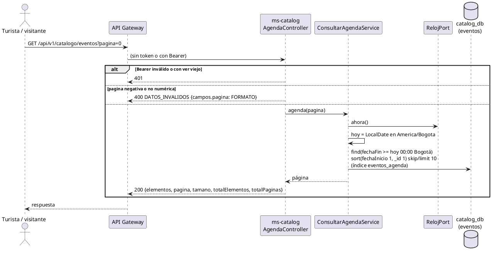

# Subsistema «Agenda de eventos»: «Consultar agenda de eventos»

Fase de Construcción (RUP). Caso de uso de la iteración E «Atractivos y agenda», sesión A2 (DEC-54, DEC-213): RF25 (parte del Turista). Cierra HC-E1 para RF25.
- **Pantallas:** sin wireframe todavía; la agenda la propondrá arquitectura en la sesión B2. Esta sesión deja el backend y el contrato.
- **Requisitos:** citados de `docs/srs/especificacion de requisitos.pdf`.
- **Fuente del modelo:** DocumentoEntregable2.md (documento del Proyecto, fuera del repositorio): §2.1 (el Turista «visualiza» `EventoTuristico`) y §2.4 (colección `eventos`).
- **Decisiones:** DEC-215 y DEC-239 en `docs/trazabilidad.md`.
- **Contrato HTTP:** en [`sad/api/ms-catalog.md`](../sad/api/ms-catalog.md), sección «Agenda de eventos (pública)».

| Campo | Valor |
|---|---|
| **Caso de uso** | «Consultar agenda de eventos» |
| **Actores** | Turista; visitante sin sesión |
| **Requisitos que traza** | RF25 |
| **Nivel** | Objetivo de usuario |
| **Alcance** | `ms-catalog` (`catalog_db.eventos`) |

## Reglas de negocio (citadas del SRS)

- **RF25:** «[…] publicándolos automáticamente en la sección de "Agenda de eventos" visible para el Turista.»

Reglas que el SRS no fija y que decidió el equipo (`docs/trazabilidad.md`):
- **DEC-215:** la agenda muestra los eventos con `fechaFin` igual o posterior a hoy en America/Bogota, por `fechaInicio` ascendente, de 10 en 10.
- **DEC-239:** la agenda es pública, sin token, como las preguntas frecuentes y los avisos. No expone `gestorId` ni `fechaRegistro`.

El diagrama de casos de uso está en [CU-registrar-evento-agenda.md](CU-registrar-evento-agenda.md).

## CU «Consultar agenda de eventos»

**Actor:** Turista (o visitante sin sesión).

**Precondiciones:** ninguna. Si llega un token, debe ser válido.

**Flujo básico:**
1. El Turista abre la sección «Agenda de eventos».
2. El sistema envía `GET /api/v1/catalogo/eventos?pagina=0`.
3. ms-catalog calcula «hoy» en Bogotá con `RelojPort` y busca los eventos con `fechaFin` igual o posterior a hoy.
4. El sistema responde 200 con la página: `{elementos, pagina, tamano, totalElementos, totalPaginas}`. Cada evento lleva `{id, nombre, fechaInicio, fechaFin, ubicacion, descripcion}`, del que empieza antes al que empieza después.

**Flujos alternos:**
- **FA1. Sin eventos vigentes.** 200 con `elementos` vacío y `totalElementos: 0`.
- **FA2. Página fuera de rango.** 200 con `elementos` vacío y el total real.
- **FA3. Página inválida.** Negativa o que no es un número → 400 `DATOS_INVALIDOS` con `campos.pagina = FORMATO`.
- **FA4. Token inválido.** Un Bearer vencido, mal firmado o con un `ver` viejo → 401, como en todo endpoint público.

**Postcondiciones:** ninguna; el CU no escribe.

## Criterios de aceptación derivados

| # | Criterio | Prueba |
|---|---|---|
| C1 | Sin token, la agenda trae solo los eventos vigentes, por `fechaInicio` ascendente, sin `gestorId` ni `fechaRegistro` | `AgendaApiIntegracionTest`, `ConsultarAgendaServiceTest` |
| C2 | Un evento que termina hoy sigue a las 23:59:59 de Bogotá y sale a las 00:00 del día siguiente | `AgendaApiIntegracionTest`, `ConsultarAgendaServiceTest` |
| C3 | Páginas de 10; página inválida → 400; Bearer inválido → 401 | `AgendaApiIntegracionTest` |

## Secuencia

## Fuera de alcance

- Filtros de la agenda (por fecha o por texto): RF25 no los pide.
- El detalle de un evento en su propia ficha.
- Las pantallas (sesión B2).
