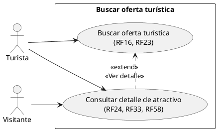
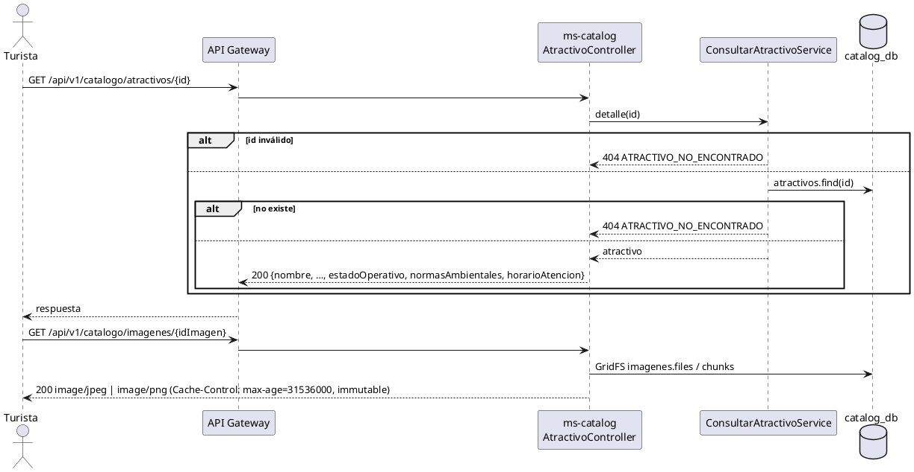

# Subsistema «Buscar oferta turística»: «Consultar detalle de atractivo»

Fase de Construcción (RUP). Caso de uso de la iteración E «Atractivos y agenda», sesión A1 (DEC-54, DEC-87, DEC-213): la ficha pública de un atractivo, donde el Turista lee lo que registró el Gestor (RF06, RF07, RF24, RF27, RF33, RF58). Cierra el pendiente «Ver detalle de los atractivos» (WF-04, WF-05, WF-17).
- **Pantallas:** WF-06 «Detalle de lugar o servicio», en su versión para atractivos (ruta `/atractivos/:id`, sesión B1). El enlace «Ver detalle» de las tarjetas, del mapa y de «Mis favoritos» deja de estar deshabilitado en B1.
- **Requisitos:** citados de `docs/srs/especificacion de requisitos.pdf`.
- **Decisiones:** en `docs/trazabilidad.md` (DEC-87, DEC-217).
- **Contrato HTTP:** en [`sad/api/ms-catalog.md`](../sad/api/ms-catalog.md), secciones «Detalle público de un atractivo» e «Imágenes».

| Campo | Valor |
|---|---|
| **Caso de uso** | «Consultar detalle de atractivo» |
| **Actores** | Turista (y cualquier visitante sin sesión) |
| **Requisitos que traza** | RF24 y RF33 («visible en la ficha»), RF58 («visible en la ficha de detalle»), RF06, RF07, RF27 (lectura); RF23 (las imágenes) |
| **Nivel** | Objetivo de usuario |
| **Alcance** | `ms-catalog` (`catalog_db.atractivos` y GridFS `imagenes`) |

## Reglas de negocio (citadas del SRS)

- **RF24:** las «Normas Ambientales» se renderizan «de forma estática y visible en la página de detalles del atractivo para que el Turista lo lea antes de visitarlo».
- **RF33:** el estado operativo se muestra «de forma visible en la ficha del atractivo para los Turistas».
- **RF58:** los días y horarios de atención son «un campo de texto visible en la ficha de detalle para el Turista».

Reglas que el SRS no fija y que decidió el equipo (`docs/trazabilidad.md`):
- **DEC-87:** un atractivo es visible mientras exista: no tiene estado de publicación ni dueño que lo oculte.
- **DEC-217:** `GET /api/v1/catalogo/atractivos/{id}` es público, sin token, y no expone el Gestor ni la versión. Un id que no es un ObjectId o que no existe es el mismo 404 `ATRACTIVO_NO_ENCONTRADO`.
- **DEC-209:** las imágenes se sirven en `GET /api/v1/catalogo/imagenes/{id}`, públicas, con el tipo detectado por su firma y en caché un año (no cambian).

## Diagrama de casos de uso

## CU «Consultar detalle de atractivo»

**Actor:** Turista o visitante sin sesión.

**Precondiciones:** ninguna (público). Un Bearer que llegue se valida igual (como en los demás endpoints públicos).

**Flujo básico:**
1. El Turista elige «Ver detalle» en un atractivo de la búsqueda, del mapa o de «Mis favoritos».
2. El sistema envía `GET /api/v1/catalogo/atractivos/{id}`.
3. ms-catalog devuelve el nombre, la categoría, la descripción, las coordenadas, las imágenes, la capacidad de carga, el estado operativo, las normas ambientales, el horario de atención y las condiciones de accesibilidad (en el orden de RF27).
4. El sistema muestra la ficha; cada imagen se pide a su ruta (`/api/v1/catalogo/imagenes/{id}` o, en la semilla, `/imagenes/catalogo/*.webp`).

**Flujos alternos:**
- **FA1. Atractivo inexistente o id inválido.** 404 `ATRACTIVO_NO_ENCONTRADO`.
- **FA2. Atractivo cerrado o en mantenimiento.** Se muestra igual, con su estado (decisión 5 de la búsqueda).
- **FA3. Sin normas o sin horario.** El campo llega en `null`; la pantalla muestra la región deshabilitada.
- **FA4. Imagen inexistente.** 404 `IMAGEN_NO_ENCONTRADA`; la pantalla usa la ilustración de la categoría.

**Postcondiciones:** ninguna (solo lectura).

## Criterios de aceptación derivados

| # | Criterio | Prueba |
|---|---|---|
| C1 | La ficha trae los datos de RF06, RF07, RF24, RF27 y RF33, sin el Gestor ni la versión | `DetalleAtractivoApiIntegracionTest` |
| C2 | Un atractivo en mantenimiento también se ve | `DetalleAtractivoApiIntegracionTest`, `ConsultarAtractivoServiceTest` |
| C3 | Id inválido, inexistente o de un servicio → 404 `ATRACTIVO_NO_ENCONTRADO` | `DetalleAtractivoApiIntegracionTest` |
| C4 | Una imagen se sirve con su tipo y en caché; una inexistente o ajena es 404 | `ImagenApiIntegracionTest` |
| C5 | No pide token | `AccesoGestorApiIntegracionTest` |

## Secuencia

## Fuera de alcance

- Afluencia en vivo (RF39) y rutas alternativas (RF08): descartados (DEC-54).
- Calificaciones y comentarios (RF17).
- Eventos de la agenda en la ficha (RF25 es de la sesión A2 y su agenda es una sección propia).
