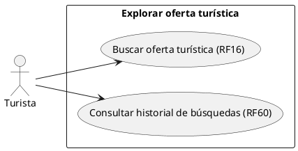
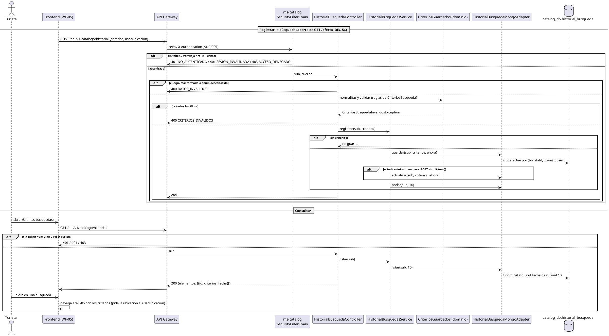

# Subsistema «Explorar oferta turística»: «Consultar historial de búsquedas»

Fase de Construcción (RUP). Caso de uso de la iteración B1 «Turista» (DEC-83): RF60.
- **Pantalla:** «Últimas búsquedas» en WF-05 ([cambios](../wireframes/WF-05-06-11-cambios-turista.puml), propuestos por arquitectura y pendientes de validación del equipo).
- **Requisitos:** citados de `docs/srs/especificacion de requisitos.pdf`.
- **Decisiones:** en `docs/trazabilidad.md` («Turista (B1) — decisiones»).
- **Contrato HTTP:** en [`sad/api/ms-catalog.md`](../sad/api/ms-catalog.md), sección «Historial de búsquedas».
- **Nombres:** se conservan los originales del modelo de casos de uso (DEC-59).

| Campo | Valor |
|---|---|
| **Casos de uso** | «Consultar historial de búsquedas» |
| **Actores** | Turista |
| **Requisitos que traza** | RF60. Además RF16, RF38, RF50 y RF61 (los criterios que se guardan) y RNF06 (solo el rol Turista) |
| **Nivel** | Objetivo de usuario |
| **Alcance** | `ms-catalog` (`catalog_db`, colección `historial_busqueda`). La pantalla la implementa la sesión B |

## Reglas de negocio (citadas del SRS)

- **RF60:** «El sistema debe mostrar al Turista un historial de sus últimas 10 búsquedas realizadas, permitiéndole repetir cualquiera de ellas con un solo clic.»
- **RF38:** «El sistema debe calcular y mostrar al Turista la distancia aproximada en línea recta entre su ubicación actual (si la comparte) y cada atractivo o servicio listado en los resultados de búsqueda.»
- **RNF06:** control de acceso basado en roles.

Reglas que el SRS no fija y que se decidieron (`docs/trazabilidad.md`):
- **DEC-56:**
  - el historial se guarda con `POST` y `GET /api/v1/catalogo/historial`, autenticados, en la colección `historial_busqueda`;
  - es una llamada aparte de la búsqueda pública, que sigue sin token (DEC-47).
- **DEC-88:**
  - **Qué se guarda:** los mismos criterios de `GET /oferta`, normalizados, sin página ni coordenadas.
    - Por RF38 la ubicación del turista no se guarda: es un dato personal y cambia. Solo se guarda si la búsqueda la usó (`usarUbicacion`); al repetirla, el frontend la vuelve a pedir.
    - El orden por sí solo no es un criterio: una búsqueda sin filtros no se guarda.
  - **Duplicados:** la misma combinación (el texto sin distinguir mayúsculas ni espacios) actualiza la fecha y sube al primer lugar.
  - **Tope:** se conservan las 10 más recientes y lo demás se poda al escribir.
  - **Respuestas:** `POST` responde siempre 204. Un criterio inválido es el mismo 400 `CRITERIOS_INVALIDOS` de la búsqueda; es una excepción explícita a la regla «`DATOS_INVALIDOS` con `campos`».

## Diagrama de casos de uso

«Buscar oferta turística» ya está implementado (WF-04, WF-05); este CU solo agrega el registro de cada búsqueda y su consulta.

## CU «Consultar historial de búsquedas» (RF60)

**Actor:** Turista.

**Precondiciones:**
1. El turista inició sesión (RF15).
2. Su token está vigente (ADR-008).

**Flujo básico:**
1. El turista busca en WF-05. Después de la búsqueda pública, el frontend registra los criterios con `POST /api/v1/catalogo/historial`, sin esperar la respuesta.
2. El sistema normaliza y valida los criterios con las reglas de la búsqueda y guarda o actualiza el registro con `fecha` = ahora. Poda lo que pase de 10 y responde 204.
3. El turista abre «Últimas búsquedas» en WF-05.
4. El sistema pide `GET /api/v1/catalogo/historial` y responde como máximo 10, la más reciente primero, con sus criterios.
5. El turista elige una búsqueda con un clic. El frontend navega a WF-05 con esos criterios en la URL y repite la búsqueda. Si la búsqueda usaba la ubicación, la vuelve a pedir.

**Flujos alternos:**
- **FA1. La misma búsqueda otra vez.** No se crea otro registro; sube al primer lugar con la fecha nueva. Si dos `POST` iguales llegan a la vez, el índice único rechaza uno, que se reintenta como actualización; si tampoco cambia nada, igual responde 204.
- **FA2. La búsqueda número 11.** Se borra la más antigua.
- **FA3. Sin criterios.** Solo el orden, o nada: no se guarda y responde 204.
- **FA4. Criterios inválidos.** Una distancia sin `usarUbicacion`, un precio negativo o un filtro sin su categoría → 400 `CRITERIOS_INVALIDOS`, como `/oferta`. Un cuerpo mal formado o un valor desconocido de un enum → 400 `DATOS_INVALIDOS`.
- **FA5. Historial vacío.** `elementos` llega vacío y la sección no se muestra.
- **FA6. El turista repite la búsqueda sin compartir la ubicación.** El frontend hace la búsqueda sin la distancia y sin ordenar por distancia (RF38: solo «si la comparte»).
- **FA7. Quien actúa no es Turista.** Prestador, Gestor o Administrador → 403 `ACCESO_DENEGADO`. Sin token → 401 `NO_AUTENTICADO`. Con `ver` viejo → 401 `SESION_INVALIDADA`. Un visitante sin sesión busca igual, sin historial.

**Postcondiciones:**
- **Éxito:** el turista tiene como máximo 10 búsquedas, sin duplicados, en `historial_busqueda`.
- **Fallo:** no cambia nada. La búsqueda pública ya se hizo de todos modos.

## Criterios de aceptación derivados (RF60)

| # | Criterio | Cómo se verifica |
|---|---|---|
| C1 | `POST` guarda los criterios normalizados, sin coordenadas ni página | `HistorialBusquedaApiIntegracionTest`, `CriteriosGuardadosTest` |
| C2 | Los mismos criterios no se duplican y suben al primer lugar | `HistorialBusquedaApiIntegracionTest`, `HistorialBusquedasServiceTest` |
| C3 | La búsqueda 11 poda la más antigua; `GET` devuelve como máximo 10, en orden | `HistorialBusquedaApiIntegracionTest`, `HistorialBusquedasServiceTest` |
| C4 | Un turista no ve el historial de otro | `HistorialBusquedaApiIntegracionTest`, `HistorialBusquedasServiceTest` |
| C5 | Dos `POST` simultáneos dejan un solo registro y nunca dan 500 | `HistorialBusquedaApiIntegracionTest`, `HistorialBusquedasServiceTest` |
| C6 | Repetir con un clic | Sesión B (pruebas del frontend) |
| C7 | Solo el Turista (RNF06) | `HistorialBusquedaApiIntegracionTest` (401, 403, `SESION_INVALIDADA`) |

## Secuencia: Registrar y consultar el historial

El historial no tiene recursos por id, así que no hay 404.

## Fuera de alcance de este CU

- **Borrar el historial** o una búsqueda: RF60 no lo pide.
- **Guardar la búsqueda dentro de `GET /oferta`:** la búsqueda pública no cambia (DEC-56).
- **La pantalla:** la implementa la sesión B de la iteración.
