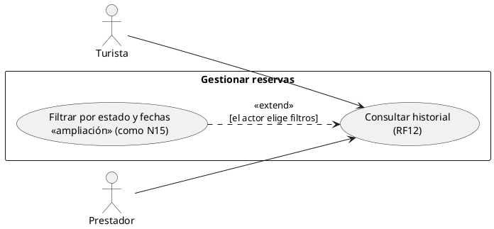
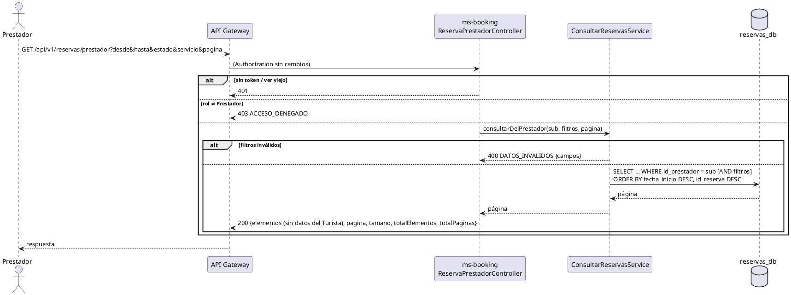

# Subsistema «Gestionar reservas»: «Consultar historial»

Fase de Construcción (RUP). Caso de uso de la iteración D «Oferta del prestador» (DEC-54): RF12, del lado del Turista (ya implementado, PR #13) y del lado del Prestador (DEC-34). Cierra HC1 y O1 para RF12.
- **Pantallas:** WF-11 «Mis reservas» (`/mis-reservas`, Turista; pendiente de diseño). La pantalla del Prestador es de la sesión B (frontend), sin wireframe todavía.
- **Requisitos:** citados de `docs/srs/especificacion de requisitos.pdf`.
- **Decisiones:** en `docs/trazabilidad.md` («Oferta del prestador — decisiones», DEC-183 a DEC-195).
- **Contrato HTTP:** en [`sad/api/ms-booking.md`](../sad/api/ms-booking.md) (`GET /reservas/mias` y `GET /reservas/prestador`).
- **Nombre:** se conserva el nombre original del CU, «Consultar historial» (Entregable 1, p. 9, «Gestionar reservas»; DEC-59).

| Campo | Valor |
|---|---|
| **Caso de uso** | «Consultar historial», con la extensión «Filtrar por estado y fechas» |
| **Actores** | Turista, Prestador |
| **Requisitos que traza** | RF12; RF52 (estado Completada); RNF06 |
| **Nivel** | Objetivo de usuario |
| **Alcance** | `ms-booking` (`reservas_db.reserva`). No llama al catálogo: responde con lo guardado (RF32) |

## Reglas de negocio (citadas del SRS)

- **RF12:** «El sistema debe registrar un historial detallado de reservas, permitiendo a turistas y prestadores consultar el estado (confirmada, cancelada o completada) filtrando por rango de fechas.»
- **RF52:** una reserva Confirmada pasa a Completada al terminar la actividad.
- **RNF06:** control de acceso basado en roles.

Reglas que el SRS no fija y que decidió el equipo (`docs/trazabilidad.md`):
- **Rango de fechas:** por la fecha de la **actividad**, en `America/Bogota`, inclusivo; una reserva aparece si su actividad cruza el rango (`fecha_inicio < (hasta + 1 día) 00:00` y `fecha_fin > desde 00:00`). Máximo 366 días. Cada extremo es opcional (PR #13).
- **DEC-191:** el Prestador ve las reservas con su `id_prestador`, que ms-booking copia del catálogo al reservar (V1). V6 agrega el índice `(id_prestador, fecha_inicio DESC, id_reserva DESC)`.
- **DEC-192:** el Prestador filtra además por servicio. **Sin datos personales del Turista** (Ley 1581; RF42 descartado) y sin `cancelableHasta`. Páginas de 20, como el Turista.

## Diagrama de casos de uso

- «Filtrar por estado y fechas» es una **ampliación del modelo de casos de uso del Entregable 1**, como N15: el texto de RF12 («filtrando por rango de fechas») la traza.
- ms-booking no es un actor: es un componente interno.

## CU «Consultar historial» (RF12)

**Actores:** Turista y Prestador.

**Precondiciones:**
1. El actor tiene sesión iniciada con su rol, Turista o Prestador (RF15). El token está vigente (firma, `iss`, `exp` y `ver`).

**Flujo básico (Turista):**
1. El Turista abre «Mis reservas» (WF-11).
2. El sistema consulta `GET /api/v1/reservas/mias` y muestra sus reservas, de la actividad que empieza más tarde a la que empieza más temprano, en páginas de 20: servicio, unidad, fechas, cantidad, precio guardado, estado y `cancelableHasta`.

**Flujo básico (Prestador):**
1. El Prestador abre el historial de reservas de sus servicios.
2. El sistema consulta `GET /api/v1/reservas/prestador` y muestra las reservas cuyo `id_prestador` es el suyo, con el mismo orden y tamaño de página: servicio, unidad, fechas, cantidad, personas, precio guardado y estado. No muestra quién reservó.

**Extensión «Filtrar por estado y fechas»:**
1. El actor elige un rango (`desde`, `hasta`), uno o varios estados (`Confirmada`, `Cancelada`, `Completada`) y, si es Prestador, un servicio.
2. El sistema vuelve a consultar con esos parámetros y muestra solo las reservas que cumplen todos los filtros.

**Flujos alternos:**
- **FA1. Filtros inválidos.** Fecha sin formato (`FORMATO`), `hasta` anterior a `desde` (`RANGO_INVALIDO`), más de 366 días (`MAXIMO_DIAS`), estado fuera del vocabulario (`NO_PERMITIDO`), `servicio` que no es un ObjectId (`FORMATO`) o página negativa → 400 `DATOS_INVALIDOS` con `campos`.
- **FA2. Sin reservas.** 200 con la lista vacía.
- **FA3. Servicio de otro prestador en el filtro.** 200 con la lista vacía: no hay reservas suyas de ese servicio.
- **FA4. Otro rol.** El Prestador en `/mias` o el Turista en `/prestador` → 403 `ACCESO_DENEGADO`. Sin sesión → 401.

**Postcondiciones:** ninguna; el CU no cambia datos.

## Criterios de aceptación derivados

| # | Criterio | Prueba |
|---|---|---|
| C1 | El Prestador ve solo las reservas de sus servicios, sin datos del Turista | `ReservasPrestadorIntegracionTest`, `ConsultarReservasPrestadorServiceTest` |
| C2 | Filtros por estado, por rango de la actividad y por servicio | `ReservasPrestadorIntegracionTest`, `FiltroReservasTest` |
| C3 | Límites del rango (366 días, `hasta` anterior) y servicio inválido | `ReservasPrestadorIntegracionTest`, `FiltroReservasTest` |
| C4 | Páginas de 20, de la actividad más tardía a la más temprana | `ReservasPrestadorIntegracionTest`, `ConsultarReservasPrestadorServiceTest` |
| C5 | Otro rol → 403; sin token → 401 | `ReservasPrestadorIntegracionTest` |
| C6 | El lado del Turista no cambia | `MisReservasIntegracionTest`, `FiltroReservasTest` |
| C7 | V6 crea el índice del historial del Prestador | `ReservasPrestadorIntegracionTest` |

## Secuencia (Prestador)

## Fuera de alcance

- Datos personales del Turista para el Prestador (RF42, descartado; Ley 1581).
- Que el Prestador cancele o modifique una reserva.
- Exportar el historial.
- Las pantallas del Prestador (sesión B).
