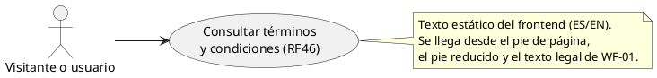

# CU «Consultar términos y condiciones»

Fase de Construcción (RUP). Caso de uso de la iteración «Contenido público»: RF46.
- **Pantalla:** WF-15 ([wireframe](../wireframes/WF-15-terminos.puml), propuesto por arquitectura y pendiente de validación del equipo).
- **Requisitos:** citados de `docs/srs/especificacion de requisitos.pdf`.
- **Decisiones:** en `docs/trazabilidad.md` («Contenido público — decisiones»).
- **Por qué es nuevo:** RF46 no tenía caso de uso en el modelo de los entregables (hallazgo HC-A). Este CU lo agrega con un nombre nuevo; los nombres originales de los demás CU se conservan (DEC-59).

| Campo | Valor |
|---|---|
| **Nombre** | Consultar términos y condiciones |
| **Actor principal** | Cualquier visitante o usuario |
| **Requisitos que traza** | RF46. Además RF03 y RNF08 (el texto es de la interfaz: va en ES y EN) |
| **Nivel** | Objetivo de usuario |
| **Alcance** | Solo el frontend: texto estático, sin backend ni endpoint. La página WF-15 la implementa la sesión B |

## Reglas de negocio (citadas del SRS)

- **RF46:** «El sistema debe incluir una sección estática de acceso público y permanente que muestre los términos, condiciones y políticas de uso de la plataforma, permitiendo a cualquier visitante o usuario consultarla en formato de texto desde el pie de página de la interfaz.»
- **RNF08:** «La interfaz de usuario debe estar disponible en español e inglés, permitiendo al usuario cambiar de idioma sin perder el estado de su sesión ni los datos en pantalla.»

Reglas que el SRS no fija y que se decidieron (`docs/trazabilidad.md`):

**DEC-68:** índice del texto. Es un texto del prototipo académico, no un documento legal vigente. Sus secciones:
1. Objeto y aceptación.
2. Uso permitido y prohibido.
3. Cuentas y roles: Turista; Prestador (validación, RF02 y RF28); Gestor; Administrador. Desactivación (RF62) e inactivación (RF22).
4. Datos personales (Ley 1581 de 2012). Lleva un ancla: es el destino de «Políticas de privacidad».
5. Reservas y cancelaciones: hasta 24 h antes del inicio, límite incluido (RF44); paso automático a Completada (RF52).
6. Contenido de terceros e imágenes de referencia.
7. Avisos y preguntas frecuentes.
8. Contacto.
9. Cambios a los términos.

El texto final en ES y EN lo redacta la sesión B.

## Diagrama de casos de uso

## Precondiciones

Ninguna: la sección es pública y permanente; no hace falta iniciar sesión.

## Flujo básico

1. El visitante elige «Términos y condiciones» en el pie de página (columna «Legal y Soporte»).
2. El sistema muestra la página WF-15 en el idioma activo: título, nota de prototipo académico, índice y secciones.
3. El visitante elige una sección del índice y el sistema lo lleva a ella.

## Flujos alternos

- **FA1. Desde las pantallas de acceso.** El enlace «Términos y condiciones» del pie reducido (WF-01 a WF-03) o el texto legal de WF-01 llevan a la misma página.
- **FA2. Políticas de privacidad.** Llevan directamente a la sección 4, «Datos personales» (DEC-68):
  - «Políticas de privacidad» del pie y del pie reducido;
  - la casilla «Política de Privacidad» del registro (WF-02 y WF-03).

  Esto cierra el pendiente de `RUTA_POLITICA_PRIVACIDAD`.
- **FA3. Cambiar de idioma.** El visitante cambia ES / EN en el encabezado; el texto cambia sin perder la posición ni la sesión (RNF08).

## Postcondiciones

Ninguna: es una consulta, sin cambios en el sistema.

## Criterios de aceptación derivados (RF46)

| # | Criterio | Cómo se verifica |
|---|---|---|
| C1 | Se llega desde el pie de página, sin iniciar sesión | Sesión B (pruebas del frontend) |
| C2 | Es texto (no un archivo para descargar), en ES y EN | Sesión B |
| C3 | «Políticas de privacidad» lleva a la sección 4 | Sesión B |

## Fuera de alcance de este CU

- **Editar los términos** desde la plataforma: RF46 pide una sección estática.
- **Registrar la aceptación** de los términos: el registro ya guarda la aceptación de la política de privacidad (D6 de «Registrarse»).
- **La página WF-15 y el texto final:** los hace la sesión B de la iteración.
