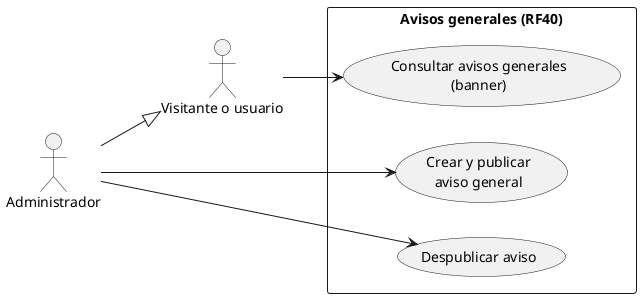
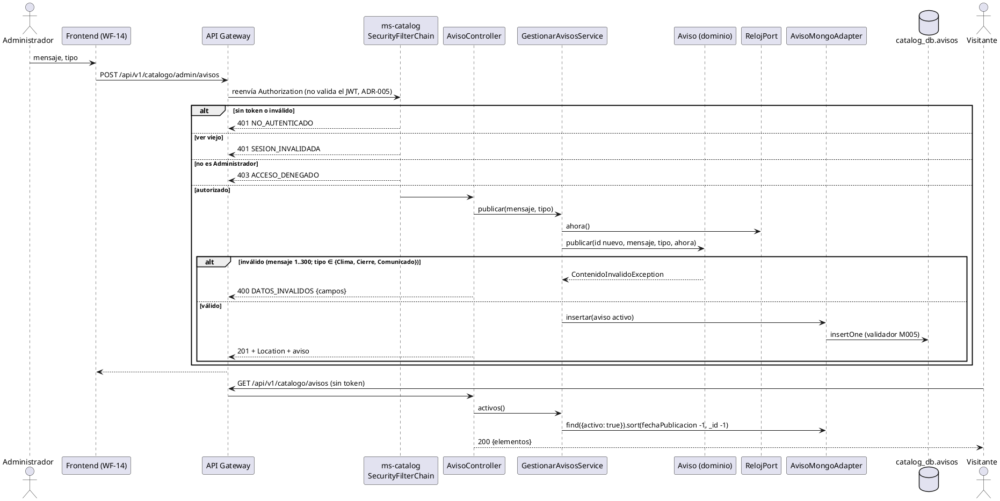
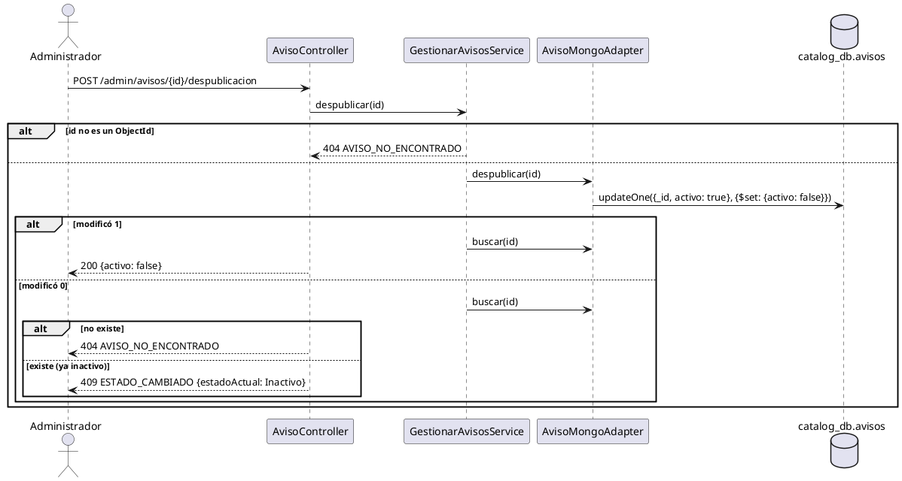

# CU «Crear y publicar aviso general»

Fase de Construcción (RUP). Caso de uso de la iteración «Contenido público»: RF40.
- **Pantalla:** WF-14 ([wireframe](../wireframes/WF-14-avisos.puml), propuesto por arquitectura y pendiente de validación del equipo).
- **CU secundario:** «Consultar avisos generales», el banner.
- **Requisitos:** citados de `docs/srs/especificacion de requisitos.pdf`.
- **Decisiones:** en `docs/trazabilidad.md` («Contenido público — decisiones»).
- **Contrato HTTP:** en [`sad/api/ms-catalog.md`](../sad/api/ms-catalog.md).
- **Nombre:** se conserva el original del modelo de casos de uso (DEC-59).

| Campo | Valor |
|---|---|
| **Nombre** | Crear y publicar aviso general |
| **Actor principal** | Administrador |
| **CU secundario** | «Consultar avisos generales»: actor, cualquier visitante o usuario |
| **Requisitos que traza** | RF40. Además RNF06 (rol Administrador) y RF03 y RNF08 (la interfaz en ES y EN; el mensaje, en un solo idioma, DEC-69) |
| **Nivel** | Objetivo de usuario |
| **Alcance** | `ms-catalog` (`catalog_db`, colección `avisos`). La gestión (WF-14) y el banner los implementa la sesión B |

## Reglas de negocio (citadas del SRS)

- **RF40:** «El sistema debe permitir al Administrador redactar y publicar avisos generales (alertas de clima, cierres temporales o comunicados), los cuales se mostrarán como un banner emergente en la parte superior de la interfaz para todos los usuarios que ingresen a la plataforma.»
- **RNF06:** control de acceso basado en roles.

Reglas que el SRS no fija y que se decidieron (`docs/trazabilidad.md`):
- **DEC-58:** el aviso tiene `mensaje` (de 1 a 300 caracteres), `tipo` (Clima, Cierre o Comunicado), `activo` y `fechaPublicacion`.
  - Sin vigencia automática: el banner muestra todos los activos y el Administrador los despublica.
- **DEC-64:** el aviso no se edita ni se borra. Despublicar un aviso ya inactivo es 409 `ESTADO_CAMBIADO`, como DEC-39.
- **DEC-67:** el banner es un elemento común de las pantallas con el encabezado de la plataforma, cerrable por sesión del navegador («Mejora de diseño»).
- **DEC-69:** el mensaje va en el idioma en que lo escribe el Administrador.

## Diagrama de casos de uso

«Despublicar aviso» es parte de la gestión del Administrador (FA2): DEC-58 lo exige al no haber vigencia automática.

## Precondiciones

1. El Administrador inició sesión (RF15).
2. Su token está vigente: firma, `iss` y `exp`, y `ver` no menor que la versión de la proyección `cuentas` (ADR-008).

## Flujo básico: crear y publicar un aviso

1. El Administrador abre la gestión de avisos (WF-14) y elige «Nuevo aviso».
2. Escribe el mensaje (la pantalla cuenta hasta 300 caracteres) y elige el tipo: Clima, Cierre o Comunicado.
3. Elige «Publicar».
4. El sistema valida los datos y guarda el aviso: mensaje recortado, `activo` y `fechaPublicacion` = ahora. Responde 201 con el aviso.
5. Desde la siguiente carga, el banner de todas las pantallas de la plataforma lo muestra primero: es el más reciente.

## Flujos alternos

- **FA1. Datos inválidos.** No cambia nada. Responde 400 `DATOS_INVALIDOS` con:
  - `campos.mensaje` = `REQUERIDO` (vacío o solo espacios) o `LONGITUD_MAXIMA` (más de 300);
  - `campos.tipo` = `REQUERIDO` o `NO_PERMITIDO` (fuera del vocabulario).
- **FA2. Despublicar.** En el listado (páginas de 10, del más reciente al más antiguo, con activos e inactivos), el Administrador elige «Despublicar» en un aviso activo y confirma. El sistema lo pasa a inactivo con un UPDATE condicional y responde 200. El aviso deja de verse en el banner.
- **FA3. El aviso ya estaba despublicado.** Otro Administrador lo hizo antes, o la lista estaba desactualizada. Responde 409 `ESTADO_CAMBIADO` con `estadoActual: "Inactivo"`; la pantalla avisa y recarga la lista.
- **FA4. El aviso no existe.** El id no existe o no es un ObjectId: 404 `AVISO_NO_ENCONTRADO`. El sistema distingue este caso del FA3 buscando el aviso cuando el UPDATE condicional no cambia nada.
- **FA5. Página inválida.** `pagina` negativa o que no es un entero: 400 `DATOS_INVALIDOS` con `campos.pagina: FORMATO`.
- **FA6. Quien actúa no es Administrador.**
  - Turista, Prestador o Gestor → 403 `ACCESO_DENEGADO` (RNF06).
  - Sin token o con un token vencido → 401 `NO_AUTENTICADO`.
  - Con `ver` viejo → 401 `SESION_INVALIDADA`.
  - **Limitación conocida:** hoy el Administrador no tiene fila en la proyección `cuentas`, así que su `ver` nunca se invalida. Se cierra en la iteración B con RF45 (DEC-59).

## CU secundario «Consultar avisos generales» (el banner)

**Actor:** cualquier visitante o usuario. **Precondición:** ninguna; no hace falta iniciar sesión.

**Flujo básico:**
1. El visitante entra a cualquier pantalla con el encabezado de la plataforma.
2. El sistema pide `GET /api/v1/catalogo/avisos` **sin token** (DEC-47). Recibe todos los avisos activos, del más reciente al más antiguo.
3. El sistema los muestra en el banner de la parte superior, con su tipo.
4. El visitante puede cerrar el banner: no vuelve a verlo en esa sesión del navegador (DEC-67).

**Flujos alternos:**
- **FA1. No hay avisos activos.** La lista llega vacía y **no se muestra el banner**.
- **FA2. El catálogo no responde.** No se muestra el banner y el resto de la pantalla funciona: el aviso no es contenido principal.

## Postcondiciones

- **Éxito (publicar):** el aviso queda en `avisos`, activo, con su fecha de publicación, y el banner lo muestra.
- **Éxito (despublicar):** el aviso queda inactivo, sigue en el listado del Administrador y sale del banner.
- **Fallo:** no cambia nada.

## Criterios de aceptación derivados (RF40)

| # | Criterio | Cómo se verifica |
|---|---|---|
| C1 | Solo el Administrador publica y despublica (RNF06) | `AvisoApiIntegracionTest` (401, 403, `SESION_INVALIDADA`) |
| C2 | El tipo es uno de los de RF40: clima, cierre o comunicado | `AvisoTest`, `MigracionesMongoTest` |
| C3 | El banner es público y solo trae los activos, del más reciente al más antiguo | `AvisoApiIntegracionTest`, `GestionarAvisosServiceTest` |
| C4 | Despublicar quita el aviso del banner; la segunda vez es 409 y un id inexistente es 404 | `AvisoApiIntegracionTest`, `GestionarAvisosServiceTest` |
| C5 | El banner aparece en la parte superior de todas las pantallas de la plataforma | Sesión B (pruebas del frontend) |

## Secuencia: Crear y publicar aviso general

**Despublicar:**

## Fuera de alcance de este CU

- **Vigencia automática** de los avisos (DEC-58): exigiría un programador sin un requisito que lo respalde.
- **Editar o borrar** un aviso (DEC-64).
- **«Noticias»** del pie de página (columna «Municipio»): RF40 no la define; sigue deshabilitada.
- **Notificar** los avisos por otros canales (RF30, RF63): ms-notificaciones.
- **Registro de auditoría** (RF13).
- **Mensajes en varios idiomas** (DEC-69).
- **Las pantallas** (gestión WF-14 y banner): las implementa la sesión B de la iteración.
