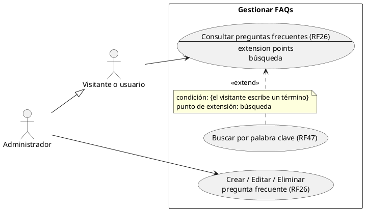
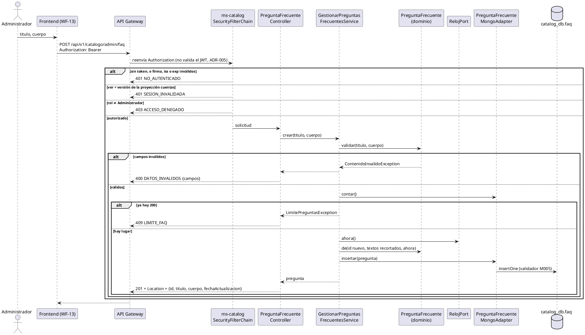

# Subsistema «Gestionar FAQs»

Fase de Construcción (RUP). Casos de uso de la iteración «Contenido público»: RF26 y RF47.
- **Pantalla:** WF-13 ([wireframe](../wireframes/WF-13-preguntas-frecuentes.puml), propuesto por arquitectura y pendiente de validación del equipo).
- **Requisitos:** citados de `docs/srs/especificacion de requisitos.pdf`.
- **Decisiones:** en `docs/trazabilidad.md` («Contenido público — decisiones»).
- **Contrato HTTP:** en [`sad/api/ms-catalog.md`](../sad/api/ms-catalog.md).
- **Nombres:** se conservan los originales del modelo de casos de uso (DEC-59).

| Campo | Valor |
|---|---|
| **Casos de uso** | «Consultar preguntas frecuentes», «Buscar por palabra clave» («extend») y «Crear / Editar / Eliminar pregunta frecuente» |
| **Actores** | Cualquier visitante o usuario (consultar y buscar, sin iniciar sesión) y el Administrador (crear, editar y eliminar; también consulta) |
| **Requisitos que traza** | RF26, RF47. Además RNF06 (rol Administrador), RNF02 (respuesta de menos de 2 s) y RF03 y RNF08 (la interfaz en ES y EN; el contenido, en un solo idioma, DEC-69) |
| **Nivel** | Objetivo de usuario |
| **Alcance** | `ms-catalog` (`catalog_db`, colección `faq`). La pantalla WF-13 la implementa la sesión B |

## Reglas de negocio (citadas del SRS)

- **RF26:** «El sistema debe permitir al Administrador crear, editar y eliminar un listado de Preguntas Frecuentes (FAQ) compuesto por un título y un cuerpo de texto, el cual será visible en una sección de acceso público para resolver dudas comunes de los turistas.»
- **RF47:** «El sistema debe incluir una barra de búsqueda en la sección de Preguntas Frecuentes (FAQ) que permita al usuario ingresar palabras clave y, en tiempo real, filtrar y mostrar únicamente las preguntas que contengan coincidencias exactas o parciales en su título o cuerpo de texto.»
- **RNF06:** control de acceso basado en roles. **RNF02:** respuesta de menos de 2 s.

Reglas que el SRS no fija y que se decidieron en esta iteración (`docs/trazabilidad.md`):
- **DEC-61:** título de 1 a 150 caracteres y cuerpo de 1 a 2000, contados sin los espacios de los extremos y en puntos de código; se guardan recortados.
- **DEC-62:** el listado público va completo, con un tope de 200 preguntas, y el filtro de RF47 se hace en el cliente. Coincidencia parcial, sin distinguir mayúsculas ni tildes.
- **DEC-63:** orden alfabético por título (colación `es`, nivel 1) con el id de desempate.
- **DEC-64:** eliminar es un borrado físico; no hay registro de auditoría (RF13 está fuera de alcance).
- **DEC-69:** el contenido va en el idioma en que lo escribe el Administrador.

## Diagrama de casos de uso

El Administrador hereda de «Visitante o usuario»: también consulta y busca.

## CU «Consultar preguntas frecuentes» (RF26)

**Actor:** cualquier visitante o usuario. **Precondición:** ninguna; no hace falta iniciar sesión.

**Punto de extensión «búsqueda»:** paso 3, mientras la lista está en pantalla.

**Flujo básico:**
1. El visitante elige «Preguntas frecuentes» en el pie de página (columna «Legal y Soporte»).
2. El sistema pide `GET /api/v1/catalogo/faq` **sin token** (DEC-47) y muestra todas las preguntas, por título en orden alfabético.
3. El visitante abre una pregunta y lee su cuerpo.

**Flujos alternos:**
- **FA1. No hay preguntas.** La lista llega vacía y la pantalla lo anuncia.
- **FA2. El catálogo no responde.** El gateway responde 503 `SERVICIO_NO_DISPONIBLE`; la pantalla muestra el aviso con «Reintentar».
- **FA3. Llega un token viejo.** Si el cliente envía un Bearer, se valida: vencido → 401 `NO_AUTENTICADO`; con `ver` viejo → 401 `SESION_INVALIDADA`. El frontend no lo envía en esta llamada (DEC-47).

**Postcondición:** ninguna; es una consulta.

## CU «Buscar por palabra clave» (RF47), extiende «Consultar preguntas frecuentes»

**Condición de extensión:** `{el visitante escribe un término}`, en el punto «búsqueda».

**Flujo:**
1. El visitante escribe en la barra de búsqueda de la sección.
2. Con cada cambio, el sistema filtra la lista ya cargada, sin llamar al servidor (DEC-62). Muestra solo las preguntas cuyo título o cuerpo contienen el término:
   - coincidencia exacta o parcial;
   - sin distinguir mayúsculas ni tildes: «cafe» encuentra «Café».
3. El caso de uso vuelve al paso 3 de «Consultar preguntas frecuentes».

**Flujos alternos:**
- **FA1. Sin coincidencias.** La pantalla dice que no hay preguntas con ese término y ofrece borrarlo.
- **FA2. El visitante borra el término.** Vuelve la lista completa.

## CU «Crear / Editar / Eliminar pregunta frecuente» (RF26)

**Actor:** Administrador.

**Precondiciones:**
1. El Administrador inició sesión (RF15).
2. Su token está vigente: firma, `iss` y `exp`, y `ver` no menor que la versión de la proyección `cuentas` (ADR-008).

**Flujo básico (crear):**
1. El Administrador abre la gestión de preguntas frecuentes (WF-13) y elige «Nueva pregunta».
2. Escribe el título y el cuerpo. La pantalla cuenta los caracteres (150 y 2000).
3. El sistema valida los datos, comprueba el tope de 200 y guarda la pregunta recortada con `fechaActualizacion` = ahora. Responde 201 con la pregunta.
4. La pregunta aparece en la sección pública, en su lugar alfabético.

**Flujos alternos:**
- **FA1. Editar.** El Administrador elige «Editar» en una pregunta, cambia el título o el cuerpo y guarda. El sistema los reemplaza, renueva `fechaActualizacion` y responde 200. **Sin control de concurrencia:** si dos administradores editan la misma pregunta, gana la última escritura. Es una limitación aceptada: RF26 no pide versiones.
- **FA2. Eliminar.** El Administrador elige «Eliminar» y confirma. El sistema borra la pregunta (204) y deja de verse en la sección pública.
- **FA3. Datos inválidos.** Título o cuerpo vacíos, solo con espacios o demasiado largos → 400 `DATOS_INVALIDOS` con `campos.titulo` o `campos.cuerpo` = `REQUERIDO` o `LONGITUD_MAXIMA`. No cambia nada. Los datos se validan antes de buscar la pregunta y antes del tope.
- **FA4. Tope alcanzado.** Ya hay 200 preguntas → 409 `LIMITE_FAQ`.
  - **Limitación aceptada:** el tope se comprueba contando antes de insertar, sin atomicidad, así que dos creaciones simultáneas pueden dejar 201. Es un solo actor y el riesgo es bajo.
- **FA5. La pregunta no existe.** Editar o eliminar un id inexistente, uno ya eliminado o uno que no es un ObjectId → 404 `FAQ_NO_ENCONTRADA`.
- **FA6. Quien actúa no es Administrador.**
  - Turista, Prestador o Gestor → 403 `ACCESO_DENEGADO` (RNF06).
  - Sin token, o con un token vencido → 401 `NO_AUTENTICADO`.
  - Con `ver` viejo → 401 `SESION_INVALIDADA`.
  - **Limitación conocida:** hoy el Administrador no tiene fila en la proyección `cuentas`, así que su `ver` nunca se invalida. Se cierra en la iteración B con RF45 (DEC-59).

**Postcondiciones:**
- **Éxito (crear o editar):** la pregunta queda en `faq` con su título y su cuerpo recortados y la fecha de la operación. La sección pública la muestra en la siguiente consulta.
- **Éxito (eliminar):** la pregunta ya no existe; editarla o eliminarla da 404.
- **Fallo:** no cambia nada.

## Criterios de aceptación derivados (RF26 y RF47)

El SRS no define criterios de verificación por RF (hallazgo HC1). Estos se derivan de los enunciados:

| # | Criterio | Cómo se verifica |
|---|---|---|
| C1 | La sección es pública: sin token responde 200 | `PreguntaFrecuenteApiIntegracionTest` |
| C2 | Solo el Administrador crea, edita y elimina (RNF06) | `PreguntaFrecuenteApiIntegracionTest` (401, 403, `SESION_INVALIDADA`) |
| C3 | Cada pregunta tiene título y cuerpo, con los límites de DEC-61 | `PreguntaFrecuenteTest`, `MigracionesMongoTest` |
| C4 | Editar renueva la fecha; eliminar la borra y después es 404 | `PreguntaFrecuenteApiIntegracionTest`, `GestionarPreguntasFrecuentesServiceTest` |
| C5 | El orden es alfabético, sin distinguir mayúsculas ni tildes | `PreguntaFrecuenteApiIntegracionTest` |
| C6 | RF47: el filtro es parcial, en título o cuerpo, sin distinguir mayúsculas ni tildes, y en tiempo real | Sesión B (pruebas del frontend) |
| C7 | Con 200 preguntas, la siguiente creación es 409 | `PreguntaFrecuenteApiIntegracionTest`, `GestionarPreguntasFrecuentesServiceTest` |

## Secuencia: Crear pregunta frecuente

## Fuera de alcance de este CU

- **Registro de auditoría** de las ediciones y los borrados (RF13).
- **Contenido en varios idiomas** (DEC-69): el Administrador escribe en un idioma; la interfaz sí está en ES y EN.
- **Orden manual** de las preguntas: no hay campo `orden` en el modelo (DEC-63).
- **La pantalla WF-13:** la implementa la sesión B de la iteración.
