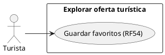
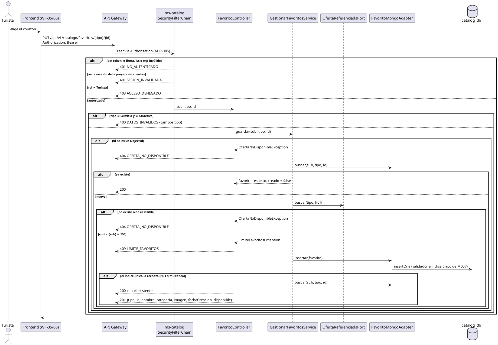

# Subsistema «Explorar oferta turística»: «Guardar favoritos»

Fase de Construcción (RUP). Caso de uso de la iteración B1 «Turista» (DEC-83): RF54.
- **Pantallas:** el corazón de las tarjetas de WF-05 y de la ficha WF-06 ([cambios](../wireframes/WF-05-06-11-cambios-turista.puml)) y «Mis favoritos», WF-17 ([wireframe](../wireframes/WF-17-mis-favoritos.puml)). Propuestos por arquitectura y pendientes de validación del equipo.
- **Requisitos:** citados de `docs/srs/especificacion de requisitos.pdf`.
- **Decisiones:** en `docs/trazabilidad.md` («Turista (B1) — decisiones»).
- **Contrato HTTP:** en [`sad/api/ms-catalog.md`](../sad/api/ms-catalog.md), sección «Favoritos».
- **Nombres:** se conservan los originales del modelo de casos de uso (DEC-59).

| Campo | Valor |
|---|---|
| **Casos de uso** | «Guardar favoritos» |
| **Actores** | Turista |
| **Requisitos que traza** | RF54. Además RNF06 (solo el rol Turista), RF16 y RF22 (la visibilidad de un servicio) |
| **Nivel** | Objetivo de usuario |
| **Alcance** | `ms-catalog` (`catalog_db`, colección `favoritos`; lee `servicios` y `atractivos`). Las pantallas las implementa la sesión B |

## Reglas de negocio (citadas del SRS)

- **RF54:** «El sistema debe permitir al Turista marcar atractivos y servicios como "favoritos" y consultarlos en una sección de "Mis Favoritos" dentro de su perfil.»
- **RF16 y RF22:** un servicio es visible si está Publicado y su prestador está activo.
- **RNF06:** control de acceso basado en roles.

Reglas que el SRS no fija y que se decidieron (`docs/trazabilidad.md`):
- **DEC-80:** los favoritos viven en ms-catalog, en la colección `favoritos` del Entregable 2 (§2.4):
  - `PUT` y `DELETE /api/v1/catalogo/favoritos/{tipo}/{id}`, idempotentes, con `tipo` igual a `Servicio` o `Atractivo`;
  - `GET /api/v1/catalogo/favoritos`;
  - índice único por turista, tipo y entidad.
- **DEC-86:**
  - tope de 100 por turista (409 `LIMITE_FAVORITOS`), sin paginar;
  - del más reciente al más antiguo;
  - los datos se resuelven al listar, sin desnormalizar;
  - un favorito que deja de estar visible se lista como no disponible y no se borra;
  - una referencia inexistente o no visible da 404 `OFERTA_NO_DISPONIBLE`, sin distinguir los casos.
- **DEC-87:** los atractivos se pueden marcar desde las tarjetas y el mapa de WF-05. El enlace «Ver detalle» de un atractivo espera el detalle de atractivo de la iteración E.

## Diagrama de casos de uso

## CU «Guardar favoritos» (RF54)

**Actor:** Turista.

**Precondiciones:**
1. El turista inició sesión (RF15).
2. Su token está vigente: firma, `iss`, `exp` y `ver` no menor que la versión de la proyección `cuentas` (ADR-008).

**Flujo básico (marcar):**
1. El turista ve un servicio o un atractivo en una tarjeta de WF-05, o un servicio en la ficha WF-06, y elige el corazón.
2. El sistema pide `PUT /api/v1/catalogo/favoritos/{tipo}/{id}`.
3. El sistema comprueba que la referencia exista y esté visible y que el turista tenga menos de 100 favoritos. Guarda el favorito con `fechaCreacion` = ahora.
4. El sistema responde 201 con el favorito resuelto, y el corazón queda marcado.

**Flujo básico (consultar «Mis favoritos»):**
1. El turista abre «Mis favoritos» desde su perfil (WF-16 → WF-17).
2. El sistema pide `GET /api/v1/catalogo/favoritos` y responde todos, del más reciente al más antiguo. Cada uno trae `tipo`, `id`, `nombre`, `categoria`, `imagen`, `fechaCreacion` y `disponible`.
3. El turista abre el detalle de un servicio disponible (WF-06).

**Flujos alternos:**
- **FA1. Ya estaba marcado.** El `PUT` responde 200 con el que ya existe, sin duplicarlo. Si dos `PUT` del mismo favorito llegan a la vez, el índice único rechaza el segundo y también responde 200, nunca 500.
- **FA2. Quitar.** El turista vuelve a elegir el corazón, o «Quitar» en WF-17 → `DELETE` → 204. Si ya no existía, también 204.
- **FA3. La referencia no existe o no está visible.** Un id que no es un ObjectId, uno inexistente, un servicio no Publicado o de un prestador inactivo → 404 `OFERTA_NO_DISPONIBLE`. No se guarda nada.
- **FA4. Tipo inválido.** Un `{tipo}` que no es `Servicio` ni `Atractivo` → 400 `DATOS_INVALIDOS` con `campos.tipo = NO_PERMITIDO`.
- **FA5. Tope alcanzado.** El turista ya tiene 100 → 409 `LIMITE_FAVORITOS`.
  - **Limitación aceptada:** el tope se cuenta antes de insertar, sin atomicidad, como `LIMITE_FAQ`.
- **FA6. Un favorito dejó de estar visible.** El servicio se despublicó o su prestador se inactivó (RF22). «Mis favoritos» lo muestra con `disponible = false`, sin enlace al detalle, y no lo borra. Si el documento ya no existe, `nombre`, `categoria` e `imagen` van en null.
- **FA7. Un atractivo.** Se lista disponible mientras exista: los atractivos no tienen estado de publicación. El enlace a su detalle queda pendiente de la iteración E (DEC-87).
- **FA8. Quien actúa no es Turista.** Prestador, Gestor o Administrador → 403 `ACCESO_DENEGADO`. Sin token → 401 `NO_AUTENTICADO`. Con `ver` viejo → 401 `SESION_INVALIDADA`.

**Postcondiciones:**
- **Éxito (marcar):** hay exactamente un documento en `favoritos` para el turista, el tipo y la entidad.
- **Éxito (quitar):** no hay ninguno.
- **Fallo:** no cambia nada.

## Criterios de aceptación derivados (RF54)

| # | Criterio | Cómo se verifica |
|---|---|---|
| C1 | Marcar crea el favorito; repetirlo no lo duplica; quitarlo es idempotente | `FavoritoApiIntegracionTest`, `GestionarFavoritosServiceTest` |
| C2 | Una referencia inexistente o no visible es 404; un tipo inválido es 400 | `FavoritoApiIntegracionTest` |
| C3 | Con 100, el siguiente es 409 `LIMITE_FAVORITOS` | `FavoritoApiIntegracionTest`, `GestionarFavoritosServiceTest` |
| C4 | Un servicio despublicado o de un prestador inactivo se lista con `disponible = false` | `FavoritoApiIntegracionTest` |
| C5 | Un turista no ve los favoritos de otro | `FavoritoApiIntegracionTest`, `GestionarFavoritosServiceTest` |
| C6 | Dos `PUT` simultáneos no duplican ni dan 500 | `FavoritoApiIntegracionTest`, `GestionarFavoritosServiceTest` |
| C7 | Solo el Turista (RNF06) | `FavoritoApiIntegracionTest` (401, 403, `SESION_INVALIDADA`) |

## Secuencia: Guardar favorito

## Fuera de alcance de este CU

- **El detalle público de un atractivo** y su enlace desde «Mis favoritos» (iteración E, DEC-87).
- **Paginar «Mis favoritos»:** con el tope de 100 va completo (DEC-86).
- **Las pantallas:** las implementa la sesión B de la iteración.
