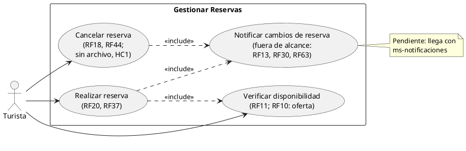
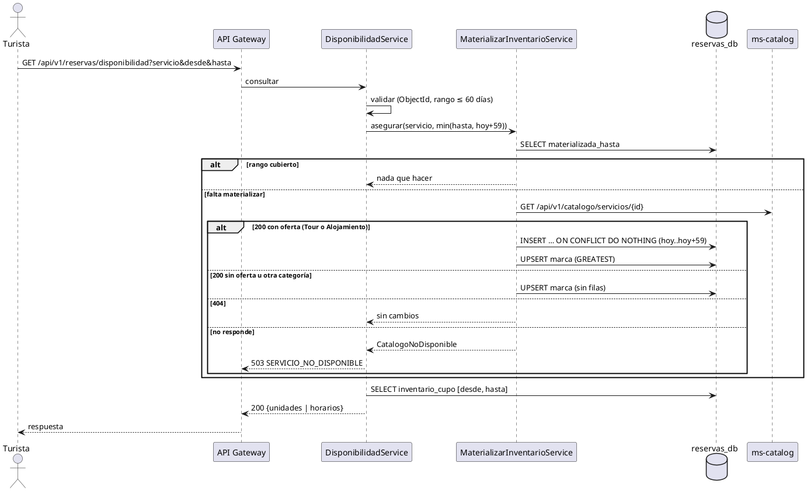
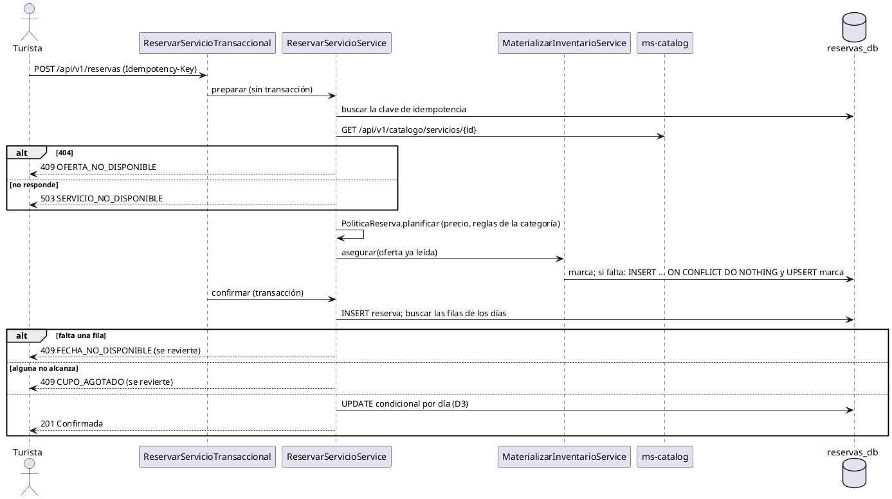
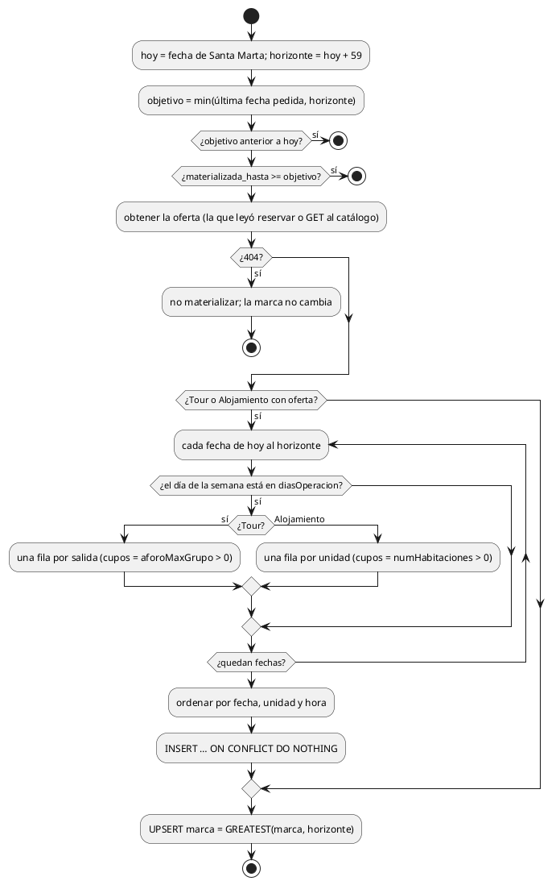

# Subsistema «Gestionar reservas»: «Realizar reserva» e incluido «Verificar disponibilidad»

Fase de Construcción (RUP). Especificación del CU que el prototipo implementa desde el PR #12 («Reservar servicio», D1 a D10) y que la iteración C, sesión A2, amplía con el **inventario bajo demanda** (DEC-135, DEC-152 a DEC-160).
- **Pantallas:** WF-10 «Disponibilidad y reserva» (`/servicios/:id/reservar`), a la que se llega desde «Ver disponibilidad y reservar» de WF-06; las tarjetas de WF-04 y WF-05 muestran el resumen de disponibilidad (RF11).
- **Requisitos:** citados de `docs/srs/especificacion de requisitos.pdf`.
- **Decisiones:** en `docs/trazabilidad.md` («Reservar servicio — decisiones», D1 a D10, e «Inventario bajo demanda — decisiones», DEC-152 a DEC-160).
- **Contrato HTTP:** en [`sad/api/ms-booking.md`](../sad/api/ms-booking.md); arquitectura en [ADR-007](../sad/adr/ADR-007-reservas-y-catalogo.md) y su enmienda A2.
- **Nombre:** se conservan los nombres originales del modelo de casos de uso del Entregable 1 (subsistema «Gestionar Reservas»; DEC-59): «Realizar reserva» «include» «Verificar disponibilidad» y «Notificar cambios de reserva». «Reservar servicio» es el nombre histórico de las decisiones D1 a D10.

| Campo | Valor |
|---|---|
| **Casos de uso** | «Realizar reserva»; incluido «Verificar disponibilidad». El incluido «Notificar cambios de reserva» está fuera de alcance |
| **Actores** | Turista |
| **Requisitos que traza** | RF10 (oferta inicial: días de operación y salidas, ampliación DEC-130), RF11, RF20 y RF37. Además RNF06 |
| **No traza** | RF18 y RF44 (son de «Cancelar reserva», sin archivo propio: HC1 sigue abierto para ese CU) ni RF32 (del subsistema «Gestionar servicios») |
| **Nivel** | Objetivo de usuario |
| **Alcance** | `ms-booking` (`reservas_db`: `inventario_cupo`, `oferta_materializada`, `reserva`, `reserva_cupo_dia`), con la consulta síncrona al detalle público de `ms-catalog` (ADR-007) |

## Reglas de negocio (citadas del SRS)

- **RF11:** «El sistema debe verificar la disponibilidad de cupos y horarios en tiempo real antes de permitir a un turista confirmar una reserva, bloqueando la transacción y notificando al usuario en caso de que el cupo esté agotado.»
- **RF20:** «El sistema debe confirmar automáticamente la reserva del Turista si existe disponibilidad, descontando de inmediato la cantidad de cupos solicitada del inventario del servicio y asignándole el estado de "Confirmada".»
- **RF37:** «El sistema debe capturar y mostrar el precio o rango de precio de cada servicio turístico registrado (RF09), independientemente de su categoría, visible para el Turista antes de confirmar una reserva.»
- **RF10:** los campos de la categoría al registrar: en Alojamiento, el número de habitaciones y la capacidad por habitación; en Tour, el aforo máximo por grupo. Con la ampliación DEC-130 y DEC-136, Tour y Alojamiento registran también su **oferta inicial** (días de operación y, en Tour, salidas).
- **RNF06:** control de acceso basado en roles.

Reglas que el SRS no fija y que decidió el equipo (`docs/trazabilidad.md`):
- **D1 y D2:** un alojamiento tiene unidades y una reserva es de una sola unidad; solo Tour y Alojamiento son reservables; un alojamiento reserva de 1 a 14 noches.
- **D3:** UPDATE condicional por día, en orden de fecha y hora, en una transacción.
- **D4:** el detalle de ms-catalog se consulta **antes** de abrir la transacción.
- **D6:** `Idempotency-Key` obligatoria.
- **DEC-153:** la ventana de inventario es de 60 días, de hoy a hoy + 59 en Santa Marta (el SRS no fija una anticipación máxima; el horizonte ya estaba en DEC-136).

## Diagrama de casos de uso

- ms-catalog (que define la oferta y responde el detalle) y ms-booking (que la materializa) no son actores: son componentes internos.
- El Turista también usa «Verificar disponibilidad» sin reservar: WF-10 y el resumen de las tarjetas son públicos.
- «Notificar cambios de reserva» se muestra porque está en el modelo del Entregable 1, pero no se implementa: las notificaciones están fuera del alcance de esta iteración.

## CU incluido «Verificar disponibilidad» (RF11; RF10: oferta)

**Actor:** Turista (con o sin sesión).

**Precondiciones:**
1. El servicio existe en ms-catalog. Si no está Publicado o su prestador está inactivo, el detalle público responde 404 y no se materializa nada (FA2).

**Flujo básico:**
1. El Turista elige fechas en WF-10 (o abre una búsqueda con tarjetas).
2. El sistema valida el servicio (ObjectId), la unidad y el rango (como mucho 60 días).
3. **Asegurar el inventario de la oferta** (paso interno, DEC-152): si la marca del servicio (`oferta_materializada`) no cubre la última fecha pedida, recortada a hoy + 59, el sistema consulta el detalle público de ms-catalog y crea las filas que falten de **toda la ventana** de 60 días:
   - Tour: una fila por cada salida de cada día de operación, con `aforoMaxGrupo` cupos;
   - Alojamiento: una fila por unidad y noche de operación (la fecha de entrada de la noche), con sus `numHabitaciones`;
   - las filas que ya existen no cambian, ni sus cupos (`ON CONFLICT DO NOTHING`); después avanza la marca.
4. El sistema lee los cupos del rango y responde, por unidad y noche (alojamiento) o por horario (tour), con el horario de los alojamientos y el plazo de cancelación.
5. WF-10 muestra los cupos; un día sin filas aparece sin disponibilidad.

**Flujos alternos:**
- **FA1. Datos inválidos.** Un `servicio` que no es un ObjectId, una fecha mal escrita o un rango de más de 60 días → 400 `DATOS_INVALIDOS` con `campos`. No se consulta ms-catalog.
- **FA2. El catálogo no muestra el servicio (404).** No se materializa ni avanza la marca; la respuesta trae lo que ya existía (sin filas, `categoria: null`). Si el servicio se publica después, la siguiente consulta lo materializa.
- **FA3. El catálogo no responde y falta materializar.** 503 `SERVICIO_NO_DISPONIBLE` (`servicio: ms-catalog`). Si el rango ya estaba materializado, el paso 3 no llama al catálogo y la consulta responde normalmente. No se borra ninguna fila.
- **FA4. Resumen de las tarjetas.** Hasta 10 servicios, del mismo modo, con un plazo total de 2,5 s para materializar: si ms-catalog no responde o el plazo se agota, 503 para toda la respuesta (las tarjetas muestran «—», nunca «Sin fechas» falso; DEC-155).
- **FA5. Día no operativo, salida no ofrecida o fecha posterior a la ventana.** Sin filas: la pantalla lo muestra sin disponibilidad.

**Postcondiciones:** el inventario del servicio existe de hoy a hoy + 59 según su oferta, y la marca lo registra. Ninguna fila existente cambió.

## CU «Realizar reserva» (RF20, RF37)

**Actor:** Turista.

**Precondiciones:**
1. El Turista inició sesión con el rol Turista y el token está vigente (firma, `iss`, `exp` y `ver`).
2. El servicio está Publicado y su prestador está activo (el detalle público responde 200).

**Flujo básico:**
1. El Turista elige en WF-10 la unidad y las fechas (alojamiento) o la fecha y el horario (tour), y las personas. El sistema le muestra el total (RF37).
2. El Turista confirma. El sistema envía `POST /api/v1/reservas` con una `Idempotency-Key` y el `precioTotalEsperado`.
3. El sistema valida el pedido y busca la clave de idempotencia (D6).
4. El sistema consulta el detalle público de ms-catalog, fuera de toda transacción (D4).
5. El sistema aplica las reglas de la categoría y calcula el precio en el servidor (D1, D2, RF37).
6. **«include» Verificar disponibilidad, paso 3:** asegura el inventario de la oferta con el detalle que ya leyó, sin otra llamada al catálogo y antes de abrir la transacción (DEC-152).
7. En una transacción, el sistema inserta la reserva, comprueba que existan todas las filas pedidas y descuenta cada día con un UPDATE condicional, en orden de fecha y hora (RF11, D3).
8. El sistema responde 201 con la reserva en estado `Confirmada` (RF20) y el límite para cancelarla (`cancelableHasta`).

**Flujos alternos:**
- **FA1. Datos inválidos.** 400 `DATOS_INVALIDOS` con `campos`; también `CATEGORIA_NO_RESERVABLE` (Gastronomía y Alquiler), que se detecta antes del paso 6: no se materializa nada.
- **FA2. Oferta no disponible.** El catálogo responde 404 → 409 `OFERTA_NO_DISPONIBLE`.
- **FA3. Servicio no disponible.** El catálogo no responde o el circuito está abierto → 503 `SERVICIO_NO_DISPONIBLE`. No se toca la base.
- **FA4. Unidad no disponible.** El alojamiento no tiene esa unidad → 409 `UNIDAD_NO_DISPONIBLE`.
- **FA5. Precio cambiado (RF37).** El total calculado no coincide con el esperado → 409 `PRECIO_CAMBIADO` con el precio vigente.
- **FA6. Fecha no disponible.** Falta alguna fila: el servicio no opera ese día, no ofrece esa salida o la fecha es posterior a la ventana de 60 días → 409 `FECHA_NO_DISPONIBLE`. La transacción se revierte.
- **FA7. Cupo agotado (RF11).** Alguna fila no alcanza → 409 `CUPO_AGOTADO`; no se descuenta nada.
- **FA8. Reenvío.** La misma clave con el mismo pedido → 201 con la misma reserva e `Idempotent-Replayed: true`; con otro pedido → 422 `IDEMPOTENCIA_CONFLICTO`.
- **FA9. Sin sesión u otro rol.** 401 `NO_AUTENTICADO` o `SESION_INVALIDADA`; 403 `ACCESO_DENEGADO`.

**Postcondiciones:**
- **Éxito:** la reserva existe `Confirmada`, con el precio y los nombres congelados, y los cupos de cada día se descontaron.
- **Fallo:** no hay reserva ni descuentos. Las filas de inventario que el paso 6 materializó se conservan: son la oferta del catálogo, no dependen de la reserva.

## Criterios de aceptación derivados

| # | Criterio | Prueba |
|---|---|---|
| C1 | Un tour con días parciales solo tiene filas en sus días, una por salida con el aforo | `MaterializacionOfertaTest`, `MaterializacionIntegracionTest` |
| C2 | Un alojamiento con N unidades tiene una fila por unidad y noche de operación con sus habitaciones | `MaterializacionOfertaTest`, `MaterializacionIntegracionTest` |
| C3 | Materializar dos veces no duplica filas ni cambia los cupos de las que tienen reservas | `MaterializarInventarioServiceTest`, `MaterializacionIntegracionTest` |
| C4 | Dos materializaciones simultáneas, o una con reservas, no duplican filas ni pierden cupos | `MaterializacionIntegracionTest` |
| C5 | Catálogo 404: no se materializa; catálogo caído: 503 si falta materializar, 200 si ya estaba | `DisponibilidadServiceTest`, `InventarioBajoDemandaApiIntegracionTest` |
| C6 | El resumen responde 503 antes de los 3 s con un catálogo lento, nunca `SIN_INVENTARIO` | `InventarioBajoDemandaApiIntegracionTest` |
| C7 | Gastronomía y Alquiler: `CATEGORIA_NO_RESERVABLE` sin materializar | `ReservarServicioServiceTest` |
| C8 | Nunca se materializan fechas pasadas ni posteriores a hoy + 59 | `MaterializacionOfertaTest`, `ReservarServicioServiceTest` |
| C9 | La oferta de la semilla produce las filas del generador D5 | `MaterializacionOfertaTest`, `MaterializacionIntegracionTest` |
| C10 | Un día no operativo es 409 `FECHA_NO_DISPONIBLE`; uno operativo se reserva (201) | `ReservarServicioServiceTest`, `InventarioBajoDemandaApiIntegracionTest` |
| C11 | Los ids que no son ObjectId son 400 sin consultar ms-catalog | `DisponibilidadServiceTest`, `InventarioBajoDemandaApiIntegracionTest` |
| C12 | Confirmación, precio, idempotencia y concurrencia de las reservas (D1 a D6) | `ReservaApiIntegracionTest`, `ConcurrenciaIntegracionTest`, `PoliticaReservaTest` |

## Secuencia de «Verificar disponibilidad»

## Secuencia de «Realizar reserva»

## Actividad de la materialización

## Fuera de alcance

- «Notificar cambios de reserva» (RF13, RF30, RF63; ms-notificaciones).
- Modificar fechas, horarios y cupos de un servicio ya registrado, y reconciliar las filas ya materializadas con una oferta nueva (RF19, DEC-34, DEC-130).
- Pagos y «Notificarme si se libera» de WF-10 (sin requisito).
- «Cancelar reserva» (RF18, RF44): implementada, pero sin documento de CU propio (HC1).
