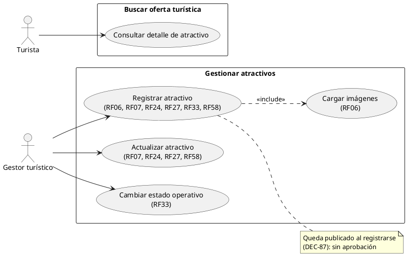
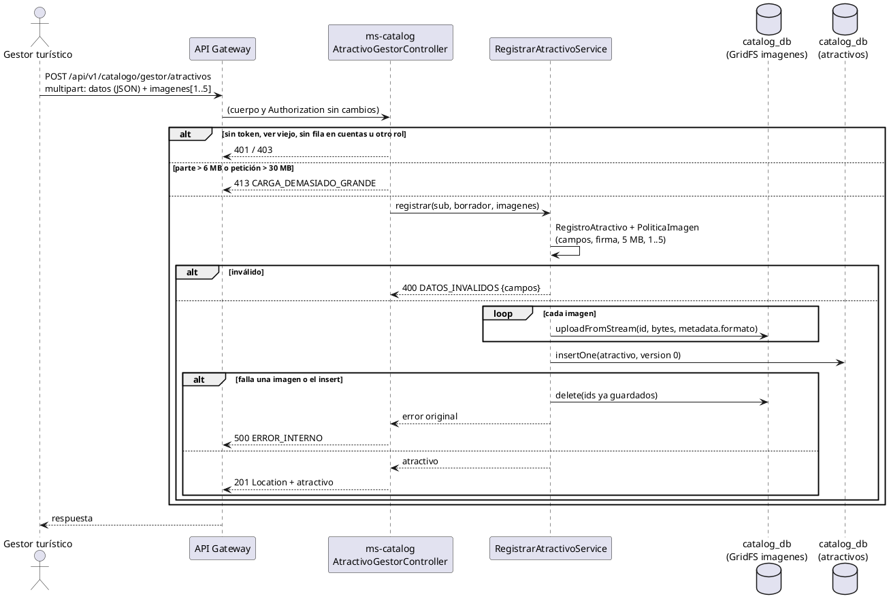
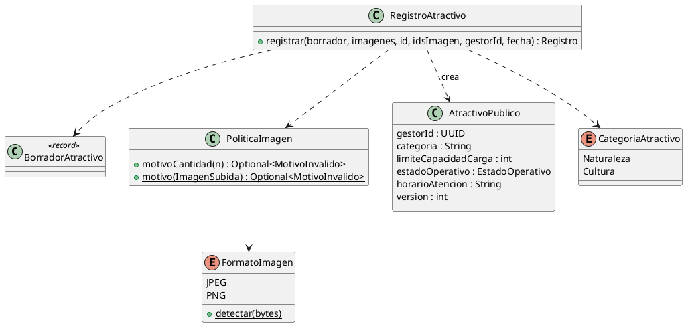

# Subsistema «Gestionar atractivos»: «Registrar atractivo»

Fase de Construcción (RUP). Caso de uso de la iteración E «Atractivos y agenda», sesión A1 (DEC-54, DEC-213): RF06, RF07, RF24, RF27 (parte del Gestor), RF33 (estado inicial) y RF58 (parte del Gestor). Cierra HC-E1 para estos RF y HC4.
- **Pantallas:** WF-09 «Registrar atractivo turístico» (`docs/wireframes/WF-09-registrar-atractivo.png`). La pantalla es de la sesión B1; esta sesión deja el backend y el contrato.
- **Requisitos:** citados de `docs/srs/especificacion de requisitos.pdf`.
- **Decisiones:** en `docs/trazabilidad.md` («Atractivos y agenda — decisiones», DEC-206 a DEC-221).
- **Contrato HTTP:** en [`sad/api/ms-catalog.md`](../sad/api/ms-catalog.md), sección «Atractivos (Gestor)». Imágenes: [ADR-009](../sad/adr/ADR-009-imagenes-gridfs.md).

| Campo | Valor |
|---|---|
| **Caso de uso** | «Registrar atractivo», con «Cargar imágenes» (inclusión) |
| **Actores** | Gestor turístico |
| **Requisitos que traza** | RF06, RF07, RF24, RF27, RF33, RF58; RNF06 |
| **Nivel** | Objetivo de usuario |
| **Alcance** | `ms-catalog` (`catalog_db.atractivos` y el bucket GridFS `imagenes`). Ni ms-auth ni ms-booking participan: un atractivo no se reserva |

## Reglas de negocio (citadas del SRS)

- **RF06:** «El sistema debe permitir al gestor turístico registrar atractivos públicos ingresando nombre, dirección o coordenadas geográficas según corresponda, descripción de texto, categoría y carga de imágenes en formato JPEG/PNG.»
- **RF07:** «El sistema debe permitir al gestor turístico configurar un límite numérico de capacidad de carga máxima para cada atractivo natural o público.»
- **RF24:** «El sistema debe permitir al Gestor Turístico ingresar un campo de texto denominado "Normas Ambientales" al registrar un atractivo, el cual se renderizará de forma estática y visible en la página de detalles del atractivo para que el Turista lo lea antes de visitarlo.»
- **RF27:** «El sistema debe permitir a Prestadores y Gestores Turísticos declarar las condiciones de accesibilidad (movilidad reducida, visual, auditiva) de sus servicios o atractivos […]».
- **RF33:** el estado operativo de un atractivo es «Abierto», «Cerrado temporalmente» o «En mantenimiento».
- **RF58:** «El sistema debe permitir al Prestador y al Gestor Turístico registrar los días y horarios de atención de sus servicios o atractivos como un campo de texto visible en la ficha de detalle para el Turista.»
- **Actor (SRS, perfiles de usuario):** «Gestor turístico: Usuario encargado de registrar atractivos públicos, definir cargas de aforo y directrices ambientales.»

**Coordenadas en lugar de dirección.** RF06 admite «dirección **o** coordenadas geográficas **según corresponda**». Un atractivo natural (una cascada, un sendero) no siempre tiene dirección postal, y WF-09 pide «Latitud (GPS)» y «Longitud (GPS)». Por eso el registro exige las coordenadas y no pide dirección.

Reglas que el SRS no fija y que decidió el equipo (`docs/trazabilidad.md`):
- **DEC-206:** solo el Gestor registra. Un atractivo es del municipio, no de un Gestor: `gestorId` registra quién lo dio de alta, pero cualquier Gestor lo edita. Sin borrado ni desactivación.
- **DEC-207:** validador v2 de `atractivos` (M012) con `version`, `fechaRegistro`, límites de longitud y vocabularios cerrados. M012 no normaliza datos: si un atractivo no cumple el v2, se detiene con la lista de `_id`.
- **DEC-208:** `horarioAtencion`, texto opcional de 1 a 500 caracteres (como en servicios).
- **DEC-209:** de 1 a 5 imágenes, JPEG o PNG reconocidos por su firma, de 5 MB como máximo, en GridFS; solo al registrar (la galería no se edita en esta iteración).
- **DEC-212:** capacidad de carga entera de 1 a 100 000; solo el dato (RF08, RF39 y RF64 están descartados).
- **DEC-214:** categorías `Naturaleza` y `Cultura`. **Decisión del equipo, no del SRS.**
- **DEC-216:** una sola petición `multipart/form-data`: la parte `datos` (JSON) y las partes `imagenes`.
- **DEC-221:** el vocabulario de accesibilidad es el de RF27 (WF-09 dibuja otras dos condiciones).

## Diagrama de casos de uso

ms-catalog no es un actor: es un componente interno.

## CU «Registrar atractivo»

**Actor:** Gestor turístico.

**Precondiciones:**
1. El Gestor tiene sesión iniciada con el rol Gestor (RF15). El token está vigente (firma, `iss`, `exp` y `ver`), y su cuenta tiene fila en la proyección `cuentas` de ms-catalog (DEC-110).

**Flujo básico:**
1. El Gestor abre «Registrar atractivo» desde el panel «Atractivos» (WF-24).
2. El Gestor escribe el nombre, elige la categoría, escribe la descripción y fija las coordenadas.
3. El Gestor escribe la capacidad de carga y elige el estado operativo inicial.
4. El Gestor marca las condiciones de accesibilidad que apliquen y escribe, si quiere, las normas ambientales y el horario de atención.
5. El Gestor adjunta de 1 a 5 imágenes (incluye «Cargar imágenes») y elige **Registrar atractivo**.
6. El sistema envía `POST /api/v1/catalogo/gestor/atractivos` en `multipart/form-data`.
7. ms-catalog valida cada campo y cada imagen (firma JPEG o PNG, 5 MB como máximo).
8. ms-catalog guarda las imágenes en GridFS e inserta el atractivo con `version` 0, el Gestor del token y la fecha de `RelojPort`.
9. El sistema responde 201 con `Location` y el atractivo. Desde ese momento aparece en la búsqueda, en el mapa y en su ficha pública.

**CU incluido «Cargar imágenes»:** cada parte `imagenes` se valida por su firma (los primeros bytes), no por el nombre ni por el tipo que declara el navegador. Las imágenes se guardan con un id generado por el servidor y el atractivo guarda su ruta pública `/api/v1/catalogo/imagenes/{id}`.

**Flujos alternos:**
- **FA1. Datos inválidos.** Falta un obligatorio, un texto supera su máximo, la categoría, el estado o una condición de accesibilidad no son del vocabulario, la capacidad está fuera de 1 a 100 000 o las coordenadas fuera de rango → 400 `DATOS_INVALIDOS` con `campos`. No se guarda nada.
- **FA2. Imágenes inválidas.** Ninguna (`imagenes: REQUERIDO`), más de 5 (`CANTIDAD_MAXIMA`), o una parte vacía (`imagenes[i]: REQUERIDO`), de más de 5 MB (`TAMANO_MAXIMO`) o que no es JPEG ni PNG (`FORMATO`) → 400. No se guarda nada.
- **FA3. Carga demasiado grande.** Una parte de más de 6 MB o una petición de más de 30 MB → 413 `CARGA_DEMASIADO_GRANDE` (nginx corta antes en 30 MB).
- **FA4. Falla el guardado.** Si una imagen o el insert fallan, ms-catalog borra las imágenes ya guardadas y responde 500 `ERROR_INTERNO`. Si el borrado también falla, queda un archivo huérfano (riesgo de ADR-009).
- **FA5. Datos que fija el servidor.** `gestorId`, `version`, fechas e `imagenes` en la parte `datos` se ignoran.
- **FA6. Otro rol o sin sesión.** 403 `ACCESO_DENEGADO`; 401 `NO_AUTENTICADO`; un Gestor sin fila en `cuentas` o con un `ver` viejo, 401 `SESION_INVALIDADA`.

**Postcondiciones:**
- **Éxito:** el atractivo existe con `version` 0, su `fechaRegistro`, su Gestor y de 1 a 5 imágenes en GridFS. Es visible en la búsqueda (RF16), en el mapa (RF23) y en su ficha.
- **Fallo:** no queda ni el atractivo ni sus imágenes (salvo el huérfano de FA4).

## Criterios de aceptación derivados

| # | Criterio | Prueba |
|---|---|---|
| C1 | El Gestor registra un atractivo con dos imágenes; queda con versión 0 y se sirven sus imágenes | `RegistrarAtractivoApiIntegracionTest`, `RegistrarAtractivoServiceTest` |
| C2 | El atractivo nuevo se ve en el detalle público y en la búsqueda | `RegistrarAtractivoApiIntegracionTest` |
| C3 | Una imagen de 5 MB exactos se acepta, por ms-catalog y de punta a punta por api-gateway; 5 MB + 1 byte es `TAMANO_MAXIMO` | `RegistrarAtractivoApiIntegracionTest`, `CargaMultipartServidorTest`, `TransferenciaImagenTest` (api-gateway), `PoliticaImagenTest` |
| C4 | Si el insert falla, las imágenes guardadas se borran | `CompensacionImagenesApiIntegracionTest`, `RegistrarAtractivoServiceTest` |
| C5 | Validaciones por campo con 400 y `campos` | `RegistroAtractivoTest`, `RegistrarAtractivoApiIntegracionTest` |
| C6 | Turista, Prestador y Administrador → 403; Gestor sin fila → 401 `SESION_INVALIDADA` | `AccesoGestorApiIntegracionTest` |
| C7 | Una parte de más de 6 MB → 413 `CARGA_DEMASIADO_GRANDE` | `CargaMultipartServidorTest` |

## Secuencia

## Clases del dominio

## Fuera de alcance

- Editar la galería de un atractivo ya registrado (agregar o quitar imágenes; DEC-209, como RF48 en servicios).
- Borrar o desactivar un atractivo (DEC-206).
- Dirección postal y geocodificación.
- La casilla de veracidad de WF-09 (sin RF; deshabilitada en B1, DEC-219).
- El semáforo de afluencia que menciona WF-09 (RF39, descartado en DEC-54).
