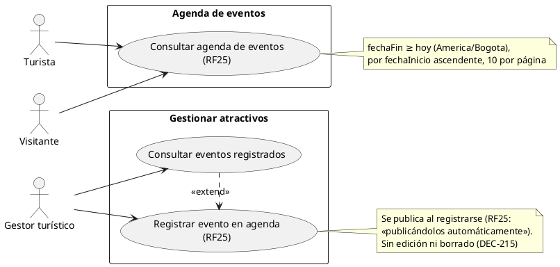
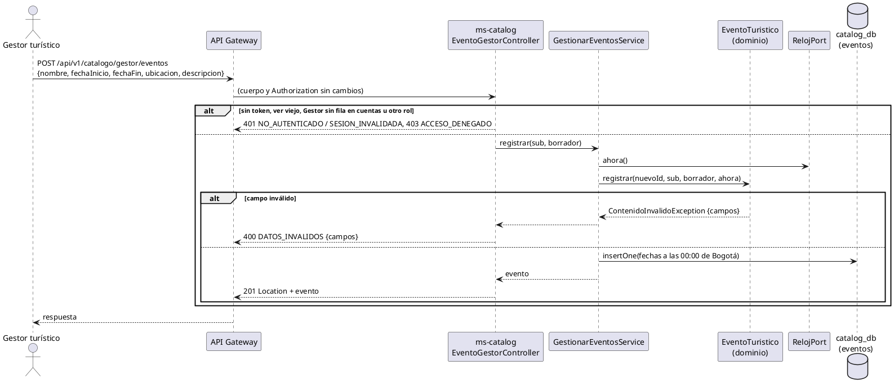
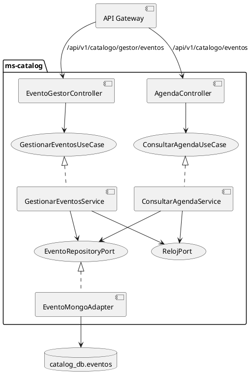
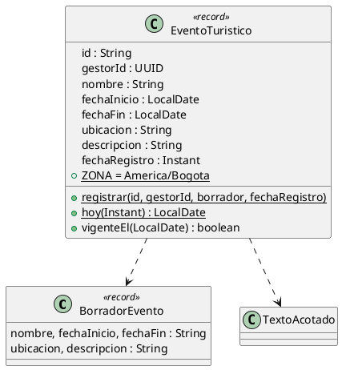

# Subsistema «Gestionar atractivos»: «Registrar evento en agenda»

Fase de Construcción (RUP). Caso de uso de la iteración E «Atractivos y agenda», sesión A2 (DEC-54, DEC-213): RF25 (parte del Gestor). Cierra HC-E1 para RF25.
- **Pantallas:** sin wireframe todavía; los de la agenda los propondrá arquitectura en la sesión B2. Esta sesión deja el backend y el contrato.
- **Requisitos:** citados de `docs/srs/especificacion de requisitos.pdf`.
- **Fuente del modelo:** DocumentoEntregable2.md (documento del Proyecto, fuera del repositorio): §1.2, figura 5 (CU «Registrar evento en agenda»), §2.1 (clase `EventoTuristico`) y §2.4 (colección `eventos`).
- **Decisiones:** en `docs/trazabilidad.md` («Atractivos y agenda — decisiones (iteración E, sesión A2)», DEC-235 a DEC-242), más DEC-215.
- **Contrato HTTP:** en [`sad/api/ms-catalog.md`](../sad/api/ms-catalog.md), sección «Agenda de eventos (Gestor)».

| Campo | Valor |
|---|---|
| **Caso de uso** | «Registrar evento en agenda», con el flujo «Consultar eventos registrados» |
| **Actores** | Gestor turístico |
| **Requisitos que traza** | RF25; RNF06 |
| **Nivel** | Objetivo de usuario |
| **Alcance** | `ms-catalog` (`catalog_db.eventos`). Ni ms-auth ni ms-booking participan: un evento no se reserva |

## Reglas de negocio (citadas del SRS)

- **RF25:** «El sistema debe permitir al Gestor Turístico registrar eventos temporales, capturando nombre, fecha de inicio, fecha de fin, ubicación y descripción, publicándolos automáticamente en la sección de "Agenda de eventos" visible para el Turista.»
- **Actor (SRS, perfiles de usuario):** «Gestor turístico: Usuario encargado de registrar atractivos públicos, definir cargas de aforo y directrices ambientales.»

Reglas que el SRS no fija y que decidió el equipo (`docs/trazabilidad.md`):
- **DEC-215:** el Gestor solo registra y lista; sin edición ni borrado. Las fechas son de día (America/Bogota).
- **DEC-235:** los cinco campos de RF25 son obligatorios (el §2.4 deja `ubicacion` y `descripcion` opcionales).
- **DEC-236:** `nombre` de 1 a 120, `ubicacion` de 1 a 200 y `descripcion` de 1 a 1000; fechas `yyyy-MM-dd`.
- **DEC-237:** `fechaFin` no puede ser anterior a `fechaInicio`.
- **DEC-242:** `fechaFin` no puede ser anterior a hoy en Bogotá. **Decisión del equipo, no del SRS.**
- **DEC-238:** el panel del Gestor lista todos los eventos, del más reciente al más antiguo por `fechaRegistro`.

## Diagrama de casos de uso

ms-catalog no es un actor: es un componente interno. «Consultar agenda de eventos» tiene su propio CU: [CU-consultar-agenda-eventos.md](CU-consultar-agenda-eventos.md).

## CU «Registrar evento en agenda»

**Actor:** Gestor turístico.

**Precondiciones:**
1. El Gestor tiene sesión iniciada con el rol Gestor (RF15). El token está vigente (firma, `iss`, `exp` y `ver`), y su cuenta tiene fila en la proyección `cuentas` de ms-catalog (DEC-110).

**Flujo básico:**
1. El Gestor abre «Registrar evento» desde su panel de eventos.
2. El Gestor escribe el nombre, la fecha de inicio, la fecha de fin, la ubicación y la descripción, y elige **Registrar evento**.
3. El sistema envía `POST /api/v1/catalogo/gestor/eventos` en JSON.
4. ms-catalog valida cada campo (DEC-235 a DEC-237 y DEC-242), con «hoy» en Bogotá según `RelojPort`.
5. ms-catalog inserta el evento con el Gestor del token, las fechas a las 00:00 de Bogotá y `fechaRegistro`.
6. El sistema responde 201 con `Location` y el evento. Desde ese momento aparece en la agenda pública mientras esté vigente.

**Flujo «Consultar eventos registrados»:** el Gestor abre su panel y el sistema envía `GET /api/v1/catalogo/gestor/eventos?pagina=0`. ms-catalog responde **todos** los eventos (también los vencidos), del más reciente al más antiguo, de 10 en 10 (DEC-238).

**Flujos alternos:**
- **FA1. Datos inválidos.** Falta un campo, un texto supera su máximo o una fecha no es un día `yyyy-MM-dd` válido → 400 `DATOS_INVALIDOS` con `campos` (`REQUERIDO`, `LONGITUD_MAXIMA`, `FORMATO`). No se guarda nada.
- **FA2. Fechas imposibles.** `fechaFin` anterior a `fechaInicio`, o anterior a hoy en Bogotá → 400 con `campos.fechaFin = NO_PERMITIDO` (DEC-237 y DEC-242).
- **FA3. Datos que fija el servidor.** `gestorId` y `fechaRegistro` en el cuerpo se ignoran.
- **FA4. Página inválida.** En el panel, una `pagina` negativa o que no es un número → 400 con `campos.pagina = FORMATO`.
- **FA5. Otro rol o sin sesión.** 403 `ACCESO_DENEGADO`; 401 `NO_AUTENTICADO`; un Gestor sin fila en `cuentas` o con un `ver` viejo, 401 `SESION_INVALIDADA`.

**Postcondiciones:**
- **Éxito:** el evento existe con su Gestor y su `fechaRegistro`, y aparece en la agenda pública hasta las 00:00 de Bogotá del día siguiente a `fechaFin`.
- **Fallo:** no se guarda nada.

## Criterios de aceptación derivados

| # | Criterio | Prueba |
|---|---|---|
| C1 | El Gestor registra un evento; se guarda con las fechas a las 00:00 de Bogotá y responde 201 con `Location` | `RegistrarEventoApiIntegracionTest`, `GestionarEventosServiceTest` |
| C2 | Validaciones por campo con 400 y `campos`, incluidos los límites en puntos de código y el formato de fecha | `EventoTuristicoTest`, `RegistrarEventoApiIntegracionTest` |
| C3 | `fechaFin` anterior a `fechaInicio` o a hoy en Bogotá es `NO_PERMITIDO`; un evento de un día es válido | `EventoTuristicoTest`, `RegistrarEventoApiIntegracionTest` |
| C4 | El panel lista todos los eventos, del más reciente al más antiguo, de 10 en 10 | `GestionarEventosServiceTest`, `RegistrarEventoApiIntegracionTest` |
| C5 | Turista, Prestador y Administrador → 403; Gestor sin fila → 401 `SESION_INVALIDADA` | `AccesoGestorApiIntegracionTest` |
| C6 | El validador de M013 rechaza un evento sin los campos obligatorios, fuera de los límites, con campos extra o con `fechaFin < fechaInicio` | `MigracionesMongoTest` |

## Secuencia

## Componentes

El diagrama de despliegue no cambia: no hay contenedores nuevos y la ruta entra en `/api/v1/catalogo/**` del gateway. Dentro de ms-catalog se suman estos componentes:

## Clases del dominio

## Fuera de alcance

- Editar, borrar o despublicar un evento (DEC-215).
- Vincular un evento a un atractivo: el §2.4 guarda la ubicación como texto.
- Notificar a los turistas de un evento nuevo (ms-notificaciones).
- Las pantallas (sesión B2).
