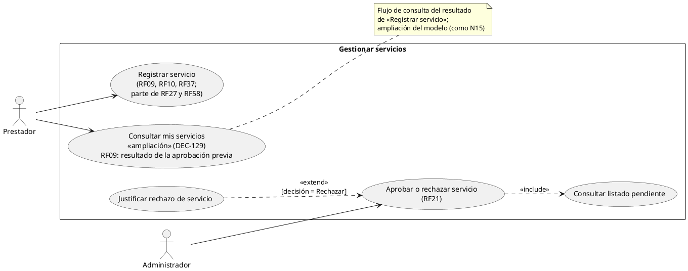
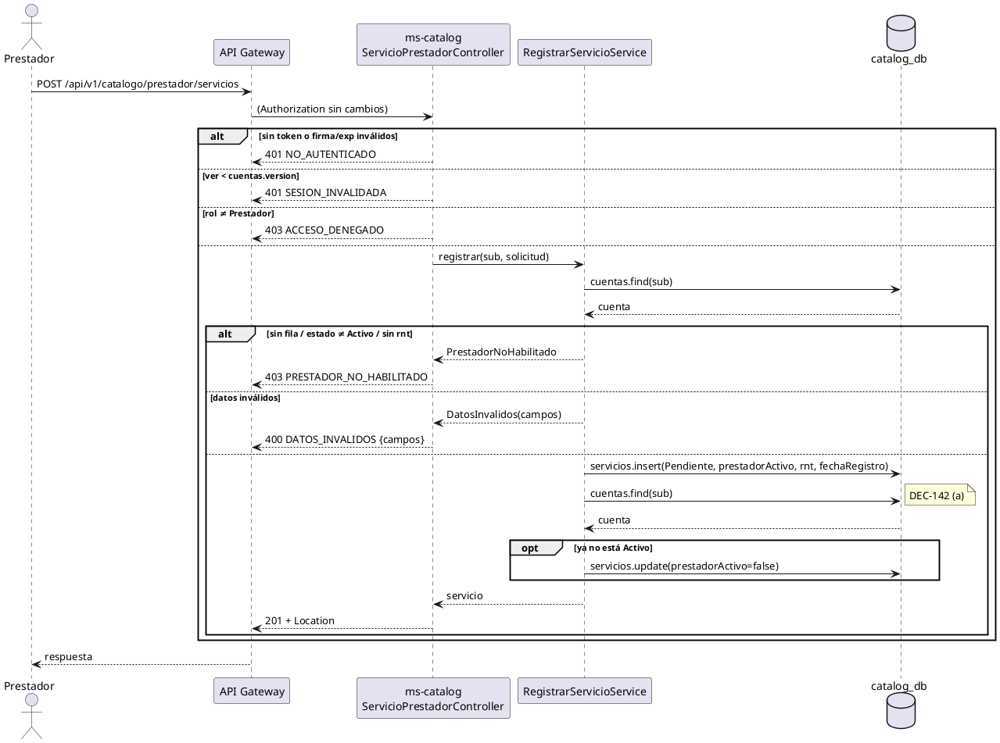
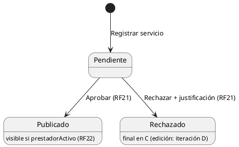

# Subsistema «Gestionar servicios»: «Registrar servicio»

Fase de Construcción (RUP). Caso de uso de la iteración C «Registrar y aprobar servicio» (DEC-54, DEC-134): RF09, RF10 y RF37, con parte de RF27 y RF58. Incluye el flujo «Consultar mis servicios» (DEC-129).
- **Pantallas:** WF-08 «Registrar servicio» ([ampliación en Salt](../wireframes/WF-08-registrar-servicio.puml) del PNG) y WF-18 «Mis servicios» ([wireframe](../wireframes/WF-18-mis-servicios.puml)), propuestos por arquitectura y pendientes de validación del equipo. Las implementa la sesión B1.
- **Requisitos:** citados de `docs/srs/especificacion de requisitos.pdf`.
- **Decisiones:** en `docs/trazabilidad.md` («Registrar y aprobar servicio — decisiones», DEC-124 a DEC-151).
- **Contrato HTTP:** en [`sad/api/ms-catalog.md`](../sad/api/ms-catalog.md), sección «Registrar servicio y Mis servicios».
- **Nombre:** se conserva el nombre original del CU (Entregable 2, figura 4; DEC-59).

| Campo | Valor |
|---|---|
| **Casos de uso** | «Registrar servicio», con el flujo «Consultar mis servicios» (ampliación, DEC-129) |
| **Actores** | Prestador |
| **Requisitos que traza** | RF09, RF10, RF37; parte de RF27 (declarar la accesibilidad) y de RF58 (registrar el horario de atención). Además RNF06 |
| **Nivel** | Objetivo de usuario |
| **Alcance** | `ms-catalog` (`catalog_db`: `servicios`, y la proyección `cuentas` que llena ms-auth, ADR-008). ms-booking materializa la oferta bajo demanda en la sesión A2 (DEC-135) |

## Reglas de negocio (citadas del SRS)

- **RF09:** «El sistema debe permitir a los prestadores con cuenta activa registrar sus servicios comerciales capturando los datos generales obligatorios: nombre comercial, categoría principal (alojamiento, gastronomía, recorrido/tour, o alquiler de equipos), descripción de texto, dirección o coordenadas geográficas según corresponda, datos de contacto (teléfono y correo). Todo servicio registrado requerirá aprobación previa del Administrador antes de ser publicado en la plataforma.»
- **RF10:** «El sistema debe solicitar campos adicionales según la categoría seleccionada por el prestador al momento del registro»: en Alojamiento, tipo de habitación, número total de habitaciones, capacidad máxima de huéspedes por habitación y servicios incluidos; en Gastronomía, tipo de cocina, aforo máximo por turno, menú vegetariano/vegano y rango de precio por plato; en Tour, punto de encuentro, duración, nivel de dificultad y aforo máximo por grupo; en Alquiler, tipo de vehículo o equipo, unidades disponibles y condiciones de alquiler.
- **RF37:** «El sistema debe capturar y mostrar el precio o rango de precio de cada servicio turístico registrado (RF09), independientemente de su categoría, visible para el Turista antes de confirmar una reserva.»
- **RF27 (parte):** «permitir a Prestadores […] declarar las condiciones de accesibilidad (movilidad reducida, visual, auditiva) de sus servicios».
- **RF58 (parte):** «permitir al Prestador […] registrar los días y horarios de atención de sus servicios […] como un campo de texto».
- **RNF06:** control de acceso basado en roles.

Reglas que el SRS no fija y que decidió el equipo (`docs/trazabilidad.md`):
- **DEC-124:** el servicio nace `Pendiente` («Pendiente de aprobación» en la interfaz).
- **DEC-125:** registrar exige el rol Prestador **y** su fila en la proyección `cuentas` con estado `Activo`. `prestadorActivo` sale de la proyección.
- **DEC-126:** `direccion` obligatoria y una copia del RNT del prestador, tomada de la proyección.
- **DEC-127:** `precioBase` obligatorio en todas las categorías («desde»); en Alojamiento se deriva del menor `precioNoche`.
- **DEC-130 y DEC-136:** el registro captura la **oferta inicial** solo en Tour (días y salidas) y Alojamiento (días). La capacidad sale de `aforoMaxGrupo` o de cada unidad. RF19 (modificarla) sigue fuera de alcance.
- **DEC-132 y DEC-137:** coordenadas obligatorias (pin en el mapa) y dirección; solo el rango global, sin límite geográfico; sin imágenes.
- **DEC-133:** Alojamiento con 1 a 20 unidades.
- **DEC-138:** límites por campo (contrato). **DEC-140:** sin tope de servicios por prestador. **DEC-141:** lo que fija el servidor se ignora si llega en el cuerpo.

## Diagrama de casos de uso



- ms-auth (que llena la proyección `cuentas`) y ms-booking (que materializa la oferta) no son actores: son componentes internos.
- «Consultar mis servicios» es una **ampliación del modelo de casos de uso del Entregable 2**, trazada a RF09 («requerirá aprobación previa»: el prestador consulta el resultado). Se especifica aquí como flujo, sin archivo propio (DEC-129).
- «Aprobar o rechazar servicio» está en [`CU-aprobar-rechazar-servicio.md`](CU-aprobar-rechazar-servicio.md).

## CU «Registrar servicio» (RF09, RF10, RF37)

**Actor:** Prestador.

**Precondiciones:**
1. El Prestador inició sesión (RF15): ms-auth solo emite el token a un prestador validado y con la cuenta Activa (D3 de «Registrarse»). El token está vigente (firma, `iss`, `exp` y `ver`).
2. La proyección `cuentas` de ms-catalog tiene su fila con estado `Activo` y su RNT. La llenan los eventos del relevo de ms-auth; V17 encoló uno por prestador (DEC-147).

**Flujo básico:**
1. El Prestador abre WF-08 desde «Mis servicios» y elige la categoría.
2. El sistema muestra los datos generales (RF09), los campos de la categoría (RF10), el precio «desde» (RF37), la accesibilidad (RF27), el horario (RF58), la dirección, el pin en el mapa y, en Tour y Alojamiento, la oferta inicial.
3. El Prestador completa el formulario (en Alojamiento, una o más unidades) y elige **Enviar a aprobación**.
4. El sistema envía `POST /api/v1/catalogo/prestador/servicios`.
5. ms-catalog lee la fila del prestador en `cuentas` y comprueba que esté `Activo` y tenga RNT.
6. ms-catalog valida cada campo y genera el id del servicio y los `idUnidad`.
7. ms-catalog guarda el servicio `Pendiente`, con `prestadorId` = `sub`, la copia del RNT, `prestadorActivo` de la proyección y `fechaRegistro`. En Alojamiento, `precioBase` es el menor `precioNoche`.
8. ms-catalog relee la proyección: si el prestador se inactivó mientras tanto, oculta el servicio (DEC-142).
9. El sistema responde 201 con el servicio y `Location`. La pantalla muestra «Pendiente de aprobación» y lleva a «Mis servicios».

**Flujo «Consultar mis servicios» (DEC-129, DEC-143):**
1. El Prestador abre «Mis servicios» (WF-18).
2. El sistema lista sus servicios con `GET /api/v1/catalogo/prestador/servicios?estado=&pagina=`, de 10 en 10, del más reciente al más antiguo: nombre, categoría, estado, motivo del rechazo y fecha de registro. Puede filtrar por estado.
3. Si elige un servicio, el sistema muestra su detalle con `GET /api/v1/catalogo/prestador/servicios/{id}`, en cualquier estado, con el motivo del rechazo si lo hay.

**Flujos alternos:**
- **FA1. Datos inválidos.** Un campo falta, excede su límite o no está en su vocabulario → 400 `DATOS_INVALIDOS` con `campos`: un código por campo, con el nombre JSON; los anidados con punto e índice (`detalleCategoria.unidades[1].precioNoche`, `oferta.salidas[0]`). Un cuerpo que no es JSON → 400 sin `campos`. No se guarda nada.
- **FA2. Cuenta no habilitada.** Sin fila en `cuentas`, con estado distinto de `Activo` o sin RNT → 403 `PRESTADOR_NO_HABILITADO` (DEC-139). Se evalúa antes que los datos.
- **FA3. Otro rol.** Turista, Gestor o Administrador → 403 `ACCESO_DENEGADO` (RNF06).
- **FA4. Sin sesión.** Sin token o vencido → 401 `NO_AUTENTICADO`. Con `ver` viejo → 401 `SESION_INVALIDADA`.
- **FA5. Campos del servidor en el cuerpo.** `prestadorId`, `estadoPublicacion`, `prestadorActivo`, `rnt`, `idUnidad` o el `precioBase` de un alojamiento se ignoran (DEC-141).
- **FA6. El prestador se inactiva durante el registro (RF22, DEC-142).** El servicio queda guardado con `prestadorActivo = false`: no se verá aunque se apruebe.
- **FA7. Detalle de un servicio ajeno o inexistente.** 404 `SERVICIO_NO_ENCONTRADO`.
- **FA8. Estado o página inválidos en «Mis servicios».** 400 `DATOS_INVALIDOS` con `campos.estado` (`NO_PERMITIDO`) o `campos.pagina` (`FORMATO`).

**Postcondiciones:**
- **Éxito:** el servicio existe en `servicios` como `Pendiente`, con su oferta inicial (Tour y Alojamiento). No aparece en la búsqueda pública ni en el detalle público (404) hasta que el Administrador lo apruebe (RF21). ms-booking no puede materializar inventario de un servicio no publicado: el detalle público responde 404 (ADR-007).
- **Fallo:** no se guarda nada.

## Criterios de aceptación derivados

| # | Criterio | Prueba |
|---|---|---|
| C1 | Un servicio válido de cada categoría queda `Pendiente`, con `prestadorId = sub` y el RNT y `prestadorActivo` de la proyección | `RegistrarServicioApiIntegracionTest`, `RegistrarServicioServiceTest` |
| C2 | Alojamiento con 1 y con varias unidades; `precioBase` = menor `precioNoche` | `RegistroServicioTest`, `RegistrarServicioApiIntegracionTest` |
| C3 | Cada campo se valida con su código, también los anidados y la oferta | `RegistroServicioTest`, `RegistrarServicioApiIntegracionTest` |
| C4 | Lo que fija el servidor no se toma del cuerpo | `RegistrarServicioApiIntegracionTest` |
| C5 | Un `Pendiente` no aparece en la búsqueda ni en el detalle público | `RegistrarServicioApiIntegracionTest` |
| C6 | 401 sin token o con `ver` viejo; 403 a otro rol y a un prestador sin fila, no Activo o sin RNT | `RegistrarServicioApiIntegracionTest` |
| C7 | «Mis servicios»: solo los propios, filtro por estado, páginas de 10, motivo del rechazo | `AprobacionServicioApiIntegracionTest`, `ConsultarMisServiciosServiceTest` |
| C8 | La carrera con RF22 nunca deja visible un servicio de un prestador inactivo | `RegistrarServicioServiceTest`, `CarreraRegistroInactivacionTest` |

## Secuencia



## Estados de `estadoPublicacion`



## Clases del dominio

```plantuml
@startuml
class ServicioComercial {
  id; prestadorId: UUID; nombreComercial; categoria: Categoria
  descripcion; direccion; coordenada: Coordenada; contacto: Contacto
  condicionesAccesibilidad: Set<CondicionAccesibilidad>; horarioAtencion
  precioBase: BigDecimal; estadoPublicacion: EstadoPublicacion
  prestadorActivo: boolean; rnt; fechaRegistro: Instant
  +conPrestadorActivo(activo): ServicioComercial
}
class RegistroServicio {
  +registrar(borrador, id, idsUnidad, prestadorId, rnt, prestadorActivo, fechaRegistro): ServicioComercial
}
interface DetalleCategoria
class DetalleAlojamiento { unidades; serviciosIncluidos; precioDesde() }
class UnidadAlojamiento { idUnidad; nombre; tipoHabitacion; numHabitaciones; capacidadMaxHuespedes; precioNoche }
class DetalleTour { puntoEncuentro; duracionHoras; nivelDificultad; aforoMaxGrupo }
class DetalleGastronomia { tipoCocina; aforoMaxTurno; menuVegetariano; rangoPrecioPlato }
class DetalleAlquilerEquipo { tipoVehiculoEquipo; unidadesDisponibles; condicionesAlquiler }
class Oferta { diasOperacion: List<DiaSemana>; salidas: List<LocalTime> }
class Revision { revisadoPor: UUID; fechaRevision: Instant; motivoRechazo }
enum DiaSemana
enum EstadoPublicacion { Pendiente; Publicado; Rechazado }
enum DecisionServicio { Aprobar; Rechazar }
RegistroServicio ..> ServicioComercial : crea Pendiente
ServicioComercial *-- "1" DetalleCategoria
ServicioComercial *-- "0..1" Oferta : solo Tour y Alojamiento
ServicioComercial *-- "0..1" Revision
DetalleCategoria <|.. DetalleAlojamiento
DetalleCategoria <|.. DetalleTour
DetalleCategoria <|.. DetalleGastronomia
DetalleCategoria <|.. DetalleAlquilerEquipo
DetalleAlojamiento *-- "1..20" UnidadAlojamiento
DecisionServicio ..> EstadoPublicacion : estadoDestino
@enduml
```

## Fuera de alcance

- Editar o reenviar un servicio rechazado (iteración D); `Rechazado` es final en C.
- Imágenes del servicio (RF48, GridFS en la iteración E, DEC-55): el registro guarda `imagenes` vacía.
- Modificar fechas, horarios y cupos de un servicio ya registrado (RF19, DEC-34).
- Materializar el inventario (ms-booking, sesión A2, DEC-135).
- Oferta de Gastronomía y Alquiler: no son reservables (D2 de «Reservar servicio», DEC-136).
- Geocodificar la dirección (DEC-132).
